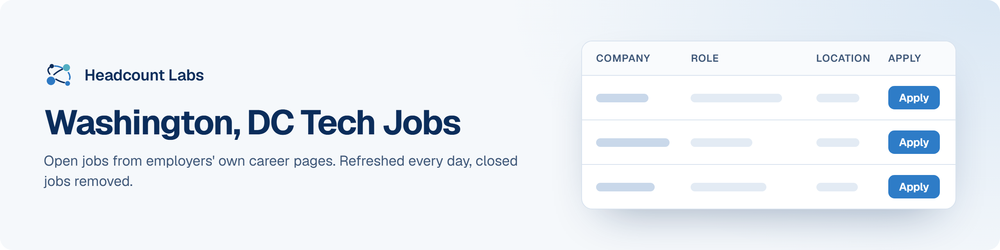

# Washington, DC Tech Jobs

Software, data, AI, product and design jobs in the Washington, DC area, sorted by field.

**400 open jobs** · 245 new since the last update · 245 removed because they closed or left the employer's board · updated October 22, 2026 at 6:22 AM EDT

This list is built and refreshed every day by [Headcount Labs](https://headcountlabs.com/?utm_source=github&utm_medium=job-list&utm_campaign=washington-dc-tech-jobs), which reads jobs straight from employers' own career pages and job boards. Every job here was still listed on its source board when we last read that board, within the past 3 days, and was posted in the past 30 days. Copies of the same job are merged into one row, and jobs that close are removed at the next update.

Want this data in your own app or agent? Use the [Headcount Labs jobs API](https://headcountlabs.com/docs/?utm_source=github&utm_medium=job-list&utm_campaign=washington-dc-tech-jobs) (free tier), the [MCP server](https://headcountlabs.com/mcp/?utm_source=github&utm_medium=job-list&utm_campaign=washington-dc-tech-jobs) for Claude, ChatGPT and other AI assistants, or the [open dataset](https://huggingface.co/datasets/HeadcountLabs/job-postings) on Hugging Face ([example queries](https://github.com/HeadcountLabs/job-postings)).

**Full dataset.** A bigger, one-off snapshot dated 2026-10-19 (all matching jobs, not only the open jobs below) is on Hugging Face: [Tech and software jobs](https://huggingface.co/datasets/HeadcountLabs/tech-jobs). It loads with `datasets.load_dataset` and is licensed CC BY 4.0.

**Jump to:** [Software engineering (221)](#software-engineering) · [Data, AI and machine learning (115)](#data-ai-and-machine-learning) · [Product and design (29)](#product-and-design) · [Hardware and engineering (35)](#hardware-and-engineering)

**Columns.** *Apply* opens the original posting on the employer's site. *Details* opens the job on Headcount Labs, with every posting we found for it. *Remote* shows what the employer states; a dash means the posting doesn't say. *Pay* is the range the employer published.

## Software engineering

| Company | Role | Location | Remote | Pay | Posted | Apply | Details |
| --- | --- | --- | --- | --- | --- | :---: | :---: |
| **WFB Ashurst Perkins Coie US LLP** | Manager, Software Engineering | 

12 locations
Seattle, WA Anchorage, AK Austin, TX Bellevue, WA Boise, ID Chicago, IL Dallas, TX Denver, CO Houston, TX Phoenix, AZ Portland, OR Washington, DC
 | Hybrid | $147k–$234k/yr | Oct 21 |  | <a href="https://headcountlabs.com/catalog/jobs/25bd3d68-c53e-482f-b7cc-d73ecbfa32c6?utm_source=github&utm_medium=job-list&utm_campaign=washington-dc-tech-jobs">via Headcount Labs</a> |
| **Warner Bros. Discovery** | Cybersecurity Engineer (Linux DevSecOps Engineer) | 

5 locations
United States Nebraska Atlanta, GA Washington, DC Silver Spring, MD
 | Hybrid | $91k–$169k/yr | Oct 21 |  | <a href="https://headcountlabs.com/catalog/jobs/28a5f867-9b2b-4fa9-8ee4-c34a5126b5c0?utm_source=github&utm_medium=job-list&utm_campaign=washington-dc-tech-jobs">via Headcount Labs</a> |
| **Verdantas LLC** | .NET Web Developer | Washington, DC | Hybrid | $55–$62.50/hr | Oct 21 |  | <a href="https://headcountlabs.com/catalog/jobs/d773b32c-bb7a-4eed-9f6d-107f63f2de34?utm_source=github&utm_medium=job-list&utm_campaign=washington-dc-tech-jobs">via Headcount Labs</a> |
| **Vantor Services Inc.** | Principal Full Stack Software Engineer (TS/SCI with CI poly) | Herndon, VA | On-site | $200k–$270k/yr | Oct 21 |  | <a href="https://headcountlabs.com/catalog/jobs/0b3d61bd-5f30-4e5b-bc2d-969d854f8477?utm_source=github&utm_medium=job-list&utm_campaign=washington-dc-tech-jobs">via Headcount Labs</a> |
| **US: Mastercard International Incor** | Manager, Software Engineering &#124; Data &amp; AI Platform | 

2 locations
Arlington, VA Arlington
 | On-site | $161k–$266k/yr | Oct 21 |  | <a href="https://headcountlabs.com/catalog/jobs/2e804e5a-be07-4fe1-a901-32802aca807e?utm_source=github&utm_medium=job-list&utm_campaign=washington-dc-tech-jobs">via Headcount Labs</a> |
| **US: Mastercard International Incor** | Senior Software Engineer &#124; Data &amp; AI Platform | 

2 locations
Arlington, VA Arlington
 | On-site | $132k–$212k/yr | Oct 21 |  | <a href="https://headcountlabs.com/catalog/jobs/25d698fc-a24b-47b4-90c4-958a281a3810?utm_source=github&utm_medium=job-list&utm_campaign=washington-dc-tech-jobs">via Headcount Labs</a> |
| **SpaceXSI** | Security Engineer - GRC Sales | 

3 locations
Palo Alto, CA New York, NY Washington, DC
 | — | $100k–$258k/yr | Oct 21 |  | <a href="https://headcountlabs.com/catalog/jobs/5e2e8295-ba04-41b5-8722-11ff9dcec9df?utm_source=github&utm_medium=job-list&utm_campaign=washington-dc-tech-jobs">via Headcount Labs</a> |
| **SpaceXSI** | Security Engineer, Kubernetes | 

4 locations
Palo Alto, CA Austin, TX New York, NY Washington, DC
 | — | $100k–$258k/yr | Oct 21 |  | <a href="https://headcountlabs.com/catalog/jobs/36b8f979-141a-4d93-a6f4-7e530eaa67e6?utm_source=github&utm_medium=job-list&utm_campaign=washington-dc-tech-jobs">via Headcount Labs</a> |
| **Seekr** | Senior Software Engineer | Reston, VA | Remote | $160k–$230k/yr | Oct 21 |  | <a href="https://headcountlabs.com/catalog/jobs/0c8ddbfd-75b7-4d3b-9739-c78b41d570e9?utm_source=github&utm_medium=job-list&utm_campaign=washington-dc-tech-jobs">via Headcount Labs</a> |
| **RED CANYON TECHNOLOGIES LLC** | Web/SharePoint Developer &amp; Administrator | Washington, DC | — | $77k–$97k/yr | Oct 21 |  | <a href="https://headcountlabs.com/catalog/jobs/9596fd04-34dd-494a-b80a-d6c5d38f4d91?utm_source=github&utm_medium=job-list&utm_campaign=washington-dc-tech-jobs">via Headcount Labs</a> |
| **PRECISE SOFTWARE SOLUTIONS INCORPORATED** | AI Developer | Washington, DC | Hybrid | — | Oct 21 |  | <a href="https://headcountlabs.com/catalog/jobs/ea5e2bad-e50f-449d-aa7e-83546e1935f3?utm_source=github&utm_medium=job-list&utm_campaign=washington-dc-tech-jobs">via Headcount Labs</a> |
| **PRECISE SOFTWARE SOLUTIONS INCORPORATED** | Senior AI Full Stack Developer | Washington, DC | Hybrid | — | Oct 21 |  | <a href="https://headcountlabs.com/catalog/jobs/81acb3d3-0a0b-4f7d-822e-0f280d5ab597?utm_source=github&utm_medium=job-list&utm_campaign=washington-dc-tech-jobs">via Headcount Labs</a> |
| **PRECISE SOFTWARE SOLUTIONS INCORPORATED** | AI Security Engineer | Washington, DC | — | — | Oct 21 |  | <a href="https://headcountlabs.com/catalog/jobs/7c7acaa6-ea06-412a-8884-2c0a57ccb81a?utm_source=github&utm_medium=job-list&utm_campaign=washington-dc-tech-jobs">via Headcount Labs</a> |
| **Morgan Business Consulting, LLC** | Application Developer - Mid Level | Arlington, VA | — | — | Oct 21 |  | <a href="https://headcountlabs.com/catalog/jobs/16f8d2d6-5d88-40c8-b17b-7322239a291f?utm_source=github&utm_medium=job-list&utm_campaign=washington-dc-tech-jobs">via Headcount Labs</a> |
| **Integrity Technology** | Cyber Security Engineer Expert Level | Reston, VA | — | — | Oct 21 |  | <a href="https://headcountlabs.com/catalog/jobs/15d6fd47-afcf-4087-a90a-2b003c382759?utm_source=github&utm_medium=job-list&utm_campaign=washington-dc-tech-jobs">via Headcount Labs</a> |
| **Celestar** | TS/SCI Cleared Full Stack Developer | Washington, DC, DC | — | $150k–$200k/yr | Oct 21 |  | <a href="https://headcountlabs.com/catalog/jobs/c65bff29-8c3c-447c-b36f-fcb1f33fad9b?utm_source=github&utm_medium=job-list&utm_campaign=washington-dc-tech-jobs">via Headcount Labs</a> |
| **BLN24** | Junior Software Developer | McLean, VA | Remote | — | Oct 21 |  | <a href="https://headcountlabs.com/catalog/jobs/cb9ced47-cebe-406e-b818-7b4f59c815c0?utm_source=github&utm_medium=job-list&utm_campaign=washington-dc-tech-jobs">via Headcount Labs</a> |
| **Bart &amp; Associates** | TS/SCI Cleared Full Stack Developer | Washington, DC, DC | — | $150k–$200k/yr | Oct 21 |  | <a href="https://headcountlabs.com/catalog/jobs/61bfa5e6-fffa-4d66-8705-62fc848ea68f?utm_source=github&utm_medium=job-list&utm_campaign=washington-dc-tech-jobs">via Headcount Labs</a> |
| **American Lebanese Syrian Associated Charities** | Software Engineer III - Salesforce Data Cloud (Memphis or Remote in USA) | 

20 locations
Memphis, TN Arlington, VA Atlanta, GA Austin, TX Boston, MA Charlotte, NC Chicago, IL Dallas, TX Detroit, MI Durham, NC Houston, TX Indianapolis, IN +8 more
 | Remote | — | Oct 21 |  | <a href="https://headcountlabs.com/catalog/jobs/be49d93c-2a03-462e-b472-2a8d2302c93f?utm_source=github&utm_medium=job-list&utm_campaign=washington-dc-tech-jobs">via Headcount Labs</a> |
| **West 4th Strategy** | Junior Data Scientist/Dashboard Developer | Arlington, VA | Remote | $100k–$165k/yr | Oct 20 |  | <a href="https://headcountlabs.com/catalog/jobs/aab5e553-b6ec-43b9-831d-76a86817307f?utm_source=github&utm_medium=job-list&utm_campaign=washington-dc-tech-jobs">via Headcount Labs</a> |
| **TOMORROW HIRE** | Applications Developer - Active TS/SCI with Full Scope Polygraph (FSP) | McLean, VA | On-site | — | Oct 20 |  | <a href="https://headcountlabs.com/catalog/jobs/667a754a-41fb-40d3-b3c2-f1e83e6981ab?utm_source=github&utm_medium=job-list&utm_campaign=washington-dc-tech-jobs">via Headcount Labs</a> |
| **TOMORROW HIRE** | Software Development Engineer - Active TS/SCI with Full Scope Polygraph (FSP) | Herndon, VA | On-site | — | Oct 20 |  | <a href="https://headcountlabs.com/catalog/jobs/d8fccc7f-5889-456a-8991-d9f370b922d8?utm_source=github&utm_medium=job-list&utm_campaign=washington-dc-tech-jobs">via Headcount Labs</a> |
| **The Boeing Company** | Java Software Engineer - Developer (Experienced and Senior) | 

5 locations
Herndon, VA Colorado Springs, CO El Segundo, CA Mesa, AZ Seal Beach, CA
 | On-site | $135k–$183k/yr | Oct 20 |  | <a href="https://headcountlabs.com/catalog/jobs/43288c45-b4c0-4411-8220-3a3da663279b?utm_source=github&utm_medium=job-list&utm_campaign=washington-dc-tech-jobs">via Headcount Labs</a> |
| **The Boeing Company** | Senior Software Architect | Herndon, VA | On-site | $212k–$286k/yr | Oct 20 |  | <a href="https://headcountlabs.com/catalog/jobs/794a01bf-b345-4cf6-98f2-8bf463d17838?utm_source=github&utm_medium=job-list&utm_campaign=washington-dc-tech-jobs">via Headcount Labs</a> |
| **STR** | Software Developer | 

2 locations
Arlington, VA Woburn, MA
 | — | $120k–$150k/yr | Oct 20 |  | <a href="https://headcountlabs.com/catalog/jobs/1545bb3a-9c15-4b0b-a452-7e34f91ff303?utm_source=github&utm_medium=job-list&utm_campaign=washington-dc-tech-jobs">via Headcount Labs</a> |
| **STR** | Lead Software Engineer | 

2 locations
Woburn, MA Arlington, VA
 | — | $180k–$230k/yr | Oct 20 |  | <a href="https://headcountlabs.com/catalog/jobs/0ae11d64-67e3-4720-b5bf-2d6c810b398b?utm_source=github&utm_medium=job-list&utm_campaign=washington-dc-tech-jobs">via Headcount Labs</a> |
| **Steampunk** | Senior Salesforce Application Developer | McLean, VA | — | $85k–$160k/yr | Oct 20 |  | <a href="https://headcountlabs.com/catalog/jobs/f66d9657-09a5-49a3-b51f-708936ce738f?utm_source=github&utm_medium=job-list&utm_campaign=washington-dc-tech-jobs">via Headcount Labs</a> |
| **Revolutional, LLC** | SQL Developer | McLean, VA | Remote | $90k–$109k/yr | Oct 20 |  | <a href="https://headcountlabs.com/catalog/jobs/088ec715-0e8a-4f47-bd6f-230fa19544c2?utm_source=github&utm_medium=job-list&utm_campaign=washington-dc-tech-jobs">via Headcount Labs</a> |
| **PROCLEARED LLC** | Cyber Security Engineer - Expert | Reston, VA | — | $135k–$200k/yr | Oct 20 |  | <a href="https://headcountlabs.com/catalog/jobs/a24ef6e3-ec67-4a2a-9a7d-5ded6b378b3c?utm_source=github&utm_medium=job-list&utm_campaign=washington-dc-tech-jobs">via Headcount Labs</a> |
| **Peraton** | Software Developer - SME | 

2 locations
Herndon, VA Bowie, MD
 | On-site | $135k–$216k/yr | Oct 20 |  | <a href="https://headcountlabs.com/catalog/jobs/c1b123e1-7800-43e8-88bc-584694544cd6?utm_source=github&utm_medium=job-list&utm_campaign=washington-dc-tech-jobs">via Headcount Labs</a> |
| **Peraton** | Cybersecurity Engineer - SME | Herndon, VA | On-site | $135k–$216k/yr | Oct 20 |  | <a href="https://headcountlabs.com/catalog/jobs/b2e427b7-a7c8-4eee-937a-b4e62d63d7e6?utm_source=github&utm_medium=job-list&utm_campaign=washington-dc-tech-jobs">via Headcount Labs</a> |
| **Peraton** | Cybersecurity Engineer - Senior | Herndon, VA | On-site | $112k–$179k/yr | Oct 20 |  | <a href="https://headcountlabs.com/catalog/jobs/6b985e26-c927-43ab-bd22-b916d710d5b5?utm_source=github&utm_medium=job-list&utm_campaign=washington-dc-tech-jobs">via Headcount Labs</a> |
| **Pearson** | Software Engineer III | 

4 locations
Tallahassee, FL Washington, DC Lansing, MI United States
 | Remote | $100k–$130k/yr | Oct 20 |  | <a href="https://headcountlabs.com/catalog/jobs/957d1719-bb5a-4f0d-b1e3-35c6b42420a9?utm_source=github&utm_medium=job-list&utm_campaign=washington-dc-tech-jobs">via Headcount Labs</a> |
| **Pantheon Data** | Senior Full Stack Developer - AI First | Reston, VA | Hybrid | $145k–$200k/yr | Oct 20 |  | <a href="https://headcountlabs.com/catalog/jobs/c0a4ae79-c2df-4f57-abab-698199f5548b?utm_source=github&utm_medium=job-list&utm_campaign=washington-dc-tech-jobs">via Headcount Labs</a> |
| **OpenDataJobs** | Software Engineer (Python, AWS) | Washington, DC | Hybrid | — | Oct 20 |  | <a href="https://headcountlabs.com/catalog/jobs/429e4c08-b82a-4cb1-96f8-7ff414213e6c?utm_source=github&utm_medium=job-list&utm_campaign=washington-dc-tech-jobs">via Headcount Labs</a> |
| **OneGlobe LLC** | Network/Cloud Engineer (DevSecOps/Security) | Washington, DC | — | $130k–$150k/yr | Oct 20 |  | <a href="https://headcountlabs.com/catalog/jobs/2a79b7cb-ea6a-4b97-ad58-8dc0b5b80305?utm_source=github&utm_medium=job-list&utm_campaign=washington-dc-tech-jobs">via Headcount Labs</a> |
| **L3HHCM20** | Lead, Software Engineer - Embedded Software Applications - RUST | Herndon, VA | On-site | — | Oct 20 |  | <a href="https://headcountlabs.com/catalog/jobs/6104e45f-35b1-4a98-b6d9-df0e810c18a3?utm_source=github&utm_medium=job-list&utm_campaign=washington-dc-tech-jobs">via Headcount Labs</a> |
| **ITC Federal, Inc.** | Software/ML Engineer (Top-Secret) | Reston, VA | Remote | $120k–$160k/yr | Oct 20 |  | <a href="https://headcountlabs.com/catalog/jobs/d3888733-fe44-41e2-a9b1-537e8299251a?utm_source=github&utm_medium=job-list&utm_campaign=washington-dc-tech-jobs">via Headcount Labs</a> |
| **Humana Inc.** | Lead Full-Stack Engineer - Backend Focus | 

13 locations
NYC METRO, NY Atlanta, GA Boston, MA Charlotte, NC Chicago, IL Dallas, TX Fort Lauderdale, FL Louisville, KY Nashville, TN Tampa, FL Washington, DC Work at Home - Texas +1 more
 | Remote | $155k–$213k/yr | Oct 20 |  | <a href="https://headcountlabs.com/catalog/jobs/d5ffd123-0733-40db-8139-8fcf7b5c9075?utm_source=github&utm_medium=job-list&utm_campaign=washington-dc-tech-jobs">via Headcount Labs</a> |
| **Equilibrium Technologies LLC** | Software Developer | Herndon, VA | — | — | Oct 20 |  | <a href="https://headcountlabs.com/catalog/jobs/7f36998d-fb4b-4a91-9730-dd46e98b84b0?utm_source=github&utm_medium=job-list&utm_campaign=washington-dc-tech-jobs">via Headcount Labs</a> |
| **Dell Technologies** | DevOps Storage Engineer - Federal Customer | Mclean, VA | Remote | $186k–$241k/yr | Oct 20 |  | <a href="https://headcountlabs.com/catalog/jobs/c8e2758e-7acd-428f-9cd5-265c841e060f?utm_source=github&utm_medium=job-list&utm_campaign=washington-dc-tech-jobs">via Headcount Labs</a> |
| **Dell Inc.** | DevOps Storage Engineer - Federal Customer | Mclean, VA | Remote | — | Oct 20 |  | <a href="https://headcountlabs.com/catalog/jobs/7c9089c3-a919-46ff-b025-759861f735cf?utm_source=github&utm_medium=job-list&utm_campaign=washington-dc-tech-jobs">via Headcount Labs</a> |
| **Default - DO NOT USE** | MuleSoft Developer | Herndon, VA | Hybrid | $140k–$170k/yr | Oct 20 |  | <a href="https://headcountlabs.com/catalog/jobs/76257880-47c5-4339-b4e7-84fba3a5a9f6?utm_source=github&utm_medium=job-list&utm_campaign=washington-dc-tech-jobs">via Headcount Labs</a> |
| **DAn Solutions** | Full Stack Developer (Hybrid) | 

2 locations
Washington, DC Reston, VA
 | Hybrid | $165k/yr | Oct 20 |  | <a href="https://headcountlabs.com/catalog/jobs/5fdc91a8-f350-4016-8446-989117d97484?utm_source=github&utm_medium=job-list&utm_campaign=washington-dc-tech-jobs">via Headcount Labs</a> |
| **DAn Solutions** | Senior Software Test Engineer (Hybrid) | 

2 locations
Washington, DC Reston, VA
 | Hybrid | $185k/yr | Oct 20 |  | <a href="https://headcountlabs.com/catalog/jobs/5a9dc20a-6a46-48d4-9d02-d6d2e8cfec1c?utm_source=github&utm_medium=job-list&utm_campaign=washington-dc-tech-jobs">via Headcount Labs</a> |
| **CompQsoft Inc. - ACTIVE** | MuleSoft Developer | Herndon, VA | Hybrid | $140k–$170k/yr | Oct 20 |  | <a href="https://headcountlabs.com/catalog/jobs/63fa0255-6503-407f-9874-636d15c0657b?utm_source=github&utm_medium=job-list&utm_campaign=washington-dc-tech-jobs">via Headcount Labs</a> |
| **Bespoke Technologies** | Applications Developer | McLean, VA | — | — | Oct 20 |  | <a href="https://headcountlabs.com/catalog/jobs/57c6eef3-6ac8-4bd2-909d-22437a05aebb?utm_source=github&utm_medium=job-list&utm_campaign=washington-dc-tech-jobs">via Headcount Labs</a> |
| **BAM Technologies, LLC** | Full Stack Developer II | Arlington, VA | Remote | — | Oct 20 |  | <a href="https://headcountlabs.com/catalog/jobs/bef0977d-1c01-4d5c-922a-f94607102446?utm_source=github&utm_medium=job-list&utm_campaign=washington-dc-tech-jobs">via Headcount Labs</a> |
| **BAM Technologies, LLC** | Full Stack Developer III | Arlington, VA | Remote | — | Oct 20 |  | <a href="https://headcountlabs.com/catalog/jobs/53ecee84-0086-4571-bceb-f68baaa065bf?utm_source=github&utm_medium=job-list&utm_campaign=washington-dc-tech-jobs">via Headcount Labs</a> |
| **Avanza LLC** | Software Developer (Power Platform) | Arlington, VA | Hybrid | $95k–$120k/yr | Oct 20 |  | <a href="https://headcountlabs.com/catalog/jobs/08f464de-f57b-4e65-b60c-d796daaa0c04?utm_source=github&utm_medium=job-list&utm_campaign=washington-dc-tech-jobs">via Headcount Labs</a> |
| **Avalore, LLC** | Software Development Engineer | Herndon, VA | On-site | — | Oct 20 |  | <a href="https://headcountlabs.com/catalog/jobs/75d25982-67e4-40b1-9bf3-7ff44225467d?utm_source=github&utm_medium=job-list&utm_campaign=washington-dc-tech-jobs">via Headcount Labs</a> |
| **ASI Government** | Agentic AI Developer | Washington, DC | — | — | Oct 20 |  | <a href="https://headcountlabs.com/catalog/jobs/a2b6f5e8-8c5e-44a2-9107-75797add72fe?utm_source=github&utm_medium=job-list&utm_campaign=washington-dc-tech-jobs">via Headcount Labs</a> |
| **Anduril Industries** | Classified Cloud &amp; Platform Engineer | 

2 locations
Costa Mesa, CA Washington, DC
 | — | $142k–$188k/yr | Oct 20 |  | <a href="https://headcountlabs.com/catalog/jobs/c4607144-e07e-4e32-97a4-6572b54254e4?utm_source=github&utm_medium=job-list&utm_campaign=washington-dc-tech-jobs">via Headcount Labs</a> |
| **Akima, LLC** | Senior Full-Stack Software Engineer | Arlington, VA | — | $160k–$165k/yr | Oct 20 |  | <a href="https://headcountlabs.com/catalog/jobs/7b2940f9-d37c-4cd9-9af4-4cc7fb61a334?utm_source=github&utm_medium=job-list&utm_campaign=washington-dc-tech-jobs">via Headcount Labs</a> |
| **Accenture Federal Services** | Oracle Cloud HCM Fast Formula Developer | Washington, DC | — | $92k–$179k/yr | Oct 20 |  | <a href="https://headcountlabs.com/catalog/jobs/a4530c01-e257-4172-9381-37924f4bb8e1?utm_source=github&utm_medium=job-list&utm_campaign=washington-dc-tech-jobs">via Headcount Labs</a> |
| **US: Mastercard International Incor** | Software Engineer II | 

2 locations
Arlington, VA Arlington
 | Hybrid | $106k–$169k/yr | Oct 19 |  | <a href="https://headcountlabs.com/catalog/jobs/5ab5c2d2-4ce1-4b44-b6ec-f1d77c407b06?utm_source=github&utm_medium=job-list&utm_campaign=washington-dc-tech-jobs">via Headcount Labs</a> |
| **US: Mastercard International Incor** | Senior Software Engineer | 

2 locations
Arlington, VA Arlington
 | Hybrid | $132k–$212k/yr | Oct 19 |  | <a href="https://headcountlabs.com/catalog/jobs/2ca13ea8-a44c-45bf-b301-cad29359175b?utm_source=github&utm_medium=job-list&utm_campaign=washington-dc-tech-jobs">via Headcount Labs</a> |
| **Underwriters Laboratories Inc.** | Lead Software Engineer - Technical Track | Washington, DC | Remote | $131k–$180k/yr | Oct 19 |  | <a href="https://headcountlabs.com/catalog/jobs/aebc22de-bd72-4dda-9d21-c2db23b7aa17?utm_source=github&utm_medium=job-list&utm_campaign=washington-dc-tech-jobs">via Headcount Labs</a> |
| **TIAG** | Cloud Engineer | Arlington, VA | — | $100k–$125k/yr | Oct 19 |  | <a href="https://headcountlabs.com/catalog/jobs/93cfc966-98a3-40e1-8fb9-7cf8a6d2fcdb?utm_source=github&utm_medium=job-list&utm_campaign=washington-dc-tech-jobs">via Headcount Labs</a> |
| **The Mitre Corporation** | Principal Identity Cybersecurity Engineer | McLean, VA | — | $173k–$259k/yr | Oct 19 |  | <a href="https://headcountlabs.com/catalog/jobs/bd2c249c-7a29-47bf-8575-c211a4d98a5f?utm_source=github&utm_medium=job-list&utm_campaign=washington-dc-tech-jobs">via Headcount Labs</a> |
| **The Boeing Company** | Java Software Engineer (Associate/Experienced) | Herndon, VA | On-site | $106k–$144k/yr | Oct 19 |  | <a href="https://headcountlabs.com/catalog/jobs/31d6a1cf-304c-4317-9b12-e62ec74c2543?utm_source=github&utm_medium=job-list&utm_campaign=washington-dc-tech-jobs">via Headcount Labs</a> |
| **Steampunk** | Integration Developer | McLean, VA | Remote | $100k–$160k/yr | Oct 19 |  | <a href="https://headcountlabs.com/catalog/jobs/0940f742-b89a-453d-9060-d4b3cfaf4586?utm_source=github&utm_medium=job-list&utm_campaign=washington-dc-tech-jobs">via Headcount Labs</a> |
| **SAIC** | Web Application Developer | Reston, VA | On-site | — | Oct 19 |  | <a href="https://headcountlabs.com/catalog/jobs/924744b4-ffab-4484-8afa-e55fb8dd6d97?utm_source=github&utm_medium=job-list&utm_campaign=washington-dc-tech-jobs">via Headcount Labs</a> |
| **Reinventing Geospatial, Inc. (RGi)** | Application Developer - Java | Herndon, VA | On-site | — | Oct 19 |  | <a href="https://headcountlabs.com/catalog/jobs/e3b3a32a-b91d-4bd7-92f3-3b23bdfe1ca5?utm_source=github&utm_medium=job-list&utm_campaign=washington-dc-tech-jobs">via Headcount Labs</a> |
| **PricewaterhouseCoopers Advisory Services LLC** | Manager, Full Stack AI Engineer - AWS | 

32 locations
New York Hartford, CT Stamford, CT Washington, DC Boca Raton, FL Jacksonville, FL Miami, FL Orlando, FL Tampa, FL Des Moines, IA Detroit, MI Grand Rapids, MI +20 more
 | — | $99k–$232k/yr | Oct 19 |  | <a href="https://headcountlabs.com/catalog/jobs/b781d533-5341-4a85-b94e-8ca700606f6e?utm_source=github&utm_medium=job-list&utm_campaign=washington-dc-tech-jobs">via Headcount Labs</a> |
| **PricewaterhouseCoopers Advisory Services LLC** | Senior Associate, Full Stack AI Engineer — AWS | 

33 locations
New York Hartford, CT Stamford, CT Washington, DC Boca Raton, FL Jacksonville, FL Miami, FL Orlando, FL Tampa, FL Des Moines, IA Detroit, MI Grand Rapids, MI +21 more
 | — | $77k–$202k/yr | Oct 19 |  | <a href="https://headcountlabs.com/catalog/jobs/0b72333b-b84e-4805-88fa-e5aac33485c3?utm_source=github&utm_medium=job-list&utm_campaign=washington-dc-tech-jobs">via Headcount Labs</a> |
| **Peraton** | Sr. DevOps Engineer | Herndon, VA | — | $135k–$216k/yr | Oct 19 |  | <a href="https://headcountlabs.com/catalog/jobs/69c2b5b2-5b3e-4e5f-9179-e7b2fef0bb0b?utm_source=github&utm_medium=job-list&utm_campaign=washington-dc-tech-jobs">via Headcount Labs</a> |
| **OpenDataJobs** | Software Developer | Washington, DC | Hybrid | — | Oct 19 |  | <a href="https://headcountlabs.com/catalog/jobs/f6f47ecc-afef-44e3-8165-b687eeac7282?utm_source=github&utm_medium=job-list&utm_campaign=washington-dc-tech-jobs">via Headcount Labs</a> |
| **OpenDataJobs** | Developer (Python, AWS) | Washington, DC | Hybrid | — | Oct 19 |  | <a href="https://headcountlabs.com/catalog/jobs/b0f91384-6b48-4f18-aedb-8a65f7facf1e?utm_source=github&utm_medium=job-list&utm_campaign=washington-dc-tech-jobs">via Headcount Labs</a> |
| **NuAxis Innovations** | Data Specialist / Web Content Analyst III | Washington, DC | — | — | Oct 19 |  | <a href="https://headcountlabs.com/catalog/jobs/9b3184ed-5f48-4d7a-9d87-5380706f6d21?utm_source=github&utm_medium=job-list&utm_campaign=washington-dc-tech-jobs">via Headcount Labs</a> |
| **NuAxis Innovations** | IT Web Developer III | Washington, DC | — | — | Oct 19 |  | <a href="https://headcountlabs.com/catalog/jobs/3d8cf8f2-8e22-462d-8a6c-2fdfefe64d61?utm_source=github&utm_medium=job-list&utm_campaign=washington-dc-tech-jobs">via Headcount Labs</a> |
| **Modern Government Solutions** | Senior Software Engineer - TS/SCI w CI Poly | Herndon, VA | On-site | $150k–$180k/yr | Oct 19 |  | <a href="https://headcountlabs.com/catalog/jobs/1e5a8695-fd17-4518-a2b1-413c9825caa1?utm_source=github&utm_medium=job-list&utm_campaign=washington-dc-tech-jobs">via Headcount Labs</a> |
| **MetroStar** | Sr. ServiceNow Developer I (6879) | Washington, DC | — | $158k–$178k/yr | Oct 19 |  | <a href="https://headcountlabs.com/catalog/jobs/f552e15d-e9f6-4e53-a1dc-a5a19de40944?utm_source=github&utm_medium=job-list&utm_campaign=washington-dc-tech-jobs">via Headcount Labs</a> |
| **LinTech Global** | Power Apps Developer | Washington, DC | — | $165k–$175k/yr | Oct 19 |  | <a href="https://headcountlabs.com/catalog/jobs/0bfb137b-d32d-465c-9f5a-a71fe3dbd4e7?utm_source=github&utm_medium=job-list&utm_campaign=washington-dc-tech-jobs">via Headcount Labs</a> |
| **Lincoln Institute of Land Policy** | Backend Software Engineer I/II (55745) | Washington, DC | Remote | $76k–$96k/yr | Oct 19 |  | <a href="https://headcountlabs.com/catalog/jobs/56e747e7-1e6e-4db3-b959-ced4062264c7?utm_source=github&utm_medium=job-list&utm_campaign=washington-dc-tech-jobs">via Headcount Labs</a> |
| **Inadev** | Senior Developer | Reston, VA | — | $150k–$170k/yr | Oct 19 |  | <a href="https://headcountlabs.com/catalog/jobs/f2735559-1a1d-42fb-85b1-252b93d87631?utm_source=github&utm_medium=job-list&utm_campaign=washington-dc-tech-jobs">via Headcount Labs</a> |
| **HII** | Microsoft Power BI Developer (Engineer Software 2) 30736 | Arlington, VA | — | — | Oct 19 |  | <a href="https://headcountlabs.com/catalog/jobs/f54973bc-eb43-4d89-a4c6-b6ae503397ef?utm_source=github&utm_medium=job-list&utm_campaign=washington-dc-tech-jobs">via Headcount Labs</a> |
| **Fedcap Inc** | Job Developer | Washington, DC | On-site | $25–$28/hr | Oct 19 |  | <a href="https://headcountlabs.com/catalog/jobs/d37f0dc6-8346-4c0a-a4ee-ce0530f32548?utm_source=github&utm_medium=job-list&utm_campaign=washington-dc-tech-jobs">via Headcount Labs</a> |
| **Credence** | Cloud Platform Engineer- Entry Level | McLean, VA | — | — | Oct 19 |  | <a href="https://headcountlabs.com/catalog/jobs/1afe476b-4854-4026-8abc-6520b2c5b6f9?utm_source=github&utm_medium=job-list&utm_campaign=washington-dc-tech-jobs">via Headcount Labs</a> |
| **Creative Visions** | Senior Cybersecurity RMF Engineer (DoD / Secret Clearance) | Washington, DC | On-site | — | Oct 19 |  | <a href="https://headcountlabs.com/catalog/jobs/d4a3a9b2-ee6f-437b-984c-649916be07f9?utm_source=github&utm_medium=job-list&utm_campaign=washington-dc-tech-jobs">via Headcount Labs</a> |
| **Comcast (CC) of Willow Grove** | Backend Platform Engineer - AI Operations Platform | 

3 locations
United States Philadelphia, PA Reston, VA
 | — | $136k–$214k/yr | Oct 19 |  | <a href="https://headcountlabs.com/catalog/jobs/b4fd1fbb-1161-4c91-a108-9866d63fc353?utm_source=github&utm_medium=job-list&utm_campaign=washington-dc-tech-jobs">via Headcount Labs</a> |
| **CliftonLarsonAllen LLP** | Senior Marketing Technology Developer | 

15 locations
Arizona Appleton, WI Arlington, VA Atlanta, GA Austin, TX Boise, ID North Carolina Dallas, TX Fort Myers, FL Houston, TX Indianapolis, IN Madison, WI +3 more
 | — | — | Oct 19 |  | <a href="https://headcountlabs.com/catalog/jobs/85f799ec-64ad-47e6-9ae9-a022d2aec03c?utm_source=github&utm_medium=job-list&utm_campaign=washington-dc-tech-jobs">via Headcount Labs</a> |
| **Booz Allen Hamilton_United States** | Software Engineer, Senior | McLean, VA | — | $113k–$257k/yr | Oct 19 |  | <a href="https://headcountlabs.com/catalog/jobs/05dcd15d-db6e-4960-bdcb-3b726c1ef488?utm_source=github&utm_medium=job-list&utm_campaign=washington-dc-tech-jobs">via Headcount Labs</a> |
| **Boeing** | Java Software Engineer (Associate/Experienced) | Herndon, VA | — | $106k–$144k/yr | Oct 19 |  | <a href="https://headcountlabs.com/catalog/jobs/d48fcbde-a828-4d45-ac4f-3ced455a819a?utm_source=github&utm_medium=job-list&utm_campaign=washington-dc-tech-jobs">via Headcount Labs</a> |
| **Boeing** | Full Stack Software Engineer (Associate/Experienced) | Herndon, VA | — | $106k–$144k/yr | Oct 19 |  | <a href="https://headcountlabs.com/catalog/jobs/72031085-eea2-41a9-967b-69843fd84739?utm_source=github&utm_medium=job-list&utm_campaign=washington-dc-tech-jobs">via Headcount Labs</a> |
| **AVER** | ETL Informatica Developer | Washington, DC | — | $115k–$130k/yr | Oct 19 |  | <a href="https://headcountlabs.com/catalog/jobs/40142827-1c30-4a7e-9ead-39eb3674679f?utm_source=github&utm_medium=job-list&utm_campaign=washington-dc-tech-jobs">via Headcount Labs</a> |
| **ASRC Federal** | .NET Software Engineer (Secret Clearance) | Washington, DC | On-site | — | Oct 19 |  | <a href="https://headcountlabs.com/catalog/jobs/a8526176-45d3-441b-a8df-c175c0a85349?utm_source=github&utm_medium=job-list&utm_campaign=washington-dc-tech-jobs">via Headcount Labs</a> |
| **Aretum** | Cloud Application Engineer | Washington, DC | Hybrid | — | Oct 19 |  | <a href="https://headcountlabs.com/catalog/jobs/0f77b0fd-4d9b-48a5-acea-6e069d3f9799?utm_source=github&utm_medium=job-list&utm_campaign=washington-dc-tech-jobs">via Headcount Labs</a> |
| **APA** | Senior Salesforce Developer | Washington, DC | Remote | — | Oct 19 |  | <a href="https://headcountlabs.com/catalog/jobs/cdaec3c0-0fc8-4d41-b351-f5e6efb2507a?utm_source=github&utm_medium=job-list&utm_campaign=washington-dc-tech-jobs">via Headcount Labs</a> |
| **Anthropic** | IT Systems Engineer, Client Platform Engineer, ChromeOS | 

3 locations
Boston, MA Friendly (Travel-Required) &#124; San Francisco, CA &#124; Seattle, WA &#124; New York City, NY Washington, DC
 | Remote | $325k–$360k/yr | Oct 19 |  | <a href="https://headcountlabs.com/catalog/jobs/d54baf90-8b82-4225-b73b-74b01b02ac83?utm_source=github&utm_medium=job-list&utm_campaign=washington-dc-tech-jobs">via Headcount Labs</a> |
| **Air Line Pilots Association, Int'l.** | Applications Developer | Tysons (McLean), VA | — | $81k–$140k/yr | Oct 19 |  | <a href="https://headcountlabs.com/catalog/jobs/36f93df7-6892-4085-bafc-a5a1bf51d6df?utm_source=github&utm_medium=job-list&utm_campaign=washington-dc-tech-jobs">via Headcount Labs</a> |
| **Adelphi** | Senior Software Engineer, Rust | 

2 locations
McLean, VA Washington D.C.
 | Hybrid | — | Oct 19 |  | <a href="https://headcountlabs.com/catalog/jobs/2a860ac2-fa5b-46df-8873-ebc918ba01f1?utm_source=github&utm_medium=job-list&utm_campaign=washington-dc-tech-jobs">via Headcount Labs</a> |
| **Accenture Federal Services** | Pega Application Developer | Washington, DC | — | $70k–$137k/yr | Oct 19 |  | <a href="https://headcountlabs.com/catalog/jobs/8987f531-d925-42c0-8155-aad7d9233aa7?utm_source=github&utm_medium=job-list&utm_campaign=washington-dc-tech-jobs">via Headcount Labs</a> |
| **Accenture Federal Services** | Sr. Pega Developer | Washington, DC | — | $119k–$225k/yr | Oct 19 |  | <a href="https://headcountlabs.com/catalog/jobs/a558a002-eb12-41b7-b61c-9d211bd27015?utm_source=github&utm_medium=job-list&utm_campaign=washington-dc-tech-jobs">via Headcount Labs</a> |
| **Northrop Grumman** | 2027 Software Engineer Dulles VA | 

2 locations
McLean, VA Dulles, VA
 | — | $70k–$105k/yr | Oct 17 |  | <a href="https://headcountlabs.com/catalog/jobs/e9c15c5a-47f6-499d-b69f-06f879b6d0ab?utm_source=github&utm_medium=job-list&utm_campaign=washington-dc-tech-jobs">via Headcount Labs</a> |
| **VTG** | Software Engineer | 

2 locations
Chantilly, VA Herndon, VA
 | — | — | Oct 16 |  | <a href="https://headcountlabs.com/catalog/jobs/d4fd2c48-a75f-4fca-8e42-751d1e35ed42?utm_source=github&utm_medium=job-list&utm_campaign=washington-dc-tech-jobs">via Headcount Labs</a> |
| **Twenty** | Senior/Staff Product Manager, Autonomous Cyber Operations | Arlington, VA | On-site | $161k–$225k/yr | Oct 16 |  | <a href="https://headcountlabs.com/catalog/jobs/fd6a95cf-a2dc-4b93-ae01-99156dfc8bac?utm_source=github&utm_medium=job-list&utm_campaign=washington-dc-tech-jobs">via Headcount Labs</a> |
| **The Mitre Corporation** | IC Full Stack Engineer | McLean, VA | — | $129k–$194k/yr | Oct 16 |  | <a href="https://headcountlabs.com/catalog/jobs/e08e54c8-d53f-4d4c-8b68-008ada950d1c?utm_source=github&utm_medium=job-list&utm_campaign=washington-dc-tech-jobs">via Headcount Labs</a> |
| **The Mitre Corporation** | Python Developer - Digital Forensics | McLean, VA | On-site | $159k–$238k/yr | Oct 16 |  | <a href="https://headcountlabs.com/catalog/jobs/85fb548f-540c-466d-90a0-dc4cce85e905?utm_source=github&utm_medium=job-list&utm_campaign=washington-dc-tech-jobs">via Headcount Labs</a> |
| **The Mitre Corporation** | Cyber Operations Engineer Intern | 

2 locations
McLean, VA Bedford, MA
 | — | $46k–$70k/yr | Oct 16 |  | <a href="https://headcountlabs.com/catalog/jobs/54bd7547-52f3-4d18-81be-311647515f4a?utm_source=github&utm_medium=job-list&utm_campaign=washington-dc-tech-jobs">via Headcount Labs</a> |
| **The Mitre Corporation** | Cyber Operations Engineer | 

2 locations
Fort Meade - Annapolis Junction, MD McLean, VA
 | — | $159k–$238k/yr | Oct 16 |  | <a href="https://headcountlabs.com/catalog/jobs/c9f4c3e1-9d0a-4da1-ad37-8ba6dec66a40?utm_source=github&utm_medium=job-list&utm_campaign=washington-dc-tech-jobs">via Headcount Labs</a> |
| **Systems Planning and Analysis** | SharePoint &amp; PowerApps Developer | Arlington, VA | — | $120k/yr | Oct 16 |  | <a href="https://headcountlabs.com/catalog/jobs/32685bda-3119-4fdd-9a29-c59326b337db?utm_source=github&utm_medium=job-list&utm_campaign=washington-dc-tech-jobs">via Headcount Labs</a> |
| **Seekr** | Senior Manager, Software Engineering | Reston, VA | — | $200k–$275k/yr | Oct 16 |  | <a href="https://headcountlabs.com/catalog/jobs/7e3fa1ed-46fa-4bea-98b7-8d7c9004542d?utm_source=github&utm_medium=job-list&utm_campaign=washington-dc-tech-jobs">via Headcount Labs</a> |
| **Recorded Future** | Product Support Solutions Developer | 

2 locations
Washington, DC Boston, MA
 | Hybrid | $128k–$192k/yr | Oct 16 |  | <a href="https://headcountlabs.com/catalog/jobs/b92e3a16-4daf-4c84-b424-4c1a228b3028?utm_source=github&utm_medium=job-list&utm_campaign=washington-dc-tech-jobs">via Headcount Labs</a> |
| **Quest International** | Healthcare Software Integration Engineer | 

17 locations
Irvine, CA Cincinnati, OH Denver, CO Washington, DC Chicago, IL Detroit, MI Arlington, VA Baltimore, MD Oklahoma City, OK United States Florida Union City, GA +5 more
 | Remote | $32–$35/hr | Oct 16 |  | <a href="https://headcountlabs.com/catalog/jobs/e852e68c-52c6-4e5f-bee0-27ca10f1ce39?utm_source=github&utm_medium=job-list&utm_campaign=washington-dc-tech-jobs">via Headcount Labs</a> |
| **Qualtrics** | Senior Software Engineer - Unified Orchestration | Reston, VA | Hybrid | $139k–$169k/yr | Oct 16 |  | <a href="https://headcountlabs.com/catalog/jobs/b291827d-907e-46e4-a150-75275320e59b?utm_source=github&utm_medium=job-list&utm_campaign=washington-dc-tech-jobs">via Headcount Labs</a> |
| **National Capitol Contracting LLC** | Foundry Developer II - Sr. | Washington, DC | — | $170k–$180k/yr | Oct 16 |  | <a href="https://headcountlabs.com/catalog/jobs/ff63f1e4-cdd3-4f9b-9a6d-8b7ad3df5422?utm_source=github&utm_medium=job-list&utm_campaign=washington-dc-tech-jobs">via Headcount Labs</a> |
| **LIGHTFEATHER IO LLC** | Oracle Cloud Infrastructure Engineer | Washington, DC | Hybrid | $160k–$180k/yr | Oct 16 |  | <a href="https://headcountlabs.com/catalog/jobs/ea116877-6314-4ae1-a53c-5b2f8795d2f3?utm_source=github&utm_medium=job-list&utm_campaign=washington-dc-tech-jobs">via Headcount Labs</a> |
| **LIGHTFEATHER IO LLC** | GCP Cloud/DevOps Engineer | Washington, DC | — | $120k–$140k/yr | Oct 16 |  | <a href="https://headcountlabs.com/catalog/jobs/b8f48d5d-cd58-4496-83aa-36f3aaae9f36?utm_source=github&utm_medium=job-list&utm_campaign=washington-dc-tech-jobs">via Headcount Labs</a> |
| **LIGHTFEATHER IO LLC** | Senior Azure Cloud Engineer | Washington, DC | Hybrid | $130k–$170k/yr | Oct 16 |  | <a href="https://headcountlabs.com/catalog/jobs/a0a1423d-d95c-46da-a504-b102b0602b9c?utm_source=github&utm_medium=job-list&utm_campaign=washington-dc-tech-jobs">via Headcount Labs</a> |
| **Freddie Mac** | Software Engineer Professional | McLean, VA | — | $109k–$163k/yr | Oct 16 |  | <a href="https://headcountlabs.com/catalog/jobs/895f85ac-1bbb-4963-948f-41e3ca21385c?utm_source=github&utm_medium=job-list&utm_campaign=washington-dc-tech-jobs">via Headcount Labs</a> |
| **Freddie Mac** | Software Engineer, Senior | McLean, VA | — | $129k–$193k/yr | Oct 16 |  | <a href="https://headcountlabs.com/catalog/jobs/45035b01-b952-487a-9da1-6408c1521429?utm_source=github&utm_medium=job-list&utm_campaign=washington-dc-tech-jobs">via Headcount Labs</a> |
| **E-Infosol LLC** | Cloud Engineer | 

3 locations
Washington, DC Vienna, VA Chantilly, VA
 | — | $155k–$163k/yr | Oct 16 |  | <a href="https://headcountlabs.com/catalog/jobs/f3cc31b5-06e1-4eee-a964-0cead3c9110a?utm_source=github&utm_medium=job-list&utm_campaign=washington-dc-tech-jobs">via Headcount Labs</a> |
| **E-Infosol LLC** | Software Engineer | 

3 locations
Washington, DC Vienna, VA Chantilly, VA
 | — | $200k–$211k/yr | Oct 16 |  | <a href="https://headcountlabs.com/catalog/jobs/e41ef031-f3b0-4585-811b-ed388e49a2f0?utm_source=github&utm_medium=job-list&utm_campaign=washington-dc-tech-jobs">via Headcount Labs</a> |
| **E-Infosol LLC** | Azure Infrastructure &amp; DevOps Engineer | Washington, DC | — | $163k–$172k/yr | Oct 16 |  | <a href="https://headcountlabs.com/catalog/jobs/8ba423f9-ca0b-4984-9b0d-f862a01d1a41?utm_source=github&utm_medium=job-list&utm_campaign=washington-dc-tech-jobs">via Headcount Labs</a> |
| **E-Infosol LLC** | Frontend Developer | 

3 locations
Washington, DC Vienna, VA Chantilly, VA
 | — | $134k–$144k/yr | Oct 16 |  | <a href="https://headcountlabs.com/catalog/jobs/41312e30-e73a-45d8-aee2-f94884ae43e2?utm_source=github&utm_medium=job-list&utm_campaign=washington-dc-tech-jobs">via Headcount Labs</a> |
| **E-Infosol LLC** | Azure Cloud Engineer | Washington, DC | — | $193k–$203k/yr | Oct 16 |  | <a href="https://headcountlabs.com/catalog/jobs/3efb9683-cc8e-4c76-949e-aec304c15ee3?utm_source=github&utm_medium=job-list&utm_campaign=washington-dc-tech-jobs">via Headcount Labs</a> |
| **Booz Allen Hamilton_United States** | Naval Hardware and Software Configuration Management Lead | Washington, DC | — | $69k–$158k/yr | Oct 16 |  | <a href="https://headcountlabs.com/catalog/jobs/87abb9e9-8693-4eea-a865-ade395748365?utm_source=github&utm_medium=job-list&utm_campaign=washington-dc-tech-jobs">via Headcount Labs</a> |
| **Booz Allen Hamilton_United States** | Software Engineer | 

2 locations
Washington, DC Arlington, VA
 | — | $69k–$158k/yr | Oct 16 |  | <a href="https://headcountlabs.com/catalog/jobs/ef3700c4-66d0-42a6-a5f2-3261161c5ea9?utm_source=github&utm_medium=job-list&utm_campaign=washington-dc-tech-jobs">via Headcount Labs</a> |
| **Booz Allen Hamilton_United States** | DevOps Engineer | 

7 locations
Lexington, MA Arlington, VA Bethesda, MD Colorado Springs, CO McLean, VA Montgomery, AL Tampa, FL
 | — | $78k–$176k/yr | Oct 16 |  | <a href="https://headcountlabs.com/catalog/jobs/c1440dd5-f686-492e-87e2-805b98b030b4?utm_source=github&utm_medium=job-list&utm_campaign=washington-dc-tech-jobs">via Headcount Labs</a> |
| **Bigbear.ai** | Mobile Application Developer, (iOS Developer) | McLean, VA | — | — | Oct 16 |  | <a href="https://headcountlabs.com/catalog/jobs/d025d17e-36c2-4a49-a63a-f1894030e5c9?utm_source=github&utm_medium=job-list&utm_campaign=washington-dc-tech-jobs">via Headcount Labs</a> |
| **Bigbear.ai** | Mobile Application Developer, (Android Developer) | McLean, VA | — | — | Oct 16 |  | <a href="https://headcountlabs.com/catalog/jobs/5ab5d8b4-681e-4fc1-97a9-da4a021d9f8f?utm_source=github&utm_medium=job-list&utm_campaign=washington-dc-tech-jobs">via Headcount Labs</a> |
| **AVER** | Senior SharePoint Developer | Washington, DC | — | — | Oct 16 |  | <a href="https://headcountlabs.com/catalog/jobs/63cfa30e-46e2-4e8e-9c25-8de4094390aa?utm_source=github&utm_medium=job-list&utm_campaign=washington-dc-tech-jobs">via Headcount Labs</a> |
| **Accenture Federal Services** | Staff Software Senior Engineer | Washington, DC | — | $158k–$311k/yr | Oct 16 |  | <a href="https://headcountlabs.com/catalog/jobs/303cce33-61b0-4629-9731-741cc20a5143?utm_source=github&utm_medium=job-list&utm_campaign=washington-dc-tech-jobs">via Headcount Labs</a> |
| **Accenture Federal Services** | Application Security Engineer | Washington, DC | — | $110k–$224k/yr | Oct 16 |  | <a href="https://headcountlabs.com/catalog/jobs/cf7b864c-9880-4ce5-a87b-9a4da719931a?utm_source=github&utm_medium=job-list&utm_campaign=washington-dc-tech-jobs">via Headcount Labs</a> |
| **SAIC** | Cloud Engineer Mid-level | Washington, DC | On-site | — | Oct 15 |  | <a href="https://headcountlabs.com/catalog/jobs/ef7e4881-7dcb-4cac-82c4-9752152f2841?utm_source=github&utm_medium=job-list&utm_campaign=washington-dc-tech-jobs">via Headcount Labs</a> |
| **SAIC** | AI Machine Learning Developer Principal | 

2 locations
Chantilly, VA Arlington, VA
 | Hybrid | — | Oct 15 |  | <a href="https://headcountlabs.com/catalog/jobs/4047b42e-8a20-45e2-a4fe-a3cce8384196?utm_source=github&utm_medium=job-list&utm_campaign=washington-dc-tech-jobs">via Headcount Labs</a> |
| **Parsons Corporation** | Software Engineer | Reston, VA | On-site | $148k–$267k/yr | Oct 15 |  | <a href="https://headcountlabs.com/catalog/jobs/7958b8e2-f45d-4d46-b42c-6d4f2e7458f1?utm_source=github&utm_medium=job-list&utm_campaign=washington-dc-tech-jobs">via Headcount Labs</a> |
| **Mastercard** | Principal Software Engineer, Data Architecture | 

2 locations
Arlington, VA Arlington
 | — | $195k–$323k/yr | Oct 15 |  | <a href="https://headcountlabs.com/catalog/jobs/b87726f3-0501-4146-84e6-dc10e08ece12?utm_source=github&utm_medium=job-list&utm_campaign=washington-dc-tech-jobs">via Headcount Labs</a> |
| **iTech AG** | ServiceNow ITOM Senior Developer (385) | Arlington, VA | — | — | Oct 15 |  | <a href="https://headcountlabs.com/catalog/jobs/934d777a-6c8a-468f-8a41-4e384eb83cee?utm_source=github&utm_medium=job-list&utm_campaign=washington-dc-tech-jobs">via Headcount Labs</a> |
| **HII** | DSCA Senior Front-End Full-Stack/Platform Engineer (Software Development Analyst) - 30710 | Arlington, VA | Remote | — | Oct 15 |  | <a href="https://headcountlabs.com/catalog/jobs/8b46e595-8c13-483d-b50c-7cd0f79ded6c?utm_source=github&utm_medium=job-list&utm_campaign=washington-dc-tech-jobs">via Headcount Labs</a> |
| **HII** | DSCA Senior AI/RAG Engineer (Software Development Analyst) - 30714 | Arlington, VA | Remote | — | Oct 15 |  | <a href="https://headcountlabs.com/catalog/jobs/93a4c446-ff97-47e3-a235-1535f9a14fe1?utm_source=github&utm_medium=job-list&utm_campaign=washington-dc-tech-jobs">via Headcount Labs</a> |
| **Gallatin** | Senior Frontend Engineer | 

6 locations
El Segundo, CA Washington, DC Palo Alto, CA San Francisco, CA Austin, TX New York City, NY
 | On-site | $80k–$120k/yr | Oct 15 |  | <a href="https://headcountlabs.com/catalog/jobs/51f9c8a8-3f71-464f-8dc0-4fc37063fcd0?utm_source=github&utm_medium=job-list&utm_campaign=washington-dc-tech-jobs">via Headcount Labs</a> |
| **Gallatin** | Fullstack Engineer | 

6 locations
El Segundo, CA Washington, DC Palo Alto, CA San Francisco, CA Austin, TX New York City, NY
 | On-site | $80k–$120k/yr | Oct 15 |  | <a href="https://headcountlabs.com/catalog/jobs/4740093a-9224-4c7c-b05f-923a9f6c5b7b?utm_source=github&utm_medium=job-list&utm_campaign=washington-dc-tech-jobs">via Headcount Labs</a> |
| **Comcast (CC) of Willow Grove** | Python or GoLang Software Engineer (Tier-2) - 2 Days Onsite in Reston, VA - FreeWheel | 

2 locations
United States Reston, VA
 | On-site | $120k–$180k/yr | Oct 15 |  | <a href="https://headcountlabs.com/catalog/jobs/666c8ba1-636a-4888-a24c-52862b930876?utm_source=github&utm_medium=job-list&utm_campaign=washington-dc-tech-jobs">via Headcount Labs</a> |
| **Comcast** | Junior Software Engineer- 4 Days Onsite- Englewood, CO- FreeWheel | 

2 locations
Englewood, CO Reston, VA
 | On-site | $97k–$146k/yr | Oct 15 |  | <a href="https://headcountlabs.com/catalog/jobs/326cb4d4-0a6b-40f2-b2b7-fda5ae9e3bb8?utm_source=github&utm_medium=job-list&utm_campaign=washington-dc-tech-jobs">via Headcount Labs</a> |
| **Yudrio, Inc** | Salesforce Developer | Washington, DC | Hybrid | — | Oct 14 |  | <a href="https://headcountlabs.com/catalog/jobs/56585ab4-de51-4a02-89e9-2ad9b8453c4e?utm_source=github&utm_medium=job-list&utm_campaign=washington-dc-tech-jobs">via Headcount Labs</a> |
| **V2X** | DevOps Engineer | McLean, VA | — | — | Oct 14 |  | <a href="https://headcountlabs.com/catalog/jobs/4a9877d1-3aa4-4f29-9c3d-167a9367acf1?utm_source=github&utm_medium=job-list&utm_campaign=washington-dc-tech-jobs">via Headcount Labs</a> |
| **UKG** | Principal Software Development Engineer | 

55 locations
Madison, WI Annapolis, MD Jefferson City, MO Austin, TX Salt Lake City, UT Dover, DE Phoenix, AZ Oklahoma City, OK United States Nashville, TN Providence, RI Indianapolis, IN +43 more
 | Remote | $150k–$214k/yr | Oct 14 |  | <a href="https://headcountlabs.com/catalog/jobs/fb112826-4c87-40ca-92fc-ed83e7b481b4?utm_source=github&utm_medium=job-list&utm_campaign=washington-dc-tech-jobs">via Headcount Labs</a> |
| **UKG** | Lead Software Development Engineer | 

55 locations
Jackson, MS Tallahassee, FL Concord, NH Baton Rouge, LA Oklahoma City, OK Annapolis, MD Phoenix, AZ Richmond, VA Denver, CO Columbus, OH Charleston, WV Albany, NY +43 more
 | Remote | $134k–$191k/yr | Oct 14 |  | <a href="https://headcountlabs.com/catalog/jobs/56fe903e-62dd-49ab-9b08-f23fa8ee5050?utm_source=github&utm_medium=job-list&utm_campaign=washington-dc-tech-jobs">via Headcount Labs</a> |
| **Tria Federal** | UiPath RPA Developer | Washington, DC | — | — | Oct 14 |  | <a href="https://headcountlabs.com/catalog/jobs/33873640-aca4-4ee7-ba0b-03608ae21db0?utm_source=github&utm_medium=job-list&utm_campaign=washington-dc-tech-jobs">via Headcount Labs</a> |
| **TechSur Solutions** | Junior Web Software Developer | Reston, VA | Hybrid | $85k–$90k/yr | Oct 14 |  | <a href="https://headcountlabs.com/catalog/jobs/23de1ebc-1543-4855-9945-93467c69c2eb?utm_source=github&utm_medium=job-list&utm_campaign=washington-dc-tech-jobs">via Headcount Labs</a> |
| **Tanium** | Senior Software Engineer, DevOps | 

2 locations
Durham, NC Reston, VA
 | Hybrid | $180k–$270k/yr | Oct 14 |  | <a href="https://headcountlabs.com/catalog/jobs/19425b59-f39d-4407-afe6-e7ee780e2ca8?utm_source=github&utm_medium=job-list&utm_campaign=washington-dc-tech-jobs">via Headcount Labs</a> |
| **MetroStar** | Cloud Engineer (6851) | Reston, VA | — | $150k–$185k/yr | Oct 14 |  | <a href="https://headcountlabs.com/catalog/jobs/8551b357-f895-48ec-901f-5b321562d210?utm_source=github&utm_medium=job-list&utm_campaign=washington-dc-tech-jobs">via Headcount Labs</a> |
| **i360technologies, Inc.** | Oracle Fusion Cloud - Integration Developer | Washington, DC | On-site | — | Oct 14 |  | <a href="https://headcountlabs.com/catalog/jobs/06a71c51-5edd-491e-adcb-f7227bb9aa4d?utm_source=github&utm_medium=job-list&utm_campaign=washington-dc-tech-jobs">via Headcount Labs</a> |
| **i360technologies, Inc.** | Oracle Analytics FDI Designer/Developer | Washington, DC | On-site | — | Oct 14 |  | <a href="https://headcountlabs.com/catalog/jobs/bd43f8d3-502b-4171-ae8c-558316bbb4d3?utm_source=github&utm_medium=job-list&utm_campaign=washington-dc-tech-jobs">via Headcount Labs</a> |
| **i360technologies, Inc.** | Oracle Fusion Cloud EPBCS Developer | Washington, DC | On-site | — | Oct 14 |  | <a href="https://headcountlabs.com/catalog/jobs/b05818e6-9c8b-4914-bcf9-9b0728ecd1ea?utm_source=github&utm_medium=job-list&utm_campaign=washington-dc-tech-jobs">via Headcount Labs</a> |
| **i360technologies, Inc.** | Oracle Analytics FDI Developer | Washington, DC | On-site | — | Oct 14 |  | <a href="https://headcountlabs.com/catalog/jobs/94cbcda8-2e3b-404c-81fa-d4df703a8963?utm_source=github&utm_medium=job-list&utm_campaign=washington-dc-tech-jobs">via Headcount Labs</a> |
| **i360technologies, Inc.** | Oracle Visual Builder (VB) PaaS Extensions Developer | Washington, DC | On-site | — | Oct 14 |  | <a href="https://headcountlabs.com/catalog/jobs/8bdd64aa-2740-414f-bc45-fe0013211381?utm_source=github&utm_medium=job-list&utm_campaign=washington-dc-tech-jobs">via Headcount Labs</a> |
| **i360technologies, Inc.** | Oracle Fusion Cloud Reporting Developer | Washington, DC | On-site | — | Oct 14 |  | <a href="https://headcountlabs.com/catalog/jobs/811188eb-cc02-4e64-8143-cd197ce13a0a?utm_source=github&utm_medium=job-list&utm_campaign=washington-dc-tech-jobs">via Headcount Labs</a> |
| **i360technologies, Inc.** | OIC Interface Developer | Washington, DC | On-site | — | Oct 14 |  | <a href="https://headcountlabs.com/catalog/jobs/4e2b9779-9511-460e-ab1b-0d58f546a4bb?utm_source=github&utm_medium=job-list&utm_campaign=washington-dc-tech-jobs">via Headcount Labs</a> |
| **Freddie Mac** | Software Engineering Senior (DevOps) | McLean, VA | — | $129k–$193k/yr | Oct 14 |  | <a href="https://headcountlabs.com/catalog/jobs/5a28d71e-df52-4501-a989-e9dfd9ec9154?utm_source=github&utm_medium=job-list&utm_campaign=washington-dc-tech-jobs">via Headcount Labs</a> |
| **Boeing** | Lead Software Architect | Herndon, VA | On-site | $212k–$286k/yr | Oct 14 |  | <a href="https://headcountlabs.com/catalog/jobs/dcd8afaa-e741-40db-9a37-54a671c3007f?utm_source=github&utm_medium=job-list&utm_campaign=washington-dc-tech-jobs">via Headcount Labs</a> |
| **AVER** | Senior .Net Application Developer | Washington, DC | — | $130k–$157k/yr | Oct 14 |  | <a href="https://headcountlabs.com/catalog/jobs/8b9cae11-9823-4365-aa91-692211aa34cc?utm_source=github&utm_medium=job-list&utm_campaign=washington-dc-tech-jobs">via Headcount Labs</a> |
| **AVER** | Senior .Net Data Integration Developer | Washington, DC | — | — | Oct 14 |  | <a href="https://headcountlabs.com/catalog/jobs/88d823bb-0043-480d-9368-891d94355d8d?utm_source=github&utm_medium=job-list&utm_campaign=washington-dc-tech-jobs">via Headcount Labs</a> |
| **AVER** | Power Platform Developer | Washington, DC | — | $155k–$190k/yr | Oct 14 |  | <a href="https://headcountlabs.com/catalog/jobs/6ac98b96-17d9-4fce-b49e-91d466e1cfe0?utm_source=github&utm_medium=job-list&utm_campaign=washington-dc-tech-jobs">via Headcount Labs</a> |
| **ASRC Federal** | Information Security Engineer | Reston, VA | Remote | — | Oct 14 |  | <a href="https://headcountlabs.com/catalog/jobs/9f9c490d-9630-4406-988a-554eab910c52?utm_source=github&utm_medium=job-list&utm_campaign=washington-dc-tech-jobs">via Headcount Labs</a> |
| **VTG** | Cloud Security Engineer | Herndon, VA | — | $175k–$220k/yr | Oct 13 |  | <a href="https://headcountlabs.com/catalog/jobs/a48ab359-f4f7-4df3-b655-5c8c2a293338?utm_source=github&utm_medium=job-list&utm_campaign=washington-dc-tech-jobs">via Headcount Labs</a> |
| **Vontier** | Senior Net Software Developer | 

2 locations
Washington, DC Stow, OH
 | Hybrid | $112k–$130k/yr | Oct 13 |  | <a href="https://headcountlabs.com/catalog/jobs/7431ceaf-cdf7-478c-9e99-06be08640318?utm_source=github&utm_medium=job-list&utm_campaign=washington-dc-tech-jobs">via Headcount Labs</a> |
| **UnitedHealth Group** | Lead Software Engineer | Washington, DC | Remote | $113k–$193k/yr | Oct 13 |  | <a href="https://headcountlabs.com/catalog/jobs/e71db8b2-b540-4847-bd61-eba694b8557b?utm_source=github&utm_medium=job-list&utm_campaign=washington-dc-tech-jobs">via Headcount Labs</a> |
| **UltraViolet Cyber** | Senior Security Engineer | Arlington, VA | Hybrid | $100k–$130k/yr | Oct 13 |  | <a href="https://headcountlabs.com/catalog/jobs/51442c77-fc15-4be2-b2eb-c916d26c5a30?utm_source=github&utm_medium=job-list&utm_campaign=washington-dc-tech-jobs">via Headcount Labs</a> |
| **Two Six Technologies** | Senior Systems Software Engineer | Arlington, VA | On-site | $144k–$216k/yr | Oct 13 |  | <a href="https://headcountlabs.com/catalog/jobs/ebc06130-4d5d-456c-8fa9-075f0c38632a?utm_source=github&utm_medium=job-list&utm_campaign=washington-dc-tech-jobs">via Headcount Labs</a> |
| **The Boeing Company** | Senior Java Software Engineer – Developer | 

4 locations
Herndon, VA Colorado Springs, CO El Segundo, CA Seal Beach, CA
 | On-site | $172k–$232k/yr | Oct 13 |  | <a href="https://headcountlabs.com/catalog/jobs/ba3cd205-ad00-4a9c-9876-8b2274f162f1?utm_source=github&utm_medium=job-list&utm_campaign=washington-dc-tech-jobs">via Headcount Labs</a> |
| **PUNCH Cyber Analytics Group** | Cyber Security Engineer - Firewall | 

2 locations
United States Reston, VA
 | Remote | — | Oct 13 |  | <a href="https://headcountlabs.com/catalog/jobs/8085cd9b-260f-460d-befc-181310a134e7?utm_source=github&utm_medium=job-list&utm_campaign=washington-dc-tech-jobs">via Headcount Labs</a> |
| **PUNCH Cyber Analytics Group** | Cyber Security Engineer | 

2 locations
United States Reston, VA
 | Remote | — | Oct 13 |  | <a href="https://headcountlabs.com/catalog/jobs/0444cfb9-5fd9-4c16-a2cb-3de5899bc28b?utm_source=github&utm_medium=job-list&utm_campaign=washington-dc-tech-jobs">via Headcount Labs</a> |
| **Planet** | Director of Software Engineering, Analytics | 

2 locations
Arlington, VA Denver, CO
 | Hybrid | $181k–$226k/yr | Oct 13 |  | <a href="https://headcountlabs.com/catalog/jobs/6a154171-cd0a-475c-a9c3-2e6c48b406c9?utm_source=github&utm_medium=job-list&utm_campaign=washington-dc-tech-jobs">via Headcount Labs</a> |
| **MetroStar** | Sr. Information Systems Security Engineer (ISSE) II (6836) (25k Sign-on) | Reston, VA | — | $190k–$280k/yr | Oct 13 |  | <a href="https://headcountlabs.com/catalog/jobs/d175f3bb-5014-4680-a1d9-c48670962309?utm_source=github&utm_medium=job-list&utm_campaign=washington-dc-tech-jobs">via Headcount Labs</a> |
| **MetroStar** | DevOps Engineer (6842) (Up to $25k Sign-on) | Reston, VA | — | $170k–$260k/yr | Oct 13 |  | <a href="https://headcountlabs.com/catalog/jobs/90b5f07f-76b6-4e04-b72b-8ed512fcae6d?utm_source=github&utm_medium=job-list&utm_campaign=washington-dc-tech-jobs">via Headcount Labs</a> |
| **MetroStar** | Sr. DevOps Engineer (6842) (Up to $25k Sign-on) | Reston, VA | — | $170k–$260k/yr | Oct 13 |  | <a href="https://headcountlabs.com/catalog/jobs/322d8995-f202-431d-baf9-18009a3d9755?utm_source=github&utm_medium=job-list&utm_campaign=washington-dc-tech-jobs">via Headcount Labs</a> |
| **Fannie Mae** | Cloud Engineer (Advisor) | 

2 locations
Reston, VA Plano, TX
 | Hybrid | $155k–$209k/yr | Oct 13 |  | <a href="https://headcountlabs.com/catalog/jobs/8a38e2db-ceb1-4766-8c56-0aa082b99be7?utm_source=github&utm_medium=job-list&utm_campaign=washington-dc-tech-jobs">via Headcount Labs</a> |
| **Elluminates Software** | Cloud Application Security Engineer | Washington, DC | — | $134k–$185k/yr | Oct 13 |  | <a href="https://headcountlabs.com/catalog/jobs/ebb13194-a3d2-4447-968f-14af99c7b207?utm_source=github&utm_medium=job-list&utm_campaign=washington-dc-tech-jobs">via Headcount Labs</a> |
| **Boeing** | Senior Java Software Engineer – Developer | 

4 locations
Herndon, VA Seal Beach, CA El Segundo, CA Colorado Springs, CO
 | — | $172k–$232k/yr | Oct 13 |  | <a href="https://headcountlabs.com/catalog/jobs/e9fa2167-712d-45ac-983c-147a37c1cbf4?utm_source=github&utm_medium=job-list&utm_campaign=washington-dc-tech-jobs">via Headcount Labs</a> |
| **Anduril Industries** | Staff Software Architect, Intelligence Systems | Reston, VA | — | $220k–$292k/yr | Oct 13 |  | <a href="https://headcountlabs.com/catalog/jobs/66854e2c-79b2-47e7-b6ca-821db5f90e64?utm_source=github&utm_medium=job-list&utm_campaign=washington-dc-tech-jobs">via Headcount Labs</a> |
| **AeroVironment, Inc.** | Summer 2027 Software Engineering Intern | 

14 locations
Simi Valley, CA Albuquerque, NM Annapolis Junction, MD Arlington, VA Germantown, MD Huntsville, AL Melbourne, FL Minneapolis, MN Moorpark, CA Petaluma, CA Pottstown, PA San Diego, CA +2 more
 | — | — | Oct 13 |  | <a href="https://headcountlabs.com/catalog/jobs/f5820a40-ae09-41ae-aa14-e00fc0dffa86?utm_source=github&utm_medium=job-list&utm_campaign=washington-dc-tech-jobs">via Headcount Labs</a> |
| **AeroVironment, Inc.** | Summer 2027 Embedded Software Engineering Intern | 

15 locations
Simi Valley, CA Albuquerque, NM Annapolis Junction, MD Arlington, VA Centreville, VA Huntsville, AL Lawrence, KS Melbourne, FL Minneapolis, MN Moorpark, CA Petaluma, CA Pottstown, PA +3 more
 | — | — | Oct 13 |  | <a href="https://headcountlabs.com/catalog/jobs/932ed275-88de-4726-9e33-b0b338cc4d72?utm_source=github&utm_medium=job-list&utm_campaign=washington-dc-tech-jobs">via Headcount Labs</a> |
| **Northramp LLC** | Developer, Full Stack | Washington, DC | — | — | Oct 12 |  | <a href="https://headcountlabs.com/catalog/jobs/461a71a6-5879-4aed-bb9c-0ffe7a383fef?utm_source=github&utm_medium=job-list&utm_campaign=washington-dc-tech-jobs">via Headcount Labs</a> |
| **Mathematica Inc** | Digital Quality Measure Developer (Remote Eligible) | 

7 locations
Ann Arbor, MI Cambridge, MA Chicago, IL Princeton, NJ Washington, DC Windsor Mill, MD United States
 | Remote | $100k–$140k/yr | Oct 12 |  | <a href="https://headcountlabs.com/catalog/jobs/8bfeb689-aa09-4530-95d3-58f38f5d06a8?utm_source=github&utm_medium=job-list&utm_campaign=washington-dc-tech-jobs">via Headcount Labs</a> |
| **GRVTY** | Mid/Sr Software Developer | 

4 locations
Aurora, CO Chantilly, VA Herndon, VA Sterling, VA
 | — | $118k–$226k/yr | Oct 12 |  | <a href="https://headcountlabs.com/catalog/jobs/d82a38a1-d429-47c4-99b1-09749461fbcd?utm_source=github&utm_medium=job-list&utm_campaign=washington-dc-tech-jobs">via Headcount Labs</a> |
| **Freddie Mac** | Software Engineering Tech Lead | McLean, VA | — | $154k–$230k/yr | Oct 12 |  | <a href="https://headcountlabs.com/catalog/jobs/636d52eb-3b2d-4a8a-98d9-cf5389be295e?utm_source=github&utm_medium=job-list&utm_campaign=washington-dc-tech-jobs">via Headcount Labs</a> |
| **Comcast** | Site Reliability Engineer 2 - Freewheel | 

2 locations
Reston, VA Chicago, IL
 | — | $93k–$139k/yr | Oct 12 |  | <a href="https://headcountlabs.com/catalog/jobs/ef8a9f6b-cb74-41dd-a0f3-f27e1aaf5e1e?utm_source=github&utm_medium=job-list&utm_campaign=washington-dc-tech-jobs">via Headcount Labs</a> |
| **Base-2 Solutions, LLC** | Software Engineer Level 5 | 

2 locations
Washington, DC Reston, VA
 | — | — | Oct 12 |  | <a href="https://headcountlabs.com/catalog/jobs/ffb84746-f520-4a11-9bc6-523d73ac298a?utm_source=github&utm_medium=job-list&utm_campaign=washington-dc-tech-jobs">via Headcount Labs</a> |
| **Base-2 Solutions, LLC** | Software Engineer Level 4 | 

2 locations
Washington, DC Reston, VA
 | — | — | Oct 12 |  | <a href="https://headcountlabs.com/catalog/jobs/e64df6a1-898c-435b-9008-979dc2cc8f9e?utm_source=github&utm_medium=job-list&utm_campaign=washington-dc-tech-jobs">via Headcount Labs</a> |
| **Base-2 Solutions, LLC** | DevOps Engineer | 

2 locations
Washington, DC Reston, VA
 | — | — | Oct 12 |  | <a href="https://headcountlabs.com/catalog/jobs/21b86f93-e54a-4bab-9900-e7b5279cc079?utm_source=github&utm_medium=job-list&utm_campaign=washington-dc-tech-jobs">via Headcount Labs</a> |
| **Base-2 Solutions, LLC** | Senior Java Developer | 

2 locations
Washington, DC Reston, VA
 | — | — | Oct 12 |  | <a href="https://headcountlabs.com/catalog/jobs/94fd880b-cc83-4e94-a144-ab3e20842168?utm_source=github&utm_medium=job-list&utm_campaign=washington-dc-tech-jobs">via Headcount Labs</a> |
| **Base-2 Solutions, LLC** | Information Systems Security Engineer (ISSE) | Washington, DC | — | — | Oct 12 |  | <a href="https://headcountlabs.com/catalog/jobs/7c4ab41b-55d4-4857-bc0a-667984d96688?utm_source=github&utm_medium=job-list&utm_campaign=washington-dc-tech-jobs">via Headcount Labs</a> |
| **Base-2 Solutions, LLC** | Cybersecurity Engineer 3 | Reston, VA | — | — | Oct 12 |  | <a href="https://headcountlabs.com/catalog/jobs/b9403f1f-3e0c-4cfc-a2f5-448c8eadf470?utm_source=github&utm_medium=job-list&utm_campaign=washington-dc-tech-jobs">via Headcount Labs</a> |
| **Base-2 Solutions, LLC** | Sr. Cloud Engineer 3 | Reston, VA | — | — | Oct 12 |  | <a href="https://headcountlabs.com/catalog/jobs/1bd5d149-b7b1-41a5-838f-57c998ad1c85?utm_source=github&utm_medium=job-list&utm_campaign=washington-dc-tech-jobs">via Headcount Labs</a> |
| **Base-2 Solutions, LLC** | Graphics Specialist (Graphics Developer / Designer) | Reston, VA | — | — | Oct 12 |  | <a href="https://headcountlabs.com/catalog/jobs/87b6d12b-f66e-4fab-906f-ccf29d189fd4?utm_source=github&utm_medium=job-list&utm_campaign=washington-dc-tech-jobs">via Headcount Labs</a> |
| **Anduril Industries** | Senior Front End Software Engineer, React | 

3 locations
Arlington, VA Seattle, WA Washington, DC
 | — | $191k–$292k/yr | Oct 11 |  | <a href="https://headcountlabs.com/catalog/jobs/f7debc09-88a1-4aa3-b750-b9511f2416d9?utm_source=github&utm_medium=job-list&utm_campaign=washington-dc-tech-jobs">via Headcount Labs</a> |
| **Anduril Industries** | Senior Software Engineer, Strategic Defense | 

4 locations
Costa Mesa, CA Reston, VA Seattle, WA Washington, DC
 | — | $191k–$292k/yr | Oct 11 |  | <a href="https://headcountlabs.com/catalog/jobs/a1e5f3a1-e88e-4003-a610-35996888e5c6?utm_source=github&utm_medium=job-list&utm_campaign=washington-dc-tech-jobs">via Headcount Labs</a> |
| **Anduril Industries** | Software Engineer, Strategic Defense | 

4 locations
Costa Mesa, CA Reston, VA Seattle, WA Washington, DC
 | — | $166k–$220k/yr | Oct 11 |  | <a href="https://headcountlabs.com/catalog/jobs/d23ccec2-a297-4bc9-b96f-67fd4a42b66c?utm_source=github&utm_medium=job-list&utm_campaign=washington-dc-tech-jobs">via Headcount Labs</a> |
| **Parsons Corporation** | Software Architect | Reston, VA | On-site | $177k–$332k/yr | Oct 10 |  | <a href="https://headcountlabs.com/catalog/jobs/5e11bfae-ede8-461d-984a-2282741d8016?utm_source=github&utm_medium=job-list&utm_campaign=washington-dc-tech-jobs">via Headcount Labs</a> |
| **Intertape Polymer Group (IPG)** | Cloud Infrastructure Engineer | 

8 locations
Washington, DC Jacksonville, FL Charlotte, NC Atlanta, GA New York, NY Tampa, FL Raleigh, NC Orlando, FL
 | Remote | — | Oct 10 |  | <a href="https://headcountlabs.com/catalog/jobs/73caa9ee-db98-4311-aa8c-b0c25421dfda?utm_source=github&utm_medium=job-list&utm_campaign=washington-dc-tech-jobs">via Headcount Labs</a> |
| **Govcio LLC** | Senior Site Reliability Engineer | Arlington, VA | On-site | $210k–$230k/yr | Oct 10 |  | <a href="https://headcountlabs.com/catalog/jobs/f4f988c4-133d-4624-ab47-88902c32323a?utm_source=github&utm_medium=job-list&utm_campaign=washington-dc-tech-jobs">via Headcount Labs</a> |
| **Cayuse Holdings** | Senior Cloud Developer | Washington, DC | On-site | $175k–$176k/yr | Oct 10 |  | <a href="https://headcountlabs.com/catalog/jobs/f36f90a7-d885-4562-a9d4-e4d77dde1050?utm_source=github&utm_medium=job-list&utm_campaign=washington-dc-tech-jobs">via Headcount Labs</a> |
| **Cayuse Holdings** | Cloud Developer, Mid | Washington, DC | On-site | $151k–$153k/yr | Oct 10 |  | <a href="https://headcountlabs.com/catalog/jobs/a63118f2-d99a-4385-a3a7-bba4105727e4?utm_source=github&utm_medium=job-list&utm_campaign=washington-dc-tech-jobs">via Headcount Labs</a> |
| **TechOp Solutions International** | AI/ LLM Developer | Washington, DC | Hybrid | — | Oct 9 |  | <a href="https://headcountlabs.com/catalog/jobs/2920df9a-1ac9-4d1e-8da2-aa685c35bdb5?utm_source=github&utm_medium=job-list&utm_campaign=washington-dc-tech-jobs">via Headcount Labs</a> |
| **TechOp Solutions International** | Junior Dashboard Developer | Washington, DC | Hybrid | — | Oct 9 |  | <a href="https://headcountlabs.com/catalog/jobs/1df2c452-796e-4da4-9822-86c9006436d1?utm_source=github&utm_medium=job-list&utm_campaign=washington-dc-tech-jobs">via Headcount Labs</a> |
| **STR** | Software Reverse Engineer | 

3 locations
Arlington, VA Melbourne, FL Woburn, MA
 | — | $112k–$154k/yr | Oct 9 |  | <a href="https://headcountlabs.com/catalog/jobs/d6e88c13-b504-4539-945c-601e0d4dca7d?utm_source=github&utm_medium=job-list&utm_campaign=washington-dc-tech-jobs">via Headcount Labs</a> |
| **Steampunk** | Salesforce Technical Lead / Sr. Developer | McLean, VA | Remote | $150k–$200k/yr | Oct 9 |  | <a href="https://headcountlabs.com/catalog/jobs/6504db1c-689c-4348-9f73-617ae3d8e789?utm_source=github&utm_medium=job-list&utm_campaign=washington-dc-tech-jobs">via Headcount Labs</a> |
| **Noblis** | Software Developer - Multiple levels | Herndon, VA | — | $75k–$117k/yr | Oct 9 |  | <a href="https://headcountlabs.com/catalog/jobs/c80469ae-a984-448a-9988-bd3c82418707?utm_source=github&utm_medium=job-list&utm_campaign=washington-dc-tech-jobs">via Headcount Labs</a> |
| **M1 Technology** | Senior Software Developer | McLean, VA | — | — | Oct 9 |  | <a href="https://headcountlabs.com/catalog/jobs/161eb83c-f1c6-43ca-b266-0d024dcfcb45?utm_source=github&utm_medium=job-list&utm_campaign=washington-dc-tech-jobs">via Headcount Labs</a> |
| **Improvix Technologies** | Senior Platform Engineer (AI Applications) | Washington, DC | Remote | $180k–$220k/yr | Oct 9 |  | <a href="https://headcountlabs.com/catalog/jobs/24fce5c8-255a-4b60-883e-0d0bac465fe0?utm_source=github&utm_medium=job-list&utm_campaign=washington-dc-tech-jobs">via Headcount Labs</a> |
| **Ignite Digital** | Sr. Power Platform Developer | 

2 locations
Charleston, SC Washington, DC
 | — | $125k/yr | Oct 9 |  | <a href="https://headcountlabs.com/catalog/jobs/b15ec639-4c82-4495-9e88-aeed94769bca?utm_source=github&utm_medium=job-list&utm_campaign=washington-dc-tech-jobs">via Headcount Labs</a> |
| **Grant Thornton** | Cyber Data Protection Manager - MSFT Purview | 

10 locations
Arlington, VA Dallas, TX Austin, TX Houston, TX Atlanta, GA Charlotte, NC New York, NY Boston, MA Philadelphia, PA Chicago, IL
 | Hybrid | $162k–$202k/yr | Oct 9 |  | <a href="https://headcountlabs.com/catalog/jobs/d514bad6-d273-466d-a6b3-6d87dcbac6b2?utm_source=github&utm_medium=job-list&utm_campaign=washington-dc-tech-jobs">via Headcount Labs</a> |
| **Gallatin** | AI Software Engineer | 

6 locations
El Segundo, CA Washington, DC Palo Alto, CA San Francisco, CA Austin, TX New York City, NY
 | On-site | $80k–$120k/yr | Oct 9 |  | <a href="https://headcountlabs.com/catalog/jobs/ce9cdf29-b12a-4bd4-ba95-ca9cbb8a0eef?utm_source=github&utm_medium=job-list&utm_campaign=washington-dc-tech-jobs">via Headcount Labs</a> |
| **Gallatin** | Backend Engineer | 

6 locations
El Segundo, CA Washington, DC Palo Alto, CA San Francisco, CA Austin, TX New York City, NY
 | On-site | $80k–$120k/yr | Oct 9 |  | <a href="https://headcountlabs.com/catalog/jobs/0af22584-2754-4669-9ac9-92b0a1b330b7?utm_source=github&utm_medium=job-list&utm_campaign=washington-dc-tech-jobs">via Headcount Labs</a> |
| **Freddie Mac** | Senior Software Engineer | McLean, VA | — | $129k–$193k/yr | Oct 9 |  | <a href="https://headcountlabs.com/catalog/jobs/6c4ec193-55e7-4e15-b7ed-431348d36002?utm_source=github&utm_medium=job-list&utm_campaign=washington-dc-tech-jobs">via Headcount Labs</a> |
| **ConductorAI** | Forward Deployed Software Engineer | Washington, DC | Hybrid | — | Oct 9 |  | <a href="https://headcountlabs.com/catalog/jobs/663f6cb7-08b4-45da-a7f5-d509cff53651?utm_source=github&utm_medium=job-list&utm_campaign=washington-dc-tech-jobs">via Headcount Labs</a> |
| **Comcast** | Lead Site Reliability Engineer, Data- FreeWheel | 

3 locations
Reston, VA New York, NY Chicago, IL
 | — | $152k–$228k/yr | Oct 9 |  | <a href="https://headcountlabs.com/catalog/jobs/9c59f721-384f-4ba7-849f-9c1eecec1913?utm_source=github&utm_medium=job-list&utm_campaign=washington-dc-tech-jobs">via Headcount Labs</a> |
| **Boeing** | Full Stack Data Scientist | 

2 locations
Seattle, WA Arlington, VA
 | — | $138k–$186k/yr | Oct 9 |  | <a href="https://headcountlabs.com/catalog/jobs/53056128-d244-4885-b78a-6eb88477bab2?utm_source=github&utm_medium=job-list&utm_campaign=washington-dc-tech-jobs">via Headcount Labs</a> |
| **Assured Consulting Solutions** | TS/SCI Cleared Expert Cyber Security Engineer | Reston, VA | On-site | $185k–$215k/yr | Oct 9 |  | <a href="https://headcountlabs.com/catalog/jobs/195345ca-a99e-4a1d-885e-a5640a764634?utm_source=github&utm_medium=job-list&utm_campaign=washington-dc-tech-jobs">via Headcount Labs</a> |
| **APOGEE RESEARCH LLC** | Principal Software Engineer | Arlington, VA | — | $154k–$265k/yr | Oct 9 |  | <a href="https://headcountlabs.com/catalog/jobs/7c86a549-9ae8-408f-924e-2a030f9431a0?utm_source=github&utm_medium=job-list&utm_campaign=washington-dc-tech-jobs">via Headcount Labs</a> |
| **APOGEE RESEARCH LLC** | Embedded Software Engineer | Arlington, VA | — | $83k–$151k/yr | Oct 9 |  | <a href="https://headcountlabs.com/catalog/jobs/06d1ee92-f762-4a3f-aacc-863078378730?utm_source=github&utm_medium=job-list&utm_campaign=washington-dc-tech-jobs">via Headcount Labs</a> |
| **Altamira Technologies Corp.** | Software Engineer | 

2 locations
McLean, VA Chantilly, VA
 | — | $150k–$225k/yr | Oct 9 |  | <a href="https://headcountlabs.com/catalog/jobs/8366bf20-3df7-4e5f-bdd5-eb418e4a95d1?utm_source=github&utm_medium=job-list&utm_campaign=washington-dc-tech-jobs">via Headcount Labs</a> |
| **Wilson Sonsini Goodrich &amp; Rosati, Professional Corporation** | Principal Security Engineer | 

13 locations
Los Angeles Austin Boston Boulder Century City Delaware New York Palo Alto Salt Lake City San Diego San Francisco Seattle +1 more
 | Remote | $147k–$199k/yr | Oct 8 |  | <a href="https://headcountlabs.com/catalog/jobs/6d6a3565-f454-406e-a39e-854be3de5fb9?utm_source=github&utm_medium=job-list&utm_campaign=washington-dc-tech-jobs">via Headcount Labs</a> |
| **VivSoft Technologies** | OneStream Developer | Herndon, VA | Remote | $130k–$180k/yr | Oct 8 |  | <a href="https://headcountlabs.com/catalog/jobs/077987fb-08e3-4922-9266-bcb97013ce97?utm_source=github&utm_medium=job-list&utm_campaign=washington-dc-tech-jobs">via Headcount Labs</a> |
| **Steampunk** | Senior AI Developer | McLean, VA | — | $140k–$190k/yr | Oct 8 |  | <a href="https://headcountlabs.com/catalog/jobs/cfe77180-fd64-4036-bb91-281fba7064c1?utm_source=github&utm_medium=job-list&utm_campaign=washington-dc-tech-jobs">via Headcount Labs</a> |
| **SpaceX** | AI Security Software Engineer (Starshield) | 

2 locations
Hawthorne, CA Washington, DC
 | — | $130k–$160k/yr | Oct 8 |  | <a href="https://headcountlabs.com/catalog/jobs/298313ce-d94f-4543-ac5f-037575cc2245?utm_source=github&utm_medium=job-list&utm_campaign=washington-dc-tech-jobs">via Headcount Labs</a> |
| **SAIC** | Senior Network Operational Tools Developer | 

3 locations
Washington, DC Springfield, VA Beltsville, MD
 | Hybrid | — | Oct 8 |  | <a href="https://headcountlabs.com/catalog/jobs/029744e7-738f-42ef-96b2-a3dc3d80022f?utm_source=github&utm_medium=job-list&utm_campaign=washington-dc-tech-jobs">via Headcount Labs</a> |
| **Rohirrim, Inc** | Full Stack Engineer | McLean, VA | On-site | — | Oct 8 |  | <a href="https://headcountlabs.com/catalog/jobs/55871738-023e-4e60-a8cf-23a79836a95b?utm_source=github&utm_medium=job-list&utm_campaign=washington-dc-tech-jobs">via Headcount Labs</a> |

## Data, AI and machine learning

| Company | Role | Location | Remote | Pay | Posted | Apply | Details |
| --- | --- | --- | --- | --- | --- | :---: | :---: |
| **Warner Bros. Discovery** | Staff Data Architect, CNN Data Analytics, Science &amp; Insights. | 

5 locations
United States Nebraska New York, NY Atlanta, GA Washington, DC
 | Hybrid | $136k–$254k/yr | Oct 21 |  | <a href="https://headcountlabs.com/catalog/jobs/02dc0796-227b-4004-8882-501a6452debf?utm_source=github&utm_medium=job-list&utm_campaign=washington-dc-tech-jobs">via Headcount Labs</a> |
| **TheStaffed** | Senior Data Modeler | Mclean, VA | — | — | Oct 21 |  | <a href="https://headcountlabs.com/catalog/jobs/bed4bf45-9eb6-4354-80f1-4b2311cf4c53?utm_source=github&utm_medium=job-list&utm_campaign=washington-dc-tech-jobs">via Headcount Labs</a> |
| **ServiceNow** | Senior Staff Outbound Product Manager - GTM / Data &amp; Analytics | Washington, DC | Remote | $191k–$334k/yr | Oct 21 |  | <a href="https://headcountlabs.com/catalog/jobs/4c832d34-71d1-407a-a07d-b53abee624c3?utm_source=github&utm_medium=job-list&utm_campaign=washington-dc-tech-jobs">via Headcount Labs</a> |
| **PRECISE SOFTWARE SOLUTIONS INCORPORATED** | AI/ML Data Engineer | Washington, DC | Hybrid | — | Oct 21 |  | <a href="https://headcountlabs.com/catalog/jobs/2b2d6eaa-382c-4940-b1d6-069cbd79cca4?utm_source=github&utm_medium=job-list&utm_campaign=washington-dc-tech-jobs">via Headcount Labs</a> |
| **PRECISE SOFTWARE SOLUTIONS INCORPORATED** | Senior AI Engineer | Washington, DC | Hybrid | — | Oct 21 |  | <a href="https://headcountlabs.com/catalog/jobs/17a26e20-9b5c-4030-b3de-8945ae5c5e14?utm_source=github&utm_medium=job-list&utm_campaign=washington-dc-tech-jobs">via Headcount Labs</a> |
| **Okta** | Senior Data Analyst (Auth0) | 

4 locations
Chicago, IL New York, NY Seattle, WA Washington, DC
 | Hybrid | $114k–$156k/yr | Oct 21 |  | <a href="https://headcountlabs.com/catalog/jobs/a68fc6f8-a531-4fb6-9463-fa1e3e996367?utm_source=github&utm_medium=job-list&utm_campaign=washington-dc-tech-jobs">via Headcount Labs</a> |
| **MetaPhase Consulting** | Data Analyst | Washington, DC | — | — | Oct 21 |  | <a href="https://headcountlabs.com/catalog/jobs/b9cc9dff-d99f-4ef9-83a8-c5229f9be1ae?utm_source=github&utm_medium=job-list&utm_campaign=washington-dc-tech-jobs">via Headcount Labs</a> |
| **Launch Potato** | Staff Data Scientist, Lead Generation | 

77 locations
Panama City Alajuela Cartago Heredia San Jose Belo Horizonte Brasilia Fortaleza Manaus Rio de Jaineiro Salvador Sao Paulo +65 more
 | Remote | — | Oct 21 |  | <a href="https://headcountlabs.com/catalog/jobs/dbf1ded7-c97c-4cea-918f-0c7b36613529?utm_source=github&utm_medium=job-list&utm_campaign=washington-dc-tech-jobs">via Headcount Labs</a> |
| **Launch Potato** | Lead Data Scientist, AdTech | 

77 locations
Buenos Aires Cordoba La Plata Mar del Plata Rosario Santa fe Lima Valparaíso Barranquilla Bogota Cali Medellin +65 more
 | Remote | — | Oct 21 |  | <a href="https://headcountlabs.com/catalog/jobs/99a64565-9963-4b63-b947-8f4b5b9e3472?utm_source=github&utm_medium=job-list&utm_campaign=washington-dc-tech-jobs">via Headcount Labs</a> |
| **HII** | Data Analyst - 30354 | Arlington, VA | — | $73k–$104k/yr | Oct 21 |  | <a href="https://headcountlabs.com/catalog/jobs/c93c6c6b-fbd0-41ab-aafc-a0944658cf08?utm_source=github&utm_medium=job-list&utm_campaign=washington-dc-tech-jobs">via Headcount Labs</a> |
| **Gallatin** | Senior Data Engineer (Data Platform) | 

4 locations
El Segundo, CA Washington, DC San Francisco, CA Austin, TX
 | On-site | $80k–$120k/yr | Oct 21 |  | <a href="https://headcountlabs.com/catalog/jobs/e49e8f33-bc63-4c71-824e-ec10f028c005?utm_source=github&utm_medium=job-list&utm_campaign=washington-dc-tech-jobs">via Headcount Labs</a> |
| **AECOM** | Senior Control System Designer, Data Centers - Remote (U.S.) | 

3 locations
Phoenix, AZ Dallas, TX Arlington, VA
 | Remote | $150k–$235k/yr | Oct 21 |  | <a href="https://headcountlabs.com/catalog/jobs/f4ec7a3d-e24e-4dc8-94ea-817850046806?utm_source=github&utm_medium=job-list&utm_campaign=washington-dc-tech-jobs">via Headcount Labs</a> |
| **AECOM** | Senior Plumbing Engineer/Designer, Data Centers - Remote (U.S.) | 

6 locations
Arlington, VA Chicago, IL Columbus, OH Phoenix, AZ Los Angeles, CA Dallas, TX
 | Remote | $120k–$210k/yr | Oct 21 |  | <a href="https://headcountlabs.com/catalog/jobs/fb1e3cda-73f7-4b3d-ab34-4ced82e523bd?utm_source=github&utm_medium=job-list&utm_campaign=washington-dc-tech-jobs">via Headcount Labs</a> |
| **AECOM** | Senior Project Manager, Data Centers - Remote (U.S.) | Arlington, VA | Remote | $150k–$170k/yr | Oct 21 |  | <a href="https://headcountlabs.com/catalog/jobs/843989ae-50ce-4a3c-8400-40e8570deb5d?utm_source=github&utm_medium=job-list&utm_campaign=washington-dc-tech-jobs">via Headcount Labs</a> |
| **West 4th Strategy** | Data Engineer (Remote) | Arlington, VA | Remote | $125k–$135k/yr | Oct 20 |  | <a href="https://headcountlabs.com/catalog/jobs/2dbe9f8c-3e70-47ee-9367-40a6a7c43126?utm_source=github&utm_medium=job-list&utm_campaign=washington-dc-tech-jobs">via Headcount Labs</a> |
| **VTG** | Data Architect | McLean, VA | — | $180k–$240k/yr | Oct 20 |  | <a href="https://headcountlabs.com/catalog/jobs/13aa7c6f-d1a0-46bd-9eab-23eebcc87788?utm_source=github&utm_medium=job-list&utm_campaign=washington-dc-tech-jobs">via Headcount Labs</a> |
| **Viasat, Inc.** | Data Center Operations Analyst | Reston, VA | — | $70k–$111k/yr | Oct 20 |  | <a href="https://headcountlabs.com/catalog/jobs/58185d3e-2589-4386-b8c7-0d58d2632050?utm_source=github&utm_medium=job-list&utm_campaign=washington-dc-tech-jobs">via Headcount Labs</a> |
| **Vantage Risk Companies** | AVP, Data Engineer | 

8 locations
Chicago, IL Norwalk, CT New York, NY Atlanta, GA West Hartford, CT Boston, MA Washington, DC United States
 | Hybrid | $175k–$210k/yr | Oct 20 |  | <a href="https://headcountlabs.com/catalog/jobs/d202d4d2-fc70-4eaa-87ab-d5f42a251574?utm_source=github&utm_medium=job-list&utm_campaign=washington-dc-tech-jobs">via Headcount Labs</a> |
| **Turner Construction** | Traveling Senior MEP Engineer- MSG - Data Center | 

6 locations
Lancaster, PA Reston, VA Raleigh, NC Atlanta, GA Huntsville, AL Canton, MS
 | — | — | Oct 20 |  | <a href="https://headcountlabs.com/catalog/jobs/cd7bb4c6-0cb5-4423-89a8-3272b19401c1?utm_source=github&utm_medium=job-list&utm_campaign=washington-dc-tech-jobs">via Headcount Labs</a> |
| **Turner Construction** | Traveling MEP Engineer- MSG - Data Center | 

6 locations
Lancaster, PA Reston, VA Raleigh, NC Atlanta, GA Huntsville, AL Canton, MS
 | — | — | Oct 20 |  | <a href="https://headcountlabs.com/catalog/jobs/a7cc35c8-f9df-4fbe-8166-91011ce713be?utm_source=github&utm_medium=job-list&utm_campaign=washington-dc-tech-jobs">via Headcount Labs</a> |
| **Turner Construction** | Traveling Director of Project Controls- MSG- Data Centers | 

6 locations
Lancaster, PA Reston, VA Raleigh, NC Atlanta, GA Huntsville, AL Canton, MS
 | — | — | Oct 20 |  | <a href="https://headcountlabs.com/catalog/jobs/6db15157-dd45-41b0-815a-b6c0af96944c?utm_source=github&utm_medium=job-list&utm_campaign=washington-dc-tech-jobs">via Headcount Labs</a> |
| **TransUnion LLC** | Principal, AI Product Management, TruIQ | 

4 locations
Chicago, IL Crum Lynne, PA New York, NY Reston, VA
 | — | $169k–$281k/yr | Oct 20 |  | <a href="https://headcountlabs.com/catalog/jobs/8ce5585b-07b5-46d1-9779-498121055ca7?utm_source=github&utm_medium=job-list&utm_campaign=washington-dc-tech-jobs">via Headcount Labs</a> |
| **TOMORROW HIRE** | Data Engineer - Active TS/SCI with CI Polygraph (CIP) | McLean, VA | On-site | — | Oct 20 |  | <a href="https://headcountlabs.com/catalog/jobs/a4f2b638-ef08-450c-803e-a5f833e62968?utm_source=github&utm_medium=job-list&utm_campaign=washington-dc-tech-jobs">via Headcount Labs</a> |
| **TOMORROW HIRE** | Data Scientist (Expert) - Active TS/SCI with Full Scope Polygraph (FSP) | McLean, VA | On-site | — | Oct 20 |  | <a href="https://headcountlabs.com/catalog/jobs/2dac9e01-5cb8-4606-b631-fc436a22a6df?utm_source=github&utm_medium=job-list&utm_campaign=washington-dc-tech-jobs">via Headcount Labs</a> |
| **TOMORROW HIRE** | Data Scientist - Active TS/SCI with CI Polygraph (CIP) | McLean, VA | On-site | — | Oct 20 |  | <a href="https://headcountlabs.com/catalog/jobs/14f8013f-46ef-403f-9edb-e071e7fae311?utm_source=github&utm_medium=job-list&utm_campaign=washington-dc-tech-jobs">via Headcount Labs</a> |
| **TOMORROW HIRE** | Data Analyst - Active TS/SCI with CI Polygraph (CIP) | McLean, VA | On-site | — | Oct 20 |  | <a href="https://headcountlabs.com/catalog/jobs/0cd0eee6-6a81-4007-95ec-646b66b6ae0b?utm_source=github&utm_medium=job-list&utm_campaign=washington-dc-tech-jobs">via Headcount Labs</a> |
| **Revalize** | AI Enablement Engineer | Reston, VA | Hybrid | — | Oct 20 |  | <a href="https://headcountlabs.com/catalog/jobs/9ce3c869-fa76-42b3-b885-2e63870877db?utm_source=github&utm_medium=job-list&utm_campaign=washington-dc-tech-jobs">via Headcount Labs</a> |
| **Peraton** | Data Scientist | 

3 locations
Washington, DC McLean, VA Herndon, VA
 | On-site | $112k–$179k/yr | Oct 20 |  | <a href="https://headcountlabs.com/catalog/jobs/c37a7eb7-4f22-4caf-9bbb-cebe1ef41917?utm_source=github&utm_medium=job-list&utm_campaign=washington-dc-tech-jobs">via Headcount Labs</a> |
| **Peraton** | AI / Data Analyst | Herndon, VA | On-site | $135k–$216k/yr | Oct 20 |  | <a href="https://headcountlabs.com/catalog/jobs/aafc5bca-773a-44c5-ae67-e46af28a1230?utm_source=github&utm_medium=job-list&utm_campaign=washington-dc-tech-jobs">via Headcount Labs</a> |
| **Novel Applications of Vital Information** | Senior Human Capital Data Analyst | McLean, VA | — | — | Oct 20 |  | <a href="https://headcountlabs.com/catalog/jobs/35f1d89b-953f-46be-b27e-edb1e17f7880?utm_source=github&utm_medium=job-list&utm_campaign=washington-dc-tech-jobs">via Headcount Labs</a> |
| **MetroStar** | Sr. AI/ML Engineer II (6883) | 

3 locations
Reston, VA Local to D.C. metro area Tysons Corner, VA
 | Hybrid | $180k–$205k/yr | Oct 20 |  | <a href="https://headcountlabs.com/catalog/jobs/355b0777-e953-4546-a5e8-4d2891de248b?utm_source=github&utm_medium=job-list&utm_campaign=washington-dc-tech-jobs">via Headcount Labs</a> |
| **LMI** | Logistics Data Analyst - Clearance Required | Washington, DC, DC | On-site | $52k–$88k/yr | Oct 20 |  | <a href="https://headcountlabs.com/catalog/jobs/76d94710-7b36-4db7-8898-4963dbd736db?utm_source=github&utm_medium=job-list&utm_campaign=washington-dc-tech-jobs">via Headcount Labs</a> |
| **Knowledge Management, Inc.** | Sr. Data Scientist SME - USMC | Arlington, VA | On-site | $160k–$180k/yr | Oct 20 |  | <a href="https://headcountlabs.com/catalog/jobs/7aeec5b6-59dd-4ba6-8678-5b3c8579dd3d?utm_source=github&utm_medium=job-list&utm_campaign=washington-dc-tech-jobs">via Headcount Labs</a> |
| **ITC Federal, Inc.** | Data Scientist (Top-Secret) | Reston, VA | Remote | $120k–$160k/yr | Oct 20 |  | <a href="https://headcountlabs.com/catalog/jobs/57acb69a-818a-4eec-8c97-0ded6bf580fc?utm_source=github&utm_medium=job-list&utm_campaign=washington-dc-tech-jobs">via Headcount Labs</a> |
| **ISI Enterprises** | Data Engineer (AI &amp; Automation) | Reston, VA | Remote | $130k–$150k/yr | Oct 20 |  | <a href="https://headcountlabs.com/catalog/jobs/28e00195-b25a-4968-a7d7-9a86434a2102?utm_source=github&utm_medium=job-list&utm_campaign=washington-dc-tech-jobs">via Headcount Labs</a> |
| **FSA Federal** | Data Analyst Supporting the FBI | Washington, DC | — | — | Oct 20 |  | <a href="https://headcountlabs.com/catalog/jobs/8f4078c3-6021-4c52-abc7-a2643efd6cd9?utm_source=github&utm_medium=job-list&utm_campaign=washington-dc-tech-jobs">via Headcount Labs</a> |
| **Darkstar Intelligence LLC** | Senior Human Capital Data Analyst | Mclean, VA | — | $130k–$165k/yr | Oct 20 |  | <a href="https://headcountlabs.com/catalog/jobs/1551273d-1254-4323-966c-53c7190e9f17?utm_source=github&utm_medium=job-list&utm_campaign=washington-dc-tech-jobs">via Headcount Labs</a> |
| **Contact Discovery Services LLC** | Associate Director of Legal Data Analytics | Washington, DC | Remote | $125k–$160k/yr | Oct 20 |  | <a href="https://headcountlabs.com/catalog/jobs/d294aeda-4a3c-4217-85d6-ad3f97ff2840?utm_source=github&utm_medium=job-list&utm_campaign=washington-dc-tech-jobs">via Headcount Labs</a> |
| **Carnegie Mellon University** | Senior Machine Learning Research Scientist - Secure AI Lab | 

2 locations
Pittsburgh, PA Arlington, VA
 | — | — | Oct 20 |  | <a href="https://headcountlabs.com/catalog/jobs/f2ea8a03-6447-4ad0-8f07-8aad79cb438c?utm_source=github&utm_medium=job-list&utm_campaign=washington-dc-tech-jobs">via Headcount Labs</a> |
| **Ardent Principles, Inc.** | Data Analyst | McLean, VA | On-site | $130k–$260k/yr | Oct 20 |  | <a href="https://headcountlabs.com/catalog/jobs/b26f41c8-7819-4130-b4b7-c25cb148a946?utm_source=github&utm_medium=job-list&utm_campaign=washington-dc-tech-jobs">via Headcount Labs</a> |
| **Ardent Principles, Inc.** | Data Policy Analyst | McLean, VA | On-site | $130k–$260k/yr | Oct 20 |  | <a href="https://headcountlabs.com/catalog/jobs/5a08051c-b4eb-4cc6-bf7d-5b680b033c86?utm_source=github&utm_medium=job-list&utm_campaign=washington-dc-tech-jobs">via Headcount Labs</a> |
| **AECOM** | Electrical Engineer, Data Centers - Remote (U.S.) | 

6 locations
Chicago, IL Arlington, VA Los Angeles, CA Dallas, TX Phoenix, AZ Columbus, OH
 | Remote | $140k–$180k/yr | Oct 20 |  | <a href="https://headcountlabs.com/catalog/jobs/56e21495-be63-4a27-9f81-1cc2becb76b1?utm_source=github&utm_medium=job-list&utm_campaign=washington-dc-tech-jobs">via Headcount Labs</a> |
| **US: Mastercard Technologies, LLC** | Lead Data Engineer | 

2 locations
Arlington, VA Arlington
 | Hybrid | $161k–$266k/yr | Oct 19 |  | <a href="https://headcountlabs.com/catalog/jobs/262f5821-75ee-447f-a0bf-0ddd28c484a1?utm_source=github&utm_medium=job-list&utm_campaign=washington-dc-tech-jobs">via Headcount Labs</a> |
| **US: Mastercard International Incor** | Chief of Staff, AI &amp; Data Operations | 

2 locations
Arlington, VA Arlington
 | — | $164k–$271k/yr | Oct 19 |  | <a href="https://headcountlabs.com/catalog/jobs/2ee10e9c-5b77-4bb7-8579-e45f89af3128?utm_source=github&utm_medium=job-list&utm_campaign=washington-dc-tech-jobs">via Headcount Labs</a> |
| **UpToDate, Inc.** | Director, Product Management, Content Strategy &amp; AI Readiness | 

14 locations
Massachusetts Austin, TX Coppell, TX Glen Allen, VA Greenwood Village, CO Indianapolis, IN Philadelphia, PA Princeton, NJ Tampa, FL Waltham, MA Washington, DC California +2 more
 | Remote | $152k–$271k/yr | Oct 19 |  | <a href="https://headcountlabs.com/catalog/jobs/daf5f328-4cb0-400e-b3f6-49087a21efa4?utm_source=github&utm_medium=job-list&utm_campaign=washington-dc-tech-jobs">via Headcount Labs</a> |
| **The Cook Political Report** | Associate, Elections Data &amp; Analytics | Arlington, VA | — | — | Oct 19 |  | <a href="https://headcountlabs.com/catalog/jobs/9ff60a30-a784-4982-87c7-1f61b3feed19?utm_source=github&utm_medium=job-list&utm_campaign=washington-dc-tech-jobs">via Headcount Labs</a> |
| **TechOp Solutions International** | Junior Ai Prompt Engineer | Washington, DC | Hybrid | — | Oct 19 |  | <a href="https://headcountlabs.com/catalog/jobs/f5b13a5b-357e-4372-b1a2-ac6e8b4b950a?utm_source=github&utm_medium=job-list&utm_campaign=washington-dc-tech-jobs">via Headcount Labs</a> |
| **Node.Digital** | Junior AI/ML Engineer | Herndon, VA | Hybrid | — | Oct 19 |  | <a href="https://headcountlabs.com/catalog/jobs/3f8ad604-cf03-48f2-b77c-b8683abcb15d?utm_source=github&utm_medium=job-list&utm_campaign=washington-dc-tech-jobs">via Headcount Labs</a> |
| **Node.Digital** | AI/ML Engineer (Midlevel) | Herndon, VA | Hybrid | — | Oct 19 |  | <a href="https://headcountlabs.com/catalog/jobs/04e092b9-bd2d-4466-8873-aeabd066e245?utm_source=github&utm_medium=job-list&utm_campaign=washington-dc-tech-jobs">via Headcount Labs</a> |
| **Noblis** | Summer 2027 - Data Innovations Intern | 

2 locations
Reston, VA Springfield, VA
 | — | $23–$38/hr | Oct 19 |  | <a href="https://headcountlabs.com/catalog/jobs/1365525d-7562-4592-ab6c-6db7d9bf6b2f?utm_source=github&utm_medium=job-list&utm_campaign=washington-dc-tech-jobs">via Headcount Labs</a> |
| **Mathematica Inc** | Data Scientist (Remote Eligible) | 

3 locations
Princeton, NJ Washington, DC United States
 | Remote | $78k–$100k/yr | Oct 19 |  | <a href="https://headcountlabs.com/catalog/jobs/b848c7fc-217d-43d8-adab-dd5fccc10f87?utm_source=github&utm_medium=job-list&utm_campaign=washington-dc-tech-jobs">via Headcount Labs</a> |
| **Expression** | AI Engineer | Washington, DC | On-site | $130k–$160k/yr | Oct 19 |  | <a href="https://headcountlabs.com/catalog/jobs/9f2e059a-94d9-41f5-a7e2-63d6e1dfd1e2?utm_source=github&utm_medium=job-list&utm_campaign=washington-dc-tech-jobs">via Headcount Labs</a> |
| **ECHELON SERVICES LLC** | Data Engineer | Washington, DC | — | $150k–$200k/yr | Oct 19 |  | <a href="https://headcountlabs.com/catalog/jobs/81b31859-b06e-4527-90bf-1ad592585dbd?utm_source=github&utm_medium=job-list&utm_campaign=washington-dc-tech-jobs">via Headcount Labs</a> |
| **Dezign Concepts LLC** | Human Capital Data Analyst | McLean, VA | On-site | — | Oct 19 |  | <a href="https://headcountlabs.com/catalog/jobs/f749c3e3-1d62-4f8c-8ca9-64b3c3e7adbe?utm_source=github&utm_medium=job-list&utm_campaign=washington-dc-tech-jobs">via Headcount Labs</a> |
| **Current Opportunities - Virginia Tech** | Research Data Analyst | Arlington, VA | — | $90k–$110k/yr | Oct 19 |  | <a href="https://headcountlabs.com/catalog/jobs/1ecbe40e-cd40-418c-951e-2771b88bc703?utm_source=github&utm_medium=job-list&utm_campaign=washington-dc-tech-jobs">via Headcount Labs</a> |
| **Cloudflare** | Engineering Manager, Data Center Operations | 

7 locations
Atlanta, GA Austin, TX Denver, CO New York, NY San Francisco, CA Seattle, WA Washington, DC
 | Hybrid | — | Oct 19 |  | <a href="https://headcountlabs.com/catalog/jobs/e9c94984-e622-43c8-9b94-48f690b169fe?utm_source=github&utm_medium=job-list&utm_campaign=washington-dc-tech-jobs">via Headcount Labs</a> |
| **Bright Vision Technologies** | Senior Director – Internal Audit - Data Science and AI | Reston, VA | Hybrid | $226k–$340k/yr | Oct 19 |  | <a href="https://headcountlabs.com/catalog/jobs/be2dbcdc-98b1-4a4f-b3b1-ce975ed7787b?utm_source=github&utm_medium=job-list&utm_campaign=washington-dc-tech-jobs">via Headcount Labs</a> |
| **Booz Allen Hamilton_United States** | Senior AI Data &amp; Knowledge Architect Lead | McLean, VA | — | $143k–$266k/yr | Oct 19 |  | <a href="https://headcountlabs.com/catalog/jobs/68275838-47e4-4065-a149-be93b596a76e?utm_source=github&utm_medium=job-list&utm_campaign=washington-dc-tech-jobs">via Headcount Labs</a> |
| **Booz Allen Hamilton_United States** | Scientific Data Engineering Specialist | McLean, VA | — | $78k–$176k/yr | Oct 19 |  | <a href="https://headcountlabs.com/catalog/jobs/756833e4-90e2-4630-8c31-2d1829590945?utm_source=github&utm_medium=job-list&utm_campaign=washington-dc-tech-jobs">via Headcount Labs</a> |
| **Ardent Principles, Inc.** | Data Engineer | McLean, VA | On-site | $130k–$260k/yr | Oct 19 |  | <a href="https://headcountlabs.com/catalog/jobs/4231fb7b-f559-4ece-bfee-b34394f1d88e?utm_source=github&utm_medium=job-list&utm_campaign=washington-dc-tech-jobs">via Headcount Labs</a> |
| **1P284 THE CARLYLE GROUP EMPLOYEE CO., LLC** | Data Protection and Microsoft Purview Engineer | 

2 locations
Washington, DC United States
 | Hybrid | $160k–$180k/yr | Oct 19 |  | <a href="https://headcountlabs.com/catalog/jobs/df5161f8-bf2c-4e12-a493-fc4e9596cbd5?utm_source=github&utm_medium=job-list&utm_campaign=washington-dc-tech-jobs">via Headcount Labs</a> |
| **Twenty** | Staff Product Manager, Data &amp; Platform Infrastructure | Arlington, VA | On-site | $184k–$225k/yr | Oct 16 |  | <a href="https://headcountlabs.com/catalog/jobs/f423220a-4dd3-4a0a-a5cd-79acf5185236?utm_source=github&utm_medium=job-list&utm_campaign=washington-dc-tech-jobs">via Headcount Labs</a> |
| **The Mitre Corporation** | Data Science and Engineering Intern | McLean, VA | Hybrid | $46k–$70k/yr | Oct 16 |  | <a href="https://headcountlabs.com/catalog/jobs/ab81b966-8b04-41f4-acab-4b9b37b0e817?utm_source=github&utm_medium=job-list&utm_campaign=washington-dc-tech-jobs">via Headcount Labs</a> |
| **Stand Together** | Enterprise Architecture &amp; Data Leader | Arlington, VA | Remote | $210k–$250k/yr | Oct 16 |  | <a href="https://headcountlabs.com/catalog/jobs/fe442981-884a-406f-a905-b52cc4372c04?utm_source=github&utm_medium=job-list&utm_campaign=washington-dc-tech-jobs">via Headcount Labs</a> |
| **PricewaterhouseCoopers Advisory Services LLC** | AI &amp; GenAI Data Scientist-Senior Associate | 

28 locations
New York Hartford, CT Stamford, CT Washington, DC Jacksonville, FL Miami, FL Tampa, FL Des Moines, IA Detroit, MI Grand Rapids, MI Florham Park, NJ Las Vegas, NV +16 more
 | — | $77k–$202k/yr | Oct 16 |  | <a href="https://headcountlabs.com/catalog/jobs/05176d07-2d56-4724-aa27-18ede73f69de?utm_source=github&utm_medium=job-list&utm_campaign=washington-dc-tech-jobs">via Headcount Labs</a> |
| **Planet** | Senior Data Engineer, GMS Data Team | Arlington, VA | Hybrid | $143k–$178k/yr | Oct 16 |  | <a href="https://headcountlabs.com/catalog/jobs/77277b24-7f4b-40f1-8d26-a9c937f712b1?utm_source=github&utm_medium=job-list&utm_campaign=washington-dc-tech-jobs">via Headcount Labs</a> |
| **Peraton** | Senior Data Scientist - Operational Analytics | 

3 locations
Herndon, VA Bowie, MD Annapolis Junction, MD
 | — | $104k–$166k/yr | Oct 16 |  | <a href="https://headcountlabs.com/catalog/jobs/9281eb6a-7231-4f91-94a2-cb1cf8deffff?utm_source=github&utm_medium=job-list&utm_campaign=washington-dc-tech-jobs">via Headcount Labs</a> |
| **PenFed Credit Union** | Director, Enterprise Data Governance | McLean, VA | Hybrid | $97k–$229k/yr | Oct 16 |  | <a href="https://headcountlabs.com/catalog/jobs/bbb2c366-9071-41f2-884b-7cef3617487c?utm_source=github&utm_medium=job-list&utm_campaign=washington-dc-tech-jobs">via Headcount Labs</a> |
| **E-Infosol LLC** | Data Engineer | 

3 locations
Washington, DC Vienna, VA Chantilly, VA
 | — | $155k–$165k/yr | Oct 16 |  | <a href="https://headcountlabs.com/catalog/jobs/ff6d60ad-54ff-4307-b217-c19658c7225c?utm_source=github&utm_medium=job-list&utm_campaign=washington-dc-tech-jobs">via Headcount Labs</a> |
| **E-Infosol LLC** | Data Architect | 

3 locations
Washington, DC Vienna, VA Chantilly, VA
 | — | $177k–$187k/yr | Oct 16 |  | <a href="https://headcountlabs.com/catalog/jobs/6c52841a-baf9-4fc5-a7a9-74fbe8533fe6?utm_source=github&utm_medium=job-list&utm_campaign=washington-dc-tech-jobs">via Headcount Labs</a> |
| **Chickasaw Federal Health, LLC** | Healthcare Data SME | Washington, DC | — | $135k–$215k/yr | Oct 16 |  | <a href="https://headcountlabs.com/catalog/jobs/5e0a4d4d-c5af-4268-9adc-8a839f531b34?utm_source=github&utm_medium=job-list&utm_campaign=washington-dc-tech-jobs">via Headcount Labs</a> |
| **Booz Allen Hamilton_United States** | Financial Intelligence Data Analyst, Mid | 

2 locations
Washington, DC Vienna, VA
 | — | $62k–$141k/yr | Oct 16 |  | <a href="https://headcountlabs.com/catalog/jobs/324e198f-f74b-4229-a4eb-c5193628801a?utm_source=github&utm_medium=job-list&utm_campaign=washington-dc-tech-jobs">via Headcount Labs</a> |
| **Booz Allen Hamilton_United States** | Data Analyst | 

4 locations
Washington, DC Reston, VA Arlington, VA McLean, VA
 | — | $62k–$141k/yr | Oct 16 |  | <a href="https://headcountlabs.com/catalog/jobs/4d558203-a6cc-452c-b8be-5afa549a5668?utm_source=github&utm_medium=job-list&utm_campaign=washington-dc-tech-jobs">via Headcount Labs</a> |
| **Accenture Federal Services** | Generative AI Applications Engineer (Agents &amp; RAG) | Washington, DC | — | $103k–$203k/yr | Oct 16 |  | <a href="https://headcountlabs.com/catalog/jobs/9237dc99-8f1e-4dbf-abab-dd22a0f48a66?utm_source=github&utm_medium=job-list&utm_campaign=washington-dc-tech-jobs">via Headcount Labs</a> |
| **Accenture Federal Services** | Machine Learning Engineer | Washington, DC | — | $108k–$203k/yr | Oct 16 |  | <a href="https://headcountlabs.com/catalog/jobs/787a49e0-cafc-491e-8873-d7b841d1a6f9?utm_source=github&utm_medium=job-list&utm_campaign=washington-dc-tech-jobs">via Headcount Labs</a> |
| **1P284 THE CARLYLE GROUP EMPLOYEE CO., LLC** | Manager, Global Private Equity Data and AI Engineer | Washington, DC | Hybrid | $140k–$180k/yr | Oct 16 |  | <a href="https://headcountlabs.com/catalog/jobs/43057a0a-3fd3-4e8e-ad52-ec4cc433810a?utm_source=github&utm_medium=job-list&utm_campaign=washington-dc-tech-jobs">via Headcount Labs</a> |
| **Vantor Services Inc.** | Big Data Analyst (TS/SCI) | 

2 locations
Herndon, VA Springfield, VA
 | — | $120k–$176k/yr | Oct 15 |  | <a href="https://headcountlabs.com/catalog/jobs/c89cd5e1-b040-490d-999b-985580fcfce7?utm_source=github&utm_medium=job-list&utm_campaign=washington-dc-tech-jobs">via Headcount Labs</a> |
| **Steampunk** | Power BI Data Visualization Engineer | McLean, VA | — | $110k–$160k/yr | Oct 15 |  | <a href="https://headcountlabs.com/catalog/jobs/a562bf98-2546-4785-a703-11dacfd49760?utm_source=github&utm_medium=job-list&utm_campaign=washington-dc-tech-jobs">via Headcount Labs</a> |
| **SAIC** | AI Machine Learning Technical Project Manager | 

3 locations
Chantilly, VA Reston, VA Arlington, VA
 | Hybrid | — | Oct 15 |  | <a href="https://headcountlabs.com/catalog/jobs/f6f4d85f-e1c7-475d-89a1-dec3bf1e4fb5?utm_source=github&utm_medium=job-list&utm_campaign=washington-dc-tech-jobs">via Headcount Labs</a> |
| **PwC US Consulting LLP** | Managed Services - Data, Analytics &amp; AI - Director | 

28 locations
Atlanta, GA Hartford, CT Washington, DC Jacksonville, FL Miami, FL Tampa, FL Detroit, MI Grand Rapids, MI Florham Park, NJ Las Vegas, NV Albany, NY Buffalo, NY +16 more
 | — | $155k–$410k/yr | Oct 15 |  | <a href="https://headcountlabs.com/catalog/jobs/98c16846-7105-4613-86d2-ca7dccbcc0ec?utm_source=github&utm_medium=job-list&utm_campaign=washington-dc-tech-jobs">via Headcount Labs</a> |
| **PricewaterhouseCoopers Advisory Services LLC** | Data Validation Risk - Director | 

4 locations
New York Washington, DC Florham Park, NJ Dallas, TX
 | — | $155k–$410k/yr | Oct 15 |  | <a href="https://headcountlabs.com/catalog/jobs/860d111e-a8cb-4bec-9911-5c2474c58247?utm_source=github&utm_medium=job-list&utm_campaign=washington-dc-tech-jobs">via Headcount Labs</a> |
| **National Capitol Contracting LLC** | Data Scientist II | Washington, DC | On-site | $165k–$175k/yr | Oct 15 |  | <a href="https://headcountlabs.com/catalog/jobs/4aa89d39-fc04-41da-8e6f-e3fdb304772e?utm_source=github&utm_medium=job-list&utm_campaign=washington-dc-tech-jobs">via Headcount Labs</a> |
| **KFF** | Senior Data Analyst | Washington, DC | Hybrid | $97k–$111k/yr | Oct 15 |  | <a href="https://headcountlabs.com/catalog/jobs/9855d574-ff4a-4dcb-9865-93ceff68f340?utm_source=github&utm_medium=job-list&utm_campaign=washington-dc-tech-jobs">via Headcount Labs</a> |
| **Steampunk** | Technical Director of AI &amp; Data | McLean, VA | — | $180k–$200k/yr | Oct 14 |  | <a href="https://headcountlabs.com/catalog/jobs/d1597571-5e75-419f-95a8-b4b2e1bf2136?utm_source=github&utm_medium=job-list&utm_campaign=washington-dc-tech-jobs">via Headcount Labs</a> |
| **Steampunk** | Data Engineer - Databricks | McLean, VA | — | $110k–$160k/yr | Oct 14 |  | <a href="https://headcountlabs.com/catalog/jobs/3cf7327d-b013-48ac-a0d8-7dfe0f8bf239?utm_source=github&utm_medium=job-list&utm_campaign=washington-dc-tech-jobs">via Headcount Labs</a> |
| **Freddie Mac** | Senior Business Lead, Data Governance Strategy &amp; Execution | McLean, VA | — | $151k–$227k/yr | Oct 14 |  | <a href="https://headcountlabs.com/catalog/jobs/5c28ee11-55ef-4edd-a97e-3e727f51110b?utm_source=github&utm_medium=job-list&utm_campaign=washington-dc-tech-jobs">via Headcount Labs</a> |
| **Freddie Mac** | IAM Data Analytics, Senior | 

2 locations
McLean, VA Dallas, TX
 | — | $126k–$190k/yr | Oct 14 |  | <a href="https://headcountlabs.com/catalog/jobs/4ef7d4c4-2d4c-4e51-9a52-47718fe3e8fb?utm_source=github&utm_medium=job-list&utm_campaign=washington-dc-tech-jobs">via Headcount Labs</a> |
| **Comcast** | Data Engineer 3 - Reston, VA - Freewheel | 

2 locations
Chicago, IL Reston, VA
 | — | $104k–$155k/yr | Oct 14 |  | <a href="https://headcountlabs.com/catalog/jobs/34be32e2-f1b4-42c8-af41-b946d211735c?utm_source=github&utm_medium=job-list&utm_campaign=washington-dc-tech-jobs">via Headcount Labs</a> |
| **Comcast** | Sr. Data Engineer - Freewheel | 

2 locations
New York, NY Reston, VA
 | — | $148k–$222k/yr | Oct 14 |  | <a href="https://headcountlabs.com/catalog/jobs/024a593f-3cf9-4d13-a4cf-39b5edf91372?utm_source=github&utm_medium=job-list&utm_campaign=washington-dc-tech-jobs">via Headcount Labs</a> |
| **CAPE -- Department of Defense** | Ops Research - Data Scientist | Washington, DC | — | $122k–$197k/yr | Oct 14 |  | <a href="https://headcountlabs.com/catalog/jobs/afe08e5f-bc16-41f6-bfc5-aa4a7b420b0c?utm_source=github&utm_medium=job-list&utm_campaign=washington-dc-tech-jobs">via Headcount Labs</a> |
| **Trilogy Federal** | Data Engineer | Arlington, VA | Remote | $110k–$120k/yr | Oct 13 |  | <a href="https://headcountlabs.com/catalog/jobs/34230725-5cd6-4979-8dfe-0d69bd647a2f?utm_source=github&utm_medium=job-list&utm_campaign=washington-dc-tech-jobs">via Headcount Labs</a> |
| **Red Arch Solutions** | AI/ML Data Scientist - AI Vector Search &amp; Agentic AI Platforms | Reston, VA | On-site | $180k–$220k/yr | Oct 13 |  | <a href="https://headcountlabs.com/catalog/jobs/b05fb151-9628-464a-b082-fd2b65c3992b?utm_source=github&utm_medium=job-list&utm_campaign=washington-dc-tech-jobs">via Headcount Labs</a> |
| **Publicis Groupe Holdings B.V** | Manager Data Engineering | Arlington, VA | — | $120k–$170k/yr | Oct 13 |  | <a href="https://headcountlabs.com/catalog/jobs/1eb47595-7c59-4cd3-a153-837f59b6b5c6?utm_source=github&utm_medium=job-list&utm_campaign=washington-dc-tech-jobs">via Headcount Labs</a> |
| **Fannie Mae** | Marketing Data Strategist | 

3 locations
Washington, DC Plano, TX Reston, VA
 | Hybrid | — | Oct 13 |  | <a href="https://headcountlabs.com/catalog/jobs/28c52e66-6113-4738-8986-a6b721e7e893?utm_source=github&utm_medium=job-list&utm_campaign=washington-dc-tech-jobs">via Headcount Labs</a> |
| **AECOM** | CFD Engineer, Data Centers - Remote (U.S.) | Arlington, VA | Remote | $120k–$200k/yr | Oct 13 |  | <a href="https://headcountlabs.com/catalog/jobs/5493b3bb-d6a4-4dd9-a9f2-dfebb7940bad?utm_source=github&utm_medium=job-list&utm_campaign=washington-dc-tech-jobs">via Headcount Labs</a> |
| **1P284 THE CARLYLE GROUP EMPLOYEE CO., LLC** | Lead Engineer, AI &amp; Process Automation | Washington, DC | — | $130k–$140k/yr | Oct 13 |  | <a href="https://headcountlabs.com/catalog/jobs/2675c0c9-25d6-426c-b095-0f8476804a3c?utm_source=github&utm_medium=job-list&utm_campaign=washington-dc-tech-jobs">via Headcount Labs</a> |
| **Yudrio, Inc** | Salesforce Data &amp; File Migration Technical Lead | Washington, DC | — | — | Oct 12 |  | <a href="https://headcountlabs.com/catalog/jobs/0943b73a-2fda-49b3-a437-a9c927026a17?utm_source=github&utm_medium=job-list&utm_campaign=washington-dc-tech-jobs">via Headcount Labs</a> |
| **Ropes &amp; Gray** | LPM Data &amp; Analytics Senior Analyst | 

4 locations
Boston, MA Chicago, IL New York, NY Washington, DC, DC
 | — | $117k–$179k/yr | Oct 12 |  | <a href="https://headcountlabs.com/catalog/jobs/0fec32ca-2b3f-4ea4-96c3-930f6b0f8f5a?utm_source=github&utm_medium=job-list&utm_campaign=washington-dc-tech-jobs">via Headcount Labs</a> |
| **Paragon Cyber Solutions** | Data Scientist | Washington, DC | On-site | — | Oct 12 |  | <a href="https://headcountlabs.com/catalog/jobs/2430230e-7419-407f-a5ab-e7b3b62fc73d?utm_source=github&utm_medium=job-list&utm_campaign=washington-dc-tech-jobs">via Headcount Labs</a> |
| **Financial Times** | US Data Journalist | 

2 locations
New York, NY Washington, DC
 | Hybrid | $85k–$115k/yr | Oct 12 |  | <a href="https://headcountlabs.com/catalog/jobs/26a129dd-05a9-4152-b859-596e36be1818?utm_source=github&utm_medium=job-list&utm_campaign=washington-dc-tech-jobs">via Headcount Labs</a> |
| **American College of Radiology** | Senior Business Development Manager (Data Sciences) | Reston, VA | Remote | — | Oct 12 |  | <a href="https://headcountlabs.com/catalog/jobs/abeca3da-124c-4ba4-9a99-4099101f2898?utm_source=github&utm_medium=job-list&utm_campaign=washington-dc-tech-jobs">via Headcount Labs</a> |
| **AECOM** | Senior Architect (Licensed Building Architect), Data Centers - Remote (U.S.) | Arlington, VA | Remote | $165k–$200k/yr | Oct 12 |  | <a href="https://headcountlabs.com/catalog/jobs/fcebddfd-83c0-48ac-b193-a0f57c43f077?utm_source=github&utm_medium=job-list&utm_campaign=washington-dc-tech-jobs">via Headcount Labs</a> |
| **AECOM** | Program Manager Facility Design, Data Centers - Remote (U.S.) | Arlington, VA | Remote | $165k–$200k/yr | Oct 12 |  | <a href="https://headcountlabs.com/catalog/jobs/bbb290cc-b43a-4879-8a50-edb8387ec2c4?utm_source=github&utm_medium=job-list&utm_campaign=washington-dc-tech-jobs">via Headcount Labs</a> |
| **AECOM** | Structural Engineer, Data Centers - Remote (U.S.) | Arlington, VA | Remote | $150k–$200k/yr | Oct 12 |  | <a href="https://headcountlabs.com/catalog/jobs/a6619c12-4da5-42b9-a395-42e4f8f0e717?utm_source=github&utm_medium=job-list&utm_campaign=washington-dc-tech-jobs">via Headcount Labs</a> |
| **ABS Group** | AI/ML Engineer | Washington, DC | — | — | Oct 12 |  | <a href="https://headcountlabs.com/catalog/jobs/4a8f5fc0-d798-410f-91ca-00c289882d24?utm_source=github&utm_medium=job-list&utm_campaign=washington-dc-tech-jobs">via Headcount Labs</a> |
| **Serko Ltd** | Principal Engineer - Agentic AI Applications | 

3 locations
California City, CA Seattle, WA Washington, DC
 | Remote | — | Oct 11 |  | <a href="https://headcountlabs.com/catalog/jobs/f96cceaa-963c-4ff5-8a4e-a12fc3304f77?utm_source=github&utm_medium=job-list&utm_campaign=washington-dc-tech-jobs">via Headcount Labs</a> |
| **Under Armour, Inc.** | Lead, Enterprise Data &amp; AI Governance | 

53 locations
Frankfort, KY San Juan Boston, MA Phoenix, AZ Pierre, SD Jefferson City, MO Albany, NY Lincoln, NE Montpelier, VT Trenton, NJ Cheyenne, WY Charleston, WV +41 more
 | Remote | $100k–$135k/yr | Oct 10 |  | <a href="https://headcountlabs.com/catalog/jobs/d1ab2962-17c7-4857-9ab3-c50eeeb81ccc?utm_source=github&utm_medium=job-list&utm_campaign=washington-dc-tech-jobs">via Headcount Labs</a> |
| **Washington Gas Light Company** | WGL - Senior Manager, Commercial Development – Data Centers &amp; Power Solutions | 

2 locations
Washington, DC Springfield, VA
 | — | $149k–$215k/yr | Oct 9 |  | <a href="https://headcountlabs.com/catalog/jobs/66889efd-1b5f-43c1-9734-d80dc289819e?utm_source=github&utm_medium=job-list&utm_campaign=washington-dc-tech-jobs">via Headcount Labs</a> |
| **Under Secretary of War for Research &amp; Engineering** | CDAO - War Data Platform - Data Engineering Project Manager | Arlington, VA | On-site | — | Oct 9 |  | <a href="https://headcountlabs.com/catalog/jobs/71dc3edc-38e3-47e1-90ef-a527b0c79adb?utm_source=github&utm_medium=job-list&utm_campaign=washington-dc-tech-jobs">via Headcount Labs</a> |
| **Under Secretary of War for Research &amp; Engineering** | CDAO - War Data Platform - Quality Assurance Manager | Arlington, VA | On-site | — | Oct 9 |  | <a href="https://headcountlabs.com/catalog/jobs/8df58f92-d440-48fb-a75c-5c916adf99ee?utm_source=github&utm_medium=job-list&utm_campaign=washington-dc-tech-jobs">via Headcount Labs</a> |
| **The Boeing Company** | Senior Privacy and Data Protection Professional | 

6 locations
Plano, TX Arlington, VA Everett, WA North Charleston, SC Renton, WA Seattle, WA
 | Hybrid | $125k–$181k/yr | Oct 9 |  | <a href="https://headcountlabs.com/catalog/jobs/b43a3aaa-65d4-42c1-a269-b015ff5396e3?utm_source=github&utm_medium=job-list&utm_campaign=washington-dc-tech-jobs">via Headcount Labs</a> |
| **New Relic** | GTM AI Engineer (Automation &amp; AI) | 

15 locations
Arlington, VA Austin, TX Baltimore, MD Chicago, IL Cleveland, OH Dallas, TX Denver, CO Detroit, MI Kansas City, MO Newark, NJ Orlando, FL Philadelphia, PA +3 more
 | Remote | $95k–$119k/yr | Oct 9 |  | <a href="https://headcountlabs.com/catalog/jobs/64cacfa4-1e5b-44e9-b4fd-d3ee7ba51929?utm_source=github&utm_medium=job-list&utm_campaign=washington-dc-tech-jobs">via Headcount Labs</a> |
| **Gemini Industries Inc.** | Senior Data Analyst, Congressional Affairs Support | Arlington, VA | — | — | Oct 9 |  | <a href="https://headcountlabs.com/catalog/jobs/bffd7757-25ef-42ed-9bd0-31178dc45f8e?utm_source=github&utm_medium=job-list&utm_campaign=washington-dc-tech-jobs">via Headcount Labs</a> |
| **stanleyreid** | Data Engineer- up to $220K - FS Poly | McLean, VA | — | $220k/yr | Oct 8 |  | <a href="https://headcountlabs.com/catalog/jobs/443064ae-ae6b-4c06-8a62-bf675b4d5cfd?utm_source=github&utm_medium=job-list&utm_campaign=washington-dc-tech-jobs">via Headcount Labs</a> |
| **Salesforce, Inc.** | Solution Engineer (Pre-Sales) – Data Foundation (MuleSoft &amp; Informatica) | 

12 locations
New York Irvine, CA San Francisco, CA Denver, CO Atlanta, GA Chicago, IL Indianapolis, IN Boston, MA Austin, TX Dallas, TX Mclean, VA Seattle, WA
 | — | $70k–$245k/yr | Oct 8 |  | <a href="https://headcountlabs.com/catalog/jobs/333056e0-e35d-4184-89e6-ffd8c68f9a7c?utm_source=github&utm_medium=job-list&utm_campaign=washington-dc-tech-jobs">via Headcount Labs</a> |

## Product and design

| Company | Role | Location | Remote | Pay | Posted | Apply | Details |
| --- | --- | --- | --- | --- | --- | :---: | :---: |
| **Warner Bros. Discovery** | Staff Product Designer, Newsroom | 

5 locations
United States Nebraska New York, NY Atlanta, GA Washington, DC
 | Hybrid | $130k–$240k/yr | Oct 21 |  | <a href="https://headcountlabs.com/catalog/jobs/c1cfb0cd-2d60-43c3-ba87-19cf07e64e11?utm_source=github&utm_medium=job-list&utm_campaign=washington-dc-tech-jobs">via Headcount Labs</a> |
| **Warner Bros. Discovery** | Staff Product Designer, New Business | 

5 locations
United States Nebraska New York, NY Atlanta, GA Washington, DC
 | Hybrid | $116k–$216k/yr | Oct 21 |  | <a href="https://headcountlabs.com/catalog/jobs/914d0057-331b-4f32-a67e-149e7c8ca3be?utm_source=github&utm_medium=job-list&utm_campaign=washington-dc-tech-jobs">via Headcount Labs</a> |
| **Warner Bros. Discovery** | Staff Product Manager, New Business Underscored | 

5 locations
United States Nebraska New York, NY Atlanta, GA Washington, DC
 | Hybrid | $133k–$247k/yr | Oct 21 |  | <a href="https://headcountlabs.com/catalog/jobs/1645e065-5b45-4d1d-a9cb-cefdcf085ad7?utm_source=github&utm_medium=job-list&utm_campaign=washington-dc-tech-jobs">via Headcount Labs</a> |
| **Warner Bros. Discovery** | Staff Product Manager, Newsource | 

5 locations
United States Nebraska New York, NY Atlanta, GA Washington, DC
 | Hybrid | $130k–$240k/yr | Oct 21 |  | <a href="https://headcountlabs.com/catalog/jobs/f5a3e8e7-b4e3-47bb-9982-1293163981d9?utm_source=github&utm_medium=job-list&utm_campaign=washington-dc-tech-jobs">via Headcount Labs</a> |
| **Warner Bros. Discovery** | Senior Director, Product Management - New Business | 

5 locations
New York, NY Atlanta, GA Washington, DC United States Nebraska
 | Hybrid | $217k–$403k/yr | Oct 21 |  | <a href="https://headcountlabs.com/catalog/jobs/70125b6a-1fa1-4b44-afa8-681c44655fa7?utm_source=github&utm_medium=job-list&utm_campaign=washington-dc-tech-jobs">via Headcount Labs</a> |
| **US: Mastercard Technologies, LLC** | Director, Product Management (Test &amp; Learn) | 

2 locations
Arlington, VA Purchase, NY
 | On-site | $179k–$305k/yr | Oct 21 |  | <a href="https://headcountlabs.com/catalog/jobs/ae489435-03e5-48f0-9053-056bbf315da4?utm_source=github&utm_medium=job-list&utm_campaign=washington-dc-tech-jobs">via Headcount Labs</a> |
| **Turner Services Inc.** | Product Designer II, New Business | 

5 locations
New York, NY Atlanta, GA Washington, DC United States Nebraska
 | Hybrid | $84k–$156k/yr | Oct 21 |  | <a href="https://headcountlabs.com/catalog/jobs/5172f5f5-893f-4739-b963-df3fe6c33304?utm_source=github&utm_medium=job-list&utm_campaign=washington-dc-tech-jobs">via Headcount Labs</a> |
| **Gallatin** | Senior Product Manager, Navigator | 

2 locations
Austin, TX Washington, DC
 | On-site | — | Oct 21 |  | <a href="https://headcountlabs.com/catalog/jobs/57534edd-4918-45fd-8419-4ceab4705596?utm_source=github&utm_medium=job-list&utm_campaign=washington-dc-tech-jobs">via Headcount Labs</a> |
| **Streetsense Companies** | Project Designer | Washington, DC | — | $80k–$90k/yr | Oct 20 |  | <a href="https://headcountlabs.com/catalog/jobs/3c3bf369-5930-45b0-b66a-9c54f0e39c04?utm_source=github&utm_medium=job-list&utm_campaign=washington-dc-tech-jobs">via Headcount Labs</a> |
| **Okta** | Staff Product Manager - Okta Identity Governance | 

5 locations
Bellevue, WA Chicago, IL New York, NY San Francisco, CA Washington, DC
 | Hybrid | $217k–$298k/yr | Oct 20 |  | <a href="https://headcountlabs.com/catalog/jobs/ac5f39e6-c058-493d-acbc-9c08624f4cf8?utm_source=github&utm_medium=job-list&utm_campaign=washington-dc-tech-jobs">via Headcount Labs</a> |
| **LMI** | Product Designer - Clearance Required | Arlington, VA | — | $110k–$160k/yr | Oct 20 |  | <a href="https://headcountlabs.com/catalog/jobs/bfc76cfb-259f-437a-aeab-3ac83bd54e14?utm_source=github&utm_medium=job-list&utm_campaign=washington-dc-tech-jobs">via Headcount Labs</a> |
| **LE0001 Relativity ODA LLC** | Senior Product Designer - Discovery | 

42 locations
Illinois Alabama Arizona California Colorado Connecticut Delaware Florida Georgia Idaho Indiana Iowa +30 more
 | — | $138k–$208k/yr | Oct 20 |  | <a href="https://headcountlabs.com/catalog/jobs/12a3a0ba-6085-4429-8df8-06c75fb59ce3?utm_source=github&utm_medium=job-list&utm_campaign=washington-dc-tech-jobs">via Headcount Labs</a> |
| **G0549 Politico LLC** | Technical Product Manager, AgencyIQ by POLITICO | Arlington, VA | — | $125k–$135k/yr | Oct 20 |  | <a href="https://headcountlabs.com/catalog/jobs/47099f32-24b2-47d0-8115-81de6e663ccc?utm_source=github&utm_medium=job-list&utm_campaign=washington-dc-tech-jobs">via Headcount Labs</a> |
| **Citian** | Product Manager, ADAPT | Washington, DC | — | — | Oct 20 |  | <a href="https://headcountlabs.com/catalog/jobs/5a63fb29-684c-440c-bd1f-2e1b6931c76d?utm_source=github&utm_medium=job-list&utm_campaign=washington-dc-tech-jobs">via Headcount Labs</a> |
| **BetterUp** | Staff Product Manager, Forward Deployment | 

4 locations
Austin, TX San Francisco, CA New York, NY Arlington, VA
 | Hybrid | $200k–$250k/yr | Oct 20 |  | <a href="https://headcountlabs.com/catalog/jobs/5c5fbfad-8aa8-47f2-811f-f134fc89218f?utm_source=github&utm_medium=job-list&utm_campaign=washington-dc-tech-jobs">via Headcount Labs</a> |
| **Akima, LLC** | Interior Designer - Remote | Herndon, VA | Remote | $90k–$110k/yr | Oct 20 |  | <a href="https://headcountlabs.com/catalog/jobs/7694a533-78a7-4c83-979a-c40d2035826c?utm_source=github&utm_medium=job-list&utm_campaign=washington-dc-tech-jobs">via Headcount Labs</a> |
| **Okta** | Staff Product Designer – UI Platform | 

4 locations
Bellevue, WA Chicago, IL New York, NY Washington, DC
 | — | — | Oct 19 |  | <a href="https://headcountlabs.com/catalog/jobs/e6a7f054-634e-4eb2-84e0-c1847ea2ed9c?utm_source=github&utm_medium=job-list&utm_campaign=washington-dc-tech-jobs">via Headcount Labs</a> |
| **Planet** | Senior Director, Product Management - Defense and Intelligence | 

2 locations
San Francisco, CA Arlington, VA
 | Hybrid | $260k–$326k/yr | Oct 16 |  | <a href="https://headcountlabs.com/catalog/jobs/37a70286-72df-4508-99e3-11222a32958f?utm_source=github&utm_medium=job-list&utm_campaign=washington-dc-tech-jobs">via Headcount Labs</a> |
| **Anduril Industries** | Product Manager, Connected Warfare | 

2 locations
Washington, DC Herndon, VA
 | — | $146k–$183k/yr | Oct 16 |  | <a href="https://headcountlabs.com/catalog/jobs/ae3b26f1-868d-49dd-8605-e57b582d669b?utm_source=github&utm_medium=job-list&utm_campaign=washington-dc-tech-jobs">via Headcount Labs</a> |
| **Accenture Federal Services** | Senior Technical Product Manager | Washington, DC | — | $139k–$349k/yr | Oct 16 |  | <a href="https://headcountlabs.com/catalog/jobs/b50377a1-aa25-4616-83de-e9a459baa56f?utm_source=github&utm_medium=job-list&utm_campaign=washington-dc-tech-jobs">via Headcount Labs</a> |
| **Qualtrics** | Associate Instructional Designer | 

5 locations
Reston, VA Provo, UT Chicago, IL Dallas, TX Seattle, WA
 | Hybrid | $68k–$82k/yr | Oct 15 |  | <a href="https://headcountlabs.com/catalog/jobs/756f7f09-17b1-407c-837e-c9bad13543ba?utm_source=github&utm_medium=job-list&utm_campaign=washington-dc-tech-jobs">via Headcount Labs</a> |
| **Nationwide IT Services** | Instructional Systems Designer II | Arlington, VA | Remote | $100k–$175k/yr | Oct 15 |  | <a href="https://headcountlabs.com/catalog/jobs/59a167d1-d0c2-446b-b888-f9f9019fd2eb?utm_source=github&utm_medium=job-list&utm_campaign=washington-dc-tech-jobs">via Headcount Labs</a> |
| **i2 Group Inc.** | Product Manager | 

7 locations
Washington, DC New Hampshire New York Pennsylvania Rhode Island Vermont West Virginia
 | — | $180–$190/hr | Oct 15 |  | <a href="https://headcountlabs.com/catalog/jobs/e9ee016b-9716-43e6-81c7-66b992e212ed?utm_source=github&utm_medium=job-list&utm_campaign=washington-dc-tech-jobs">via Headcount Labs</a> |
| **UKG** | Principal Product Manager - Territory Management | 

55 locations
United States Hartford, CT Montpelier, VT Boise, ID Pierre, SD Columbus, OH Denver, CO Topeka, KS Dover, DE Baton Rouge, LA Charleston, WV Madison, WI +43 more
 | Remote | $115k–$165k/yr | Oct 14 |  | <a href="https://headcountlabs.com/catalog/jobs/8192b0a0-90d9-4d09-b13e-e72b534062c1?utm_source=github&utm_medium=job-list&utm_campaign=washington-dc-tech-jobs">via Headcount Labs</a> |
| **Anduril Industries** | Product Manager, Group 5 Mission Autonomy Aviation SME | 

2 locations
Washington, DC Costa Mesa, CA
 | — | $191k–$254k/yr | Oct 14 |  | <a href="https://headcountlabs.com/catalog/jobs/50dc2321-9438-43a0-804d-8b57c9ecc8f0?utm_source=github&utm_medium=job-list&utm_campaign=washington-dc-tech-jobs">via Headcount Labs</a> |
| **Anduril Industries** | Senior Product Designer, Mission Autonomy | 

2 locations
Washington, DC Costa Mesa, CA
 | — | $166k–$220k/yr | Oct 14 |  | <a href="https://headcountlabs.com/catalog/jobs/4dc7eca4-ac67-4e64-a4de-9f7c5b9e3f68?utm_source=github&utm_medium=job-list&utm_campaign=washington-dc-tech-jobs">via Headcount Labs</a> |
| **Wounded Warrior Project, Inc** | Digital Experience Designer | 

14 locations
Jacksonville, FL Chicago, IL Colorado Springs, CO Fayetteville, NC Houston, TX Nashville, TN New York, NY Phoenix, AZ Pittsburgh, PA San Antonio, TX San Diego, CA Tacoma, WA +2 more
 | Hybrid | $90k–$113k/yr | Oct 9 |  | <a href="https://headcountlabs.com/catalog/jobs/245432f6-eac1-4663-9e39-8d74c59d9290?utm_source=github&utm_medium=job-list&utm_campaign=washington-dc-tech-jobs">via Headcount Labs</a> |
| **Horizon3** | Staff Product Manager, Rapid Response | 

3 locations
San Francisco, CA Washington, DC New York City, NY
 | Hybrid | — | Oct 9 |  | <a href="https://headcountlabs.com/catalog/jobs/146fafd6-6c06-4967-b587-512270207e5e?utm_source=github&utm_medium=job-list&utm_campaign=washington-dc-tech-jobs">via Headcount Labs</a> |
| **Darkstar Intelligence LLC** | Senior Instructional Systems Designer (e-Learning) | Washington, DC | — | — | Oct 9 |  | <a href="https://headcountlabs.com/catalog/jobs/81192eaf-7557-4935-8ece-4ff7fcece4ac?utm_source=github&utm_medium=job-list&utm_campaign=washington-dc-tech-jobs">via Headcount Labs</a> |

## Hardware and engineering

| Company | Role | Location | Remote | Pay | Posted | Apply | Details |
| --- | --- | --- | --- | --- | --- | :---: | :---: |
| **Warner Bros. Discovery** | Systems Engineer III - Live Production | Washington, DC | Hybrid | $103k–$191k/yr | Oct 21 |  | <a href="https://headcountlabs.com/catalog/jobs/f550d8b3-3eb5-426e-8f10-52a5324965a4?utm_source=github&utm_medium=job-list&utm_campaign=washington-dc-tech-jobs">via Headcount Labs</a> |
| **GRVTY** | Systems Engineer | Herndon, VA | — | $150k–$250k/yr | Oct 21 |  | <a href="https://headcountlabs.com/catalog/jobs/18a3a7dc-76d9-4ea1-bafe-8be5f176b5da?utm_source=github&utm_medium=job-list&utm_campaign=washington-dc-tech-jobs">via Headcount Labs</a> |
| **Evans Incorporated** | Network Engineer | Washington, DC | — | $140k–$160k/yr | Oct 21 |  | <a href="https://headcountlabs.com/catalog/jobs/cf77da16-fe67-4e3a-91b3-b198c0b41143?utm_source=github&utm_medium=job-list&utm_campaign=washington-dc-tech-jobs">via Headcount Labs</a> |
| **Computable Insights LLC** | Senior Systems Engineer (Cleared) | Herndon, VA | On-site | $172k–$260k/yr | Oct 21 |  | <a href="https://headcountlabs.com/catalog/jobs/f3fb6c3f-713a-4e80-9df7-04d72b220dda?utm_source=github&utm_medium=job-list&utm_campaign=washington-dc-tech-jobs">via Headcount Labs</a> |
| **Ventus Solutions** | Systems Engineer | Washington, DC | On-site | — | Oct 20 |  | <a href="https://headcountlabs.com/catalog/jobs/8da8a0fb-d031-40a7-a467-6f66c173b31b?utm_source=github&utm_medium=job-list&utm_campaign=washington-dc-tech-jobs">via Headcount Labs</a> |
| **Vantor Inc.** | Systems Engineer Architect | 

2 locations
Westminster, CO Herndon, VA
 | — | $122k–$178k/yr | Oct 20 |  | <a href="https://headcountlabs.com/catalog/jobs/3a3b3452-15ff-44f9-9462-f9f314133637?utm_source=github&utm_medium=job-list&utm_campaign=washington-dc-tech-jobs">via Headcount Labs</a> |
| **Peraton** | Network Engineer | Washington, DC | — | $86k–$138k/yr | Oct 20 |  | <a href="https://headcountlabs.com/catalog/jobs/2ff73169-5b4f-4460-b397-6fef04a6fa02?utm_source=github&utm_medium=job-list&utm_campaign=washington-dc-tech-jobs">via Headcount Labs</a> |
| **GLOBAL ENTERPRISE SOLUTIONS, INC.** | Ground Segment Systems Engineer | Reston, VA | — | — | Oct 20 |  | <a href="https://headcountlabs.com/catalog/jobs/9fffca1c-4c8f-4633-88bf-8a31d5b2011c?utm_source=github&utm_medium=job-list&utm_campaign=washington-dc-tech-jobs">via Headcount Labs</a> |
| **FOXNEW Fox News Network, LLC** | Systems Engineer | Washington, DC | On-site | $54.75–$57.69/hr | Oct 20 |  | <a href="https://headcountlabs.com/catalog/jobs/870470e0-65f4-440f-8098-cb4ddcf154c0?utm_source=github&utm_medium=job-list&utm_campaign=washington-dc-tech-jobs">via Headcount Labs</a> |
| **Bridge Core (BCore)** | Systems Engineer | Herndon, VA | — | $135k–$160k/yr | Oct 20 |  | <a href="https://headcountlabs.com/catalog/jobs/21a11f83-a1bb-4c58-9997-ffa572c3d6c6?utm_source=github&utm_medium=job-list&utm_campaign=washington-dc-tech-jobs">via Headcount Labs</a> |
| **AMERICAN SYSTEMS** | Systems Engineer, Senior | McLean, VA | — | $120k–$130k/yr | Oct 20 |  | <a href="https://headcountlabs.com/catalog/jobs/fb6d973f-87c6-4e00-9821-a88d66cce698?utm_source=github&utm_medium=job-list&utm_campaign=washington-dc-tech-jobs">via Headcount Labs</a> |
| **Syms Strategic Group, LLC (SSG)** | Senior Systems Engineer (Production Support) | Arlington, VA | Remote | $85k–$117k/yr | Oct 19 |  | <a href="https://headcountlabs.com/catalog/jobs/c4e4b847-7c59-4a67-bee2-693cc27d1459?utm_source=github&utm_medium=job-list&utm_campaign=washington-dc-tech-jobs">via Headcount Labs</a> |
| **L3HHCM20** | Lead, Systems Engineer (Operations Analysis - Model and Sim) - Top Secret Clearance | 

2 locations
Palm Bay, FL Herndon, VA
 | — | $127k–$236k/yr | Oct 19 |  | <a href="https://headcountlabs.com/catalog/jobs/fc46ec82-7f3f-4e8a-b6bc-6ae79be5f760?utm_source=github&utm_medium=job-list&utm_campaign=washington-dc-tech-jobs">via Headcount Labs</a> |
| **L3HHCM20** | Sr Specialist, Systems Engineer (Operations Analysis - Model and Sim) - Top Secret Clearance | 

2 locations
Herndon, VA Palm Bay, FL
 | — | $106k–$198k/yr | Oct 19 |  | <a href="https://headcountlabs.com/catalog/jobs/66d796e8-a141-40e2-b098-17afe198e6c0?utm_source=github&utm_medium=job-list&utm_campaign=washington-dc-tech-jobs">via Headcount Labs</a> |
| **L3HHCM20** | Manager, Systems Engineer (Operations Analysis - Model and Sim) - Top Secret Clearance | Herndon, VA | — | $127k–$236k/yr | Oct 19 |  | <a href="https://headcountlabs.com/catalog/jobs/36826220-6101-41c9-8103-cfe8bf919e5e?utm_source=github&utm_medium=job-list&utm_campaign=washington-dc-tech-jobs">via Headcount Labs</a> |
| **L3Harris, Inc** | Lead, Systems Engineer (Operations Analysis - Model and Sim) - Top Secret Clearance | 

2 locations
Palm Bay, FL Herndon, VA
 | — | $127k–$236k/yr | Oct 19 |  | <a href="https://headcountlabs.com/catalog/jobs/ff84938c-0812-4fc0-aed0-f5ffeb42c078?utm_source=github&utm_medium=job-list&utm_campaign=washington-dc-tech-jobs">via Headcount Labs</a> |
| **L3Harris, Inc** | Sr Specialist, Systems Engineer (Operations Analysis - Model and Sim) - Top Secret Clearance | 

2 locations
Herndon, VA Palm Bay, FL
 | — | $106k–$198k/yr | Oct 19 |  | <a href="https://headcountlabs.com/catalog/jobs/d6926b30-ecde-4c07-ab4c-e5439b5de1cc?utm_source=github&utm_medium=job-list&utm_campaign=washington-dc-tech-jobs">via Headcount Labs</a> |
| **L3Harris, Inc** | Manager, Systems Engineer (Operations Analysis - Model and Sim) - Top Secret Clearance | Herndon, VA | — | $127k–$236k/yr | Oct 19 |  | <a href="https://headcountlabs.com/catalog/jobs/6662b6b8-d1af-4b8e-aa15-703fdb67b490?utm_source=github&utm_medium=job-list&utm_campaign=washington-dc-tech-jobs">via Headcount Labs</a> |
| **GLOBAL ENTERPRISE SOLUTIONS, INC.** | Senior Space Systems Engineer | Reston, VA | — | — | Oct 19 |  | <a href="https://headcountlabs.com/catalog/jobs/882a0789-077a-4291-897e-b4fc449efb85?utm_source=github&utm_medium=job-list&utm_campaign=washington-dc-tech-jobs">via Headcount Labs</a> |
| **Emagine IT** | SYSTEMS ENGINEER | Washington, DC | On-site | $100k/yr | Oct 19 |  | <a href="https://headcountlabs.com/catalog/jobs/1b63dc28-651c-4e84-8548-1ec476a88e01?utm_source=github&utm_medium=job-list&utm_campaign=washington-dc-tech-jobs">via Headcount Labs</a> |
| **Chartis Consulting Corporation** | Senior Communication Systems Engineer | Washington, DC | — | — | Oct 19 |  | <a href="https://headcountlabs.com/catalog/jobs/deef12ff-5835-4aca-85b4-f3114241b8f8?utm_source=github&utm_medium=job-list&utm_campaign=washington-dc-tech-jobs">via Headcount Labs</a> |
| **The Mitre Corporation** | Autonomous Systems Engineer | 

2 locations
McLean, VA Bedford, MA
 | — | $122k–$182k/yr | Oct 16 |  | <a href="https://headcountlabs.com/catalog/jobs/186f5e48-c1a5-4651-99cf-44120e6d1471?utm_source=github&utm_medium=job-list&utm_campaign=washington-dc-tech-jobs">via Headcount Labs</a> |
| **The Mitre Corporation** | Senior Autonomous Systems Engineer | 

2 locations
McLean, VA Bedford, MA
 | — | $144k–$215k/yr | Oct 16 |  | <a href="https://headcountlabs.com/catalog/jobs/06aeba24-f74a-4f4d-bdbf-34aac3e173ec?utm_source=github&utm_medium=job-list&utm_campaign=washington-dc-tech-jobs">via Headcount Labs</a> |
| **E-Infosol LLC** | Network Engineer | 

3 locations
Washington, DC Vienna, VA Chantilly, VA
 | — | $136k–$143k/yr | Oct 16 |  | <a href="https://headcountlabs.com/catalog/jobs/9c5b4cb1-5b51-4b6d-a028-e15410a63898?utm_source=github&utm_medium=job-list&utm_campaign=washington-dc-tech-jobs">via Headcount Labs</a> |
| **TechSur Solutions** | Sr. Systems Engineer – Linux | Reston, VA | Hybrid | $105k–$110k/yr | Oct 14 |  | <a href="https://headcountlabs.com/catalog/jobs/62c23279-9a8f-4eda-8c01-5a1fd9945667?utm_source=github&utm_medium=job-list&utm_campaign=washington-dc-tech-jobs">via Headcount Labs</a> |
| **Morrison &amp; Foerster, LLP** | Senior Cloud Systems Engineer | 

8 locations
San Francisco, CA Los Angeles, CA Austin, TX New York, NY Palo Alto, CA Boston, MA Washington, DC San Diego, CA
 | — | $140k–$185k/yr | Oct 14 |  | <a href="https://headcountlabs.com/catalog/jobs/e82e6147-4b6b-4a4e-8db5-c2aecf9c4fc1?utm_source=github&utm_medium=job-list&utm_campaign=washington-dc-tech-jobs">via Headcount Labs</a> |
| **RAND The RAND Corporation** | Classified IT Network Engineer (DC) | Washington, DC | On-site | $121k–$184k/yr | Oct 13 |  | <a href="https://headcountlabs.com/catalog/jobs/7206545c-eb64-44c0-ac08-6dc5cd46dbdf?utm_source=github&utm_medium=job-list&utm_campaign=washington-dc-tech-jobs">via Headcount Labs</a> |
| **MetroStar** | Sr. Network Engineer III (6875) | Washington, DC | — | $150k–$253k/yr | Oct 13 |  | <a href="https://headcountlabs.com/catalog/jobs/1fcaa442-4ef6-41c8-8c67-d48e8b0e9e57?utm_source=github&utm_medium=job-list&utm_campaign=washington-dc-tech-jobs">via Headcount Labs</a> |
| **Anthropic** | IT Systems Engineer, M&amp;A | 

3 locations
Boston, MA Friendly (Travel-Required) &#124; San Francisco, CA &#124; Seattle, WA &#124; New York City, NY Washington, DC
 | Remote | $325k–$360k/yr | Oct 13 |  | <a href="https://headcountlabs.com/catalog/jobs/55feb6e0-5a6f-4a17-b0ff-04f292325662?utm_source=github&utm_medium=job-list&utm_campaign=washington-dc-tech-jobs">via Headcount Labs</a> |
| **Titan Technologies** | Lead Systems Engineer | Reston, VA | Hybrid | — | Oct 12 |  | <a href="https://headcountlabs.com/catalog/jobs/88ffeb0a-5382-43df-9bef-7864ebe5c3fc?utm_source=github&utm_medium=job-list&utm_campaign=washington-dc-tech-jobs">via Headcount Labs</a> |
| **Sikich** | Network Engineer (Gov't Tech) | Washington, DC | Hybrid | $165k–$183k/yr | Oct 12 |  | <a href="https://headcountlabs.com/catalog/jobs/26e3920a-91ce-4575-9833-5ecf6f0730b1?utm_source=github&utm_medium=job-list&utm_campaign=washington-dc-tech-jobs">via Headcount Labs</a> |
| **Nutanix** | Systems Engineer - Navy/USMC | 

3 locations
Washington, DC San Diego, CA Charleston, SC
 | Remote | — | Oct 12 |  | <a href="https://headcountlabs.com/catalog/jobs/ddc779aa-90f7-4f76-837c-d1953d4e8993?utm_source=github&utm_medium=job-list&utm_campaign=washington-dc-tech-jobs">via Headcount Labs</a> |
| **Koniag Government Services, LLC** | Network Engineer | 

2 locations
Arlington, VA Washington, DC
 | Hybrid | — | Oct 10 |  | <a href="https://headcountlabs.com/catalog/jobs/99c0801d-6580-4c41-9699-125a0f4e40f2?utm_source=github&utm_medium=job-list&utm_campaign=washington-dc-tech-jobs">via Headcount Labs</a> |
| **Chenega Corporation** | Network Engineer | 

2 locations
United States Washington, DC
 | Remote | $90k/yr | Oct 9 |  | <a href="https://headcountlabs.com/catalog/jobs/723e3137-d2f9-49be-80fe-9452988aad65?utm_source=github&utm_medium=job-list&utm_campaign=washington-dc-tech-jobs">via Headcount Labs</a> |
| **The Boeing Company** | Lead Mission Systems Engineer | 

4 locations
Seal Beach, CA Aurora, CO El Segundo, CA Herndon, VA
 | On-site | $153k–$207k/yr | Oct 8 |  | <a href="https://headcountlabs.com/catalog/jobs/6d3bb27e-281a-4d6a-ad38-1571b0704b86?utm_source=github&utm_medium=job-list&utm_campaign=washington-dc-tech-jobs">via Headcount Labs</a> |

## Related data on Headcount Labs

- [Job postings data for Washington, DC](https://headcountlabs.com/data/job-postings-district-of-columbia-us/)
- [Software engineer salary data from posted pay](https://headcountlabs.com/salary-data/software-engineer/)
- [US job market report: open jobs by state, top employers, pay and remote share](https://headcountlabs.com/reports/us-job-market/)

## More lists from Headcount Labs

[Software Engineering Internships](https://github.com/HeadcountLabs/software-engineering-internships) · [Data Science, AI and Machine Learning Internships](https://github.com/HeadcountLabs/data-science-ai-internships) · [Engineering Internships](https://github.com/HeadcountLabs/engineering-internships) · [Business, Finance and Marketing Internships](https://github.com/HeadcountLabs/business-finance-internships) · [Internships in the US](https://github.com/HeadcountLabs/internships) · [New Grad Software Engineer Jobs](https://github.com/HeadcountLabs/new-grad-software-engineer-jobs) · [Entry-Level and New Grad Jobs](https://github.com/HeadcountLabs/entry-level-jobs) · [Entry-Level Data Analyst Jobs](https://github.com/HeadcountLabs/entry-level-data-analyst-jobs) · [Remote Software Engineer Jobs](https://github.com/HeadcountLabs/remote-software-engineer-jobs) · [Remote Data, AI and Machine Learning Jobs](https://github.com/HeadcountLabs/remote-data-jobs) · [Remote Product Manager Jobs](https://github.com/HeadcountLabs/remote-product-manager-jobs) · [Remote Marketing Jobs](https://github.com/HeadcountLabs/remote-marketing-jobs) · [Remote Sales Jobs](https://github.com/HeadcountLabs/remote-sales-jobs) · [Remote Customer Support and Success Jobs](https://github.com/HeadcountLabs/remote-customer-support-jobs) · [Remote Healthcare Jobs](https://github.com/HeadcountLabs/remote-healthcare-jobs) · [Remote Finance and Accounting Jobs](https://github.com/HeadcountLabs/remote-finance-accounting-jobs) · [Remote Jobs in the US](https://github.com/HeadcountLabs/remote-jobs) · [AI and Machine Learning Engineer Jobs](https://github.com/HeadcountLabs/ai-ml-engineer-jobs) · [Data Engineer Jobs](https://github.com/HeadcountLabs/data-engineer-jobs) · [Cybersecurity Jobs](https://github.com/HeadcountLabs/cybersecurity-jobs) · [Product Manager Jobs](https://github.com/HeadcountLabs/product-manager-jobs) · [Registered Nurse Jobs](https://github.com/HeadcountLabs/registered-nurse-jobs) · [Software Jobs Paying $200k+](https://github.com/HeadcountLabs/high-paying-software-jobs) · [Tech and Software Jobs in the US](https://github.com/HeadcountLabs/tech-jobs) · [Jobs with Salary Listed in the US](https://github.com/HeadcountLabs/pay-transparency-jobs) · [San Francisco Bay Area Tech Jobs](https://github.com/HeadcountLabs/bay-area-tech-jobs) · [New York City Tech Jobs](https://github.com/HeadcountLabs/new-york-tech-jobs) · [Seattle Tech Jobs](https://github.com/HeadcountLabs/seattle-tech-jobs) · [Austin Tech Jobs](https://github.com/HeadcountLabs/austin-tech-jobs) · [Boston Tech Jobs](https://github.com/HeadcountLabs/boston-tech-jobs) · [Los Angeles Tech Jobs](https://github.com/HeadcountLabs/los-angeles-tech-jobs)

## Contributing

This README is generated, so edits to it are overwritten at the next update. If a job is closed, a link is broken or a detail is wrong, [open an issue](../../issues/new) with the link and we'll fix it in the data, which fixes it everywhere. Requests for new lists are welcome too.

## License

The list data is licensed under [CC BY 4.0](LICENSE). Credit "Headcount Labs (https://headcountlabs.com)" when you reuse it. Job postings belong to the employers that published them. The same rows are in [`data/jobs.csv`](data/jobs.csv).

Generated by Headcount Labs from the jobs API on October 22, 2026 at 6:22 AM EDT. At most 8 jobs per employer are shown in each list.
