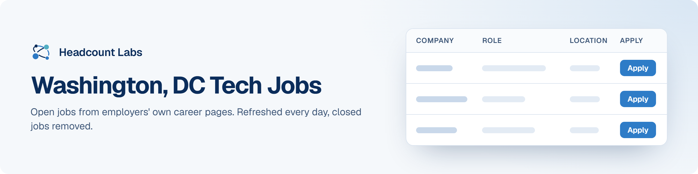

# Washington, DC Tech Jobs

Software, data, AI, product and design jobs in the Washington, DC area, sorted by field.

**390 open jobs** · 338 new since the last update · 348 removed because they closed or left the employer's board · updated November 11, 2026 at 5:26 AM EST

This list is built and refreshed every day by [Headcount Labs](https://headcountlabs.com/?utm_source=github&utm_medium=job-list&utm_campaign=washington-dc-tech-jobs), which reads jobs straight from employers' own career pages and job boards. Every job here was still listed on its source board when we last read that board, within the past 3 days, and was posted in the past 30 days. Copies of the same job are merged into one row, and jobs that close are removed at the next update.

Want this data in your own app or agent? Use the [Headcount Labs jobs API](https://headcountlabs.com/docs/?utm_source=github&utm_medium=job-list&utm_campaign=washington-dc-tech-jobs) (free tier), the [MCP server](https://headcountlabs.com/mcp/?utm_source=github&utm_medium=job-list&utm_campaign=washington-dc-tech-jobs) for Claude, ChatGPT and other AI assistants, or the [public dataset subsets](https://huggingface.co/HeadcountLabs) on Hugging Face (the full dataset is coming soon).

**Full dataset.** A bigger, one-off snapshot dated 2026-10-19 (all matching jobs, not only the open jobs below) is on Hugging Face: [Tech and software jobs](https://huggingface.co/datasets/HeadcountLabs/tech-jobs). It loads with `datasets.load_dataset` and is under the Open Database License (ODbL) 1.0.

**Jump to:** [Software engineering (209)](#software-engineering) · [Data, AI and machine learning (113)](#data-ai-and-machine-learning) · [Product and design (32)](#product-and-design) · [Hardware and engineering (36)](#hardware-and-engineering)

**Columns.** *Apply* opens the original posting on the employer's site. *Details* opens the job on Headcount Labs, with every posting we found for it. *Remote* shows what the employer states; a dash means the posting doesn't say. *Pay* is the range the employer published.

## Software engineering

| Company | Role | Location | Remote | Pay | Posted | Apply | Details |
| --- | --- | --- | --- | --- | --- | :---: | :---: |
| **Syms Strategic Group, LLC (SSG)** | Senior Software Test Engineer | Arlington, VA | Remote | $85k–$117k/yr | Nov 10 |  | <a href="https://headcountlabs.com/catalog/jobs/5d8fa93a-629b-4847-91bc-91fdd1020ecc?utm_source=github&utm_medium=job-list&utm_campaign=washington-dc-tech-jobs">via Headcount Labs</a> |
| **Syms Strategic Group, LLC (SSG)** | Software Test Manager | Arlington, VA | Remote | $85k–$117k/yr | Nov 10 |  | <a href="https://headcountlabs.com/catalog/jobs/0f4916e0-08c8-4c80-a76f-dc2493ba528b?utm_source=github&utm_medium=job-list&utm_campaign=washington-dc-tech-jobs">via Headcount Labs</a> |
| **STR** | Software Developer - Business Applications &amp; Analytics | 

2 locations
Arlington, VA Woburn, MA
 | Remote | $111k–$145k/yr | Nov 10 |  | <a href="https://headcountlabs.com/catalog/jobs/cb1b9f10-9b79-4654-8af4-a920430a77b3?utm_source=github&utm_medium=job-list&utm_campaign=washington-dc-tech-jobs">via Headcount Labs</a> |
| **Steampunk** | Salesforce Technical Lead / Sr. Developer | McLean, VA | Remote | $150k–$200k/yr | Nov 10 |  | <a href="https://headcountlabs.com/catalog/jobs/c4bd2e72-7ea0-4646-b472-6a98d57fbf19?utm_source=github&utm_medium=job-list&utm_campaign=washington-dc-tech-jobs">via Headcount Labs</a> |
| **Steampunk** | Mulesoft Developer | McLean, VA | Remote | $85k–$170k/yr | Nov 10 |  | <a href="https://headcountlabs.com/catalog/jobs/a40d4b76-8cb6-4f79-b122-2a20a05db4b6?utm_source=github&utm_medium=job-list&utm_campaign=washington-dc-tech-jobs">via Headcount Labs</a> |
| **Steampunk** | Salesforce DevOps Engineer | McLean, VA | — | $80k–$175k/yr | Nov 10 |  | <a href="https://headcountlabs.com/catalog/jobs/33424f30-f04c-4053-9e14-d16ea25572e1?utm_source=github&utm_medium=job-list&utm_campaign=washington-dc-tech-jobs">via Headcount Labs</a> |
| **Peraton** | Software Engineering, Senior Advisor | Washington, DC | — | $146k–$234k/yr | Nov 10 |  | <a href="https://headcountlabs.com/catalog/jobs/6a1ca365-73eb-4443-9563-5b18bc9311bb?utm_source=github&utm_medium=job-list&utm_campaign=washington-dc-tech-jobs">via Headcount Labs</a> |
| **GRVTY** | ETL Developer | McLean, VA | — | $150k–$250k/yr | Nov 10 |  | <a href="https://headcountlabs.com/catalog/jobs/8810cc07-4a15-4080-87aa-7b75a57ca52c?utm_source=github&utm_medium=job-list&utm_campaign=washington-dc-tech-jobs">via Headcount Labs</a> |
| **Google** | Senior Security Engineer, Google Public Sector, Offensive Agentic Development | 

2 locations
Washington, DC Reston, VA
 | — | $207k–$300k/yr | Nov 10 |  | <a href="https://headcountlabs.com/catalog/jobs/ba9773c9-f6ca-4dc1-8c19-8def6c024cbe?utm_source=github&utm_medium=job-list&utm_campaign=washington-dc-tech-jobs">via Headcount Labs</a> |
| **Google** | Technical Program Manager III, Software Tools | 

7 locations
Austin, TX Addison, TX New York, NY Reston, VA Seattle, WA San Francisco, CA Sunnyvale, CA
 | — | $163k–$236k/yr | Nov 10 |  | <a href="https://headcountlabs.com/catalog/jobs/08a715a4-c12b-4ac8-ae1c-4dff0cb9b2a0?utm_source=github&utm_medium=job-list&utm_campaign=washington-dc-tech-jobs">via Headcount Labs</a> |
| **Vantor Services Inc.** | Front End Developer | McLean, VA | — | $140k–$206k/yr | Nov 9 |  | <a href="https://headcountlabs.com/catalog/jobs/79da2411-2666-43a8-8bff-19143c8f4c86?utm_source=github&utm_medium=job-list&utm_campaign=washington-dc-tech-jobs">via Headcount Labs</a> |
| **Turing** | Full Stack Engineer | Washington, DC | Remote | $200–$300/hr | Nov 9 |  | <a href="https://headcountlabs.com/catalog/jobs/a4c52c92-97da-40c7-9ba3-d19eb24c53ee?utm_source=github&utm_medium=job-list&utm_campaign=washington-dc-tech-jobs">via Headcount Labs</a> |
| **Turing** | Senior Software Developer | Washington, DC | Remote | $200–$300/hr | Nov 9 |  | <a href="https://headcountlabs.com/catalog/jobs/bb97d8b3-dd59-4b1b-bb85-c757b7c2cc50?utm_source=github&utm_medium=job-list&utm_campaign=washington-dc-tech-jobs">via Headcount Labs</a> |
| **Turing** | Backend Engineer (Python/FastAPI) | Washington, DC | Remote | $200–$300/hr | Nov 9 |  | <a href="https://headcountlabs.com/catalog/jobs/731bb6fd-16ce-4891-bcc7-dc9302fb071a?utm_source=github&utm_medium=job-list&utm_campaign=washington-dc-tech-jobs">via Headcount Labs</a> |
| **Turing** | Full Stack Developer | Washington, DC | Remote | $200–$300/hr | Nov 9 |  | <a href="https://headcountlabs.com/catalog/jobs/6ffddb16-8028-46e6-9c39-56c29ca53bd9?utm_source=github&utm_medium=job-list&utm_campaign=washington-dc-tech-jobs">via Headcount Labs</a> |
| **Turing** | Software Engineer | Washington, DC | Remote | $200–$300/hr | Nov 9 |  | <a href="https://headcountlabs.com/catalog/jobs/4d8d3c6e-d11c-4bc0-9562-8332698c4284?utm_source=github&utm_medium=job-list&utm_campaign=washington-dc-tech-jobs">via Headcount Labs</a> |
| **Turing** | Software Developer ($200/hr) | Washington, DC | Remote | $200–$300/hr | Nov 9 |  | <a href="https://headcountlabs.com/catalog/jobs/459a4f52-7abe-4381-b5e2-be1af85f961e?utm_source=github&utm_medium=job-list&utm_campaign=washington-dc-tech-jobs">via Headcount Labs</a> |
| **Turing** | Software Developer | Washington, DC | Remote | $200–$300/hr | Nov 9 |  | <a href="https://headcountlabs.com/catalog/jobs/19ade301-64e0-41da-846c-1f7a0d5445aa?utm_source=github&utm_medium=job-list&utm_campaign=washington-dc-tech-jobs">via Headcount Labs</a> |
| **The Mitre Corporation** | Defensive Cybersecurity Engineer/SOC SME | 

7 locations
McLean, VA Bedford, MA Colorado Springs, CO Fort Meade - Annapolis Junction, MD Huntsville, AL San Diego, CA Tampa, FL
 | — | $159k–$238k/yr | Nov 9 |  | <a href="https://headcountlabs.com/catalog/jobs/d17dd5cf-faed-47a3-af63-952663d5f919?utm_source=github&utm_medium=job-list&utm_campaign=washington-dc-tech-jobs">via Headcount Labs</a> |
| **The Mitre Corporation** | Defensive Cybersecurity Engineer/Incident Response | 

7 locations
McLean, VA Bedford, MA Colorado Springs, CO Fort Meade - Annapolis Junction, MD Huntsville, AL San Diego, CA Tampa, FL
 | — | $159k–$238k/yr | Nov 9 |  | <a href="https://headcountlabs.com/catalog/jobs/3df4a955-1e2f-485b-a70f-633c48bb9277?utm_source=github&utm_medium=job-list&utm_campaign=washington-dc-tech-jobs">via Headcount Labs</a> |
| **The Mitre Corporation** | Defensive Cybersecurity Engineer/Blue Team | 

2 locations
Springfield, VA McLean, VA
 | — | $159k–$238k/yr | Nov 9 |  | <a href="https://headcountlabs.com/catalog/jobs/3624852a-1850-48fc-9676-322e4131a955?utm_source=github&utm_medium=job-list&utm_campaign=washington-dc-tech-jobs">via Headcount Labs</a> |
| **The Mitre Corporation** | Principal Software Engineer | McLean, VA | — | $173k–$260k/yr | Nov 9 |  | <a href="https://headcountlabs.com/catalog/jobs/7450f80d-9221-4ab7-8e0b-81eb568fc7b6?utm_source=github&utm_medium=job-list&utm_campaign=washington-dc-tech-jobs">via Headcount Labs</a> |
| **STR** | Principal Embedded Software Architect (Top Secret Clearance Required) | 

2 locations
Arlington, VA Woburn, MA
 | — | $219k–$300k/yr | Nov 9 |  | <a href="https://headcountlabs.com/catalog/jobs/5065ab26-92a2-4c5d-89a1-906f5e5d96fa?utm_source=github&utm_medium=job-list&utm_campaign=washington-dc-tech-jobs">via Headcount Labs</a> |
| **Steampunk** | Front End Developer | McLean, VA | — | $85k–$170k/yr | Nov 9 |  | <a href="https://headcountlabs.com/catalog/jobs/49b3b400-b279-414f-848b-21604fe1f7cc?utm_source=github&utm_medium=job-list&utm_campaign=washington-dc-tech-jobs">via Headcount Labs</a> |
| **SOSi** | Cyber Security Engineer SME | Washington, DC | Hybrid | $120k–$249k/yr | Nov 9 |  | <a href="https://headcountlabs.com/catalog/jobs/433acf85-6fff-40a5-a8eb-ebd330c7c42f?utm_source=github&utm_medium=job-list&utm_campaign=washington-dc-tech-jobs">via Headcount Labs</a> |
| **SAIC** | CyberArk Engineer Senior | Washington, DC | Hybrid | — | Nov 9 |  | <a href="https://headcountlabs.com/catalog/jobs/d1221389-c11b-4c47-b904-387fbf48bad6?utm_source=github&utm_medium=job-list&utm_campaign=washington-dc-tech-jobs">via Headcount Labs</a> |
| **SAIC** | Azure Cloud Engineer | Washington, DC | Hybrid | — | Nov 9 |  | <a href="https://headcountlabs.com/catalog/jobs/c3d4fc7d-a61c-4a67-9fad-c918d41dfa45?utm_source=github&utm_medium=job-list&utm_campaign=washington-dc-tech-jobs">via Headcount Labs</a> |
| **SAIC** | DevOps Engineer | Washington, DC | Hybrid | — | Nov 9 |  | <a href="https://headcountlabs.com/catalog/jobs/3efab033-6e7d-4eda-b6c3-e0fe0a065bce?utm_source=github&utm_medium=job-list&utm_campaign=washington-dc-tech-jobs">via Headcount Labs</a> |
| **SAIC** | Cyber Engineer Principal | 

2 locations
Reston, VA Washington, DC
 | Hybrid | — | Nov 9 |  | <a href="https://headcountlabs.com/catalog/jobs/e54bacca-9ab9-460d-ae7f-06ce7fd0db7a?utm_source=github&utm_medium=job-list&utm_campaign=washington-dc-tech-jobs">via Headcount Labs</a> |
| **MetroStar** | Sr. Security Engineer II (6836) (25k Sign-on) | Reston, VA | — | $190k–$280k/yr | Nov 9 |  | <a href="https://headcountlabs.com/catalog/jobs/db2045fa-7745-491d-805b-663d84342e2a?utm_source=github&utm_medium=job-list&utm_campaign=washington-dc-tech-jobs">via Headcount Labs</a> |
| **MetroStar** | Sr. Platform Security Engineer II (6836) (25k Sign-on) | Reston, VA | — | $190k–$280k/yr | Nov 9 |  | <a href="https://headcountlabs.com/catalog/jobs/ee3374d7-9d60-461a-b0a9-be4de9184445?utm_source=github&utm_medium=job-list&utm_campaign=washington-dc-tech-jobs">via Headcount Labs</a> |
| **MetroStar** | Cloud Engineer (6851) | Reston, VA | — | $150k–$185k/yr | Nov 9 |  | <a href="https://headcountlabs.com/catalog/jobs/bc0e0fa9-092e-44f0-985b-beccf99f689b?utm_source=github&utm_medium=job-list&utm_campaign=washington-dc-tech-jobs">via Headcount Labs</a> |
| **MetroStar** | Sr. Information Systems Security Engineer (ISSE) II (6836) (25k Sign-on) | Reston, VA | — | $190k–$280k/yr | Nov 9 |  | <a href="https://headcountlabs.com/catalog/jobs/695631b9-66e2-452a-b39f-6e46e1cc90d0?utm_source=github&utm_medium=job-list&utm_campaign=washington-dc-tech-jobs">via Headcount Labs</a> |
| **MetroStar** | DevOps Engineer (6842) (Up to $25k Sign-on) | Reston, VA | — | $170k–$260k/yr | Nov 9 |  | <a href="https://headcountlabs.com/catalog/jobs/415616f8-7831-4e9d-ac4a-a45ef6acfc24?utm_source=github&utm_medium=job-list&utm_campaign=washington-dc-tech-jobs">via Headcount Labs</a> |
| **IIIIIIUS** | Lead Software Engineer | Reston, VA | Remote | $119k–$203k/yr | Nov 9 |  | <a href="https://headcountlabs.com/catalog/jobs/76049dbe-a387-4767-9d4e-1ef9a40d983b?utm_source=github&utm_medium=job-list&utm_campaign=washington-dc-tech-jobs">via Headcount Labs</a> |
| **IIIIIIUS** | Senior Manager, Software Engineer | Reston, VA | Remote | $131k–$223k/yr | Nov 9 |  | <a href="https://headcountlabs.com/catalog/jobs/16125d9c-b030-40ee-91c9-172fd22980e1?utm_source=github&utm_medium=job-list&utm_campaign=washington-dc-tech-jobs">via Headcount Labs</a> |
| **ICF Resources, LLC** | Senior Manager, Software Engineer | Reston, VA | Remote | $131k–$223k/yr | Nov 9 |  | <a href="https://headcountlabs.com/catalog/jobs/642a4363-5e68-467e-b41b-da7f4c061c84?utm_source=github&utm_medium=job-list&utm_campaign=washington-dc-tech-jobs">via Headcount Labs</a> |
| **ICF Resources, LLC** | Lead Software Engineer | Reston, VA | Remote | $108k–$184k/yr | Nov 9 |  | <a href="https://headcountlabs.com/catalog/jobs/3b6b9a47-308c-41ec-a0e2-56c9b551f420?utm_source=github&utm_medium=job-list&utm_campaign=washington-dc-tech-jobs">via Headcount Labs</a> |
| **Credence** | Junior SAP ABAP Developer | McLean, VA | On-site | — | Nov 9 |  | <a href="https://headcountlabs.com/catalog/jobs/c756fdfc-2e80-4628-9b9c-9390bcbec221?utm_source=github&utm_medium=job-list&utm_campaign=washington-dc-tech-jobs">via Headcount Labs</a> |
| **Council on Foreign Relations** | DevOps Engineer / Site Reliability Engineer | 

2 locations
New York, NY Washington, DC
 | — | $150k–$175k/yr | Nov 9 |  | <a href="https://headcountlabs.com/catalog/jobs/bdef7835-67b9-4029-add2-23b82fba6fba?utm_source=github&utm_medium=job-list&utm_campaign=washington-dc-tech-jobs">via Headcount Labs</a> |
| **Constellation Inc** | Power BI Developer | Washington, DC | On-site | $100k–$115k/yr | Nov 9 |  | <a href="https://headcountlabs.com/catalog/jobs/091c06ca-1a99-43b3-9af7-9e63e2cf3fa7?utm_source=github&utm_medium=job-list&utm_campaign=washington-dc-tech-jobs">via Headcount Labs</a> |
| **CapTech Consulting** | Senior Full-Stack Engineer with AWS | 

5 locations
Atlanta, GA Richmond, VA Philadelphia, PA Charlotte, NC Reston, VA
 | Hybrid | — | Nov 9 |  | <a href="https://headcountlabs.com/catalog/jobs/e749fbbe-1df7-4f45-82eb-c2eb0f834291?utm_source=github&utm_medium=job-list&utm_campaign=washington-dc-tech-jobs">via Headcount Labs</a> |
| **Bespoke Technologies** | Full Stack Software Developer | Reston, VA | — | — | Nov 9 |  | <a href="https://headcountlabs.com/catalog/jobs/298c816f-9b15-4108-b9f8-e72c7d41fc97?utm_source=github&utm_medium=job-list&utm_campaign=washington-dc-tech-jobs">via Headcount Labs</a> |
| **APOGEE RESEARCH LLC** | Embedded Software Engineer | Arlington, VA | — | $83k–$151k/yr | Nov 9 |  | <a href="https://headcountlabs.com/catalog/jobs/fa4de384-951b-419c-af23-5878e518cf1d?utm_source=github&utm_medium=job-list&utm_campaign=washington-dc-tech-jobs">via Headcount Labs</a> |
| **APOGEE RESEARCH LLC** | Principal Software Engineer | Arlington, VA | — | $154k–$265k/yr | Nov 9 |  | <a href="https://headcountlabs.com/catalog/jobs/824fda4f-e522-4bf1-af5f-4abd686a219d?utm_source=github&utm_medium=job-list&utm_campaign=washington-dc-tech-jobs">via Headcount Labs</a> |
| **West 4th Strategy** | .NET Developer | Washington, DC | On-site | $115k–$125k/yr | Nov 7 |  | <a href="https://headcountlabs.com/catalog/jobs/afe0cb76-062a-4b42-9450-0189108657c2?utm_source=github&utm_medium=job-list&utm_campaign=washington-dc-tech-jobs">via Headcount Labs</a> |
| **Raydar** | Front End Software Engineer | Washington, DC | Hybrid | — | Nov 7 |  | <a href="https://headcountlabs.com/catalog/jobs/c0b0c0ed-eba6-4ebb-bcdc-cfe25e52eb38?utm_source=github&utm_medium=job-list&utm_campaign=washington-dc-tech-jobs">via Headcount Labs</a> |
| **West 4th Strategy** | Power App Developer | Washington, DC | On-site | $120k–$130k/yr | Nov 6 |  | <a href="https://headcountlabs.com/catalog/jobs/456e64f1-bbe6-429c-a8e1-2a046048b6d3?utm_source=github&utm_medium=job-list&utm_campaign=washington-dc-tech-jobs">via Headcount Labs</a> |
| **West 4th Strategy** | Senior Azure Application Developer | Washington, DC | On-site | $140k–$150k/yr | Nov 6 |  | <a href="https://headcountlabs.com/catalog/jobs/c9014905-ced5-4bb7-bf0f-ae673b8e505c?utm_source=github&utm_medium=job-list&utm_campaign=washington-dc-tech-jobs">via Headcount Labs</a> |
| **UltraViolet Cyber** | Security Engineer (Microsoft Defender) | Arlington, VA | Hybrid | $110k–$115k/yr | Nov 6 |  | <a href="https://headcountlabs.com/catalog/jobs/784f6e68-7f4b-45ab-b6d8-b064a8373dc1?utm_source=github&utm_medium=job-list&utm_campaign=washington-dc-tech-jobs">via Headcount Labs</a> |
| **STR** | Principal Mission Engineer - Full Stack (Secret Clearance Required) | 

2 locations
Arlington, VA San Diego, CA
 | Remote | $240k–$290k/yr | Nov 6 |  | <a href="https://headcountlabs.com/catalog/jobs/d8ee6e15-a7b5-463e-83ce-3647330e88f3?utm_source=github&utm_medium=job-list&utm_campaign=washington-dc-tech-jobs">via Headcount Labs</a> |
| **Steampunk** | Salesforce Application Developer | McLean, VA | — | $85k–$160k/yr | Nov 6 |  | <a href="https://headcountlabs.com/catalog/jobs/6aa09098-cb38-4767-8055-f4db091f4063?utm_source=github&utm_medium=job-list&utm_campaign=washington-dc-tech-jobs">via Headcount Labs</a> |
| **Softthink Solutions Inc** | Senior Dot NET Developer - Azure - Microservices - AKS | Washington, DC | Remote | $40–$50/hr | Nov 6 |  | <a href="https://headcountlabs.com/catalog/jobs/d03d89b3-4433-4a6e-af7c-63078311776c?utm_source=github&utm_medium=job-list&utm_campaign=washington-dc-tech-jobs">via Headcount Labs</a> |
| **Softthink Solutions Inc** | Mobile Application Developer - Dot NET MAUI - iOS - Android | Washington, DC | Remote | $45–$55/hr | Nov 6 |  | <a href="https://headcountlabs.com/catalog/jobs/c34f37cd-b280-41e2-86a8-911fb5180a3f?utm_source=github&utm_medium=job-list&utm_campaign=washington-dc-tech-jobs">via Headcount Labs</a> |
| **Qualtrics** | Software Engineer II - Discover Studio | Reston, VA | Hybrid | $112k–$136k/yr | Nov 6 |  | <a href="https://headcountlabs.com/catalog/jobs/e39be123-2877-4915-bf46-d04ae7b90843?utm_source=github&utm_medium=job-list&utm_campaign=washington-dc-tech-jobs">via Headcount Labs</a> |
| **Praescient Analytics** | Information Systems Security Engineer – Senior (TS/SCI) | Washington, DC | — | — | Nov 6 |  | <a href="https://headcountlabs.com/catalog/jobs/8624573f-a2fe-49ad-9eb3-49ba0890071d?utm_source=github&utm_medium=job-list&utm_campaign=washington-dc-tech-jobs">via Headcount Labs</a> |
| **Planet Technologies** | Cybersecurity Engineer | Washington, DC | On-site | $120k–$190k/yr | Nov 6 |  | <a href="https://headcountlabs.com/catalog/jobs/6f3b1ecf-09e5-4396-9218-186adf2d4ada?utm_source=github&utm_medium=job-list&utm_campaign=washington-dc-tech-jobs">via Headcount Labs</a> |
| **LIGHTFEATHER IO LLC** | GCP Cloud/DevOps Engineer | Washington, DC | — | $120k–$140k/yr | Nov 6 |  | <a href="https://headcountlabs.com/catalog/jobs/6e5e2f60-37cd-4a28-923d-f92133c08a41?utm_source=github&utm_medium=job-list&utm_campaign=washington-dc-tech-jobs">via Headcount Labs</a> |
| **LIGHTFEATHER IO LLC** | Oracle Cloud Infrastructure Engineer | Washington, DC | Hybrid | $160k–$180k/yr | Nov 6 |  | <a href="https://headcountlabs.com/catalog/jobs/756c7a48-dec5-448e-92db-d45a2beb4f0e?utm_source=github&utm_medium=job-list&utm_campaign=washington-dc-tech-jobs">via Headcount Labs</a> |
| **LIGHTFEATHER IO LLC** | Senior Azure Cloud Engineer | Washington, DC | Hybrid | $130k–$170k/yr | Nov 6 |  | <a href="https://headcountlabs.com/catalog/jobs/c7580217-b861-478e-8340-7ae160d799ad?utm_source=github&utm_medium=job-list&utm_campaign=washington-dc-tech-jobs">via Headcount Labs</a> |
| **Google** | Software Engineer, AI/ML, Technical Delivery, Google Public Sector | 

2 locations
Reston, VA Washington, DC
 | — | $147k–$210k/yr | Nov 6 |  | <a href="https://headcountlabs.com/catalog/jobs/9a242fa3-df07-4240-af65-8cf82ad90599?utm_source=github&utm_medium=job-list&utm_campaign=washington-dc-tech-jobs">via Headcount Labs</a> |
| **Fusion Technology** | Mid-Level Business Intelligence Developer | Washington, DC | — | $81k–$86k/yr | Nov 6 |  | <a href="https://headcountlabs.com/catalog/jobs/8a9f9218-f329-47e4-bc67-0e792478efcf?utm_source=github&utm_medium=job-list&utm_campaign=washington-dc-tech-jobs">via Headcount Labs</a> |
| **ASRC Federal** | Senior Full Stack Software Developer | Washington, DC | On-site | — | Nov 6 |  | <a href="https://headcountlabs.com/catalog/jobs/35295dee-10c1-4ab1-808e-0f5e603e3f90?utm_source=github&utm_medium=job-list&utm_campaign=washington-dc-tech-jobs">via Headcount Labs</a> |
| **Anduril Industries** | Site Reliability Engineer, Strategic Defense | Washington, DC | — | $147k–$196k/yr | Nov 6 |  | <a href="https://headcountlabs.com/catalog/jobs/f44818e5-90f4-4ee0-9bdf-75893b9e2421?utm_source=github&utm_medium=job-list&utm_campaign=washington-dc-tech-jobs">via Headcount Labs</a> |
| **SpaceX** | Software Engineer, Telemetry - Top Secret Clearance (Starlink) | 

2 locations
Washington, DC Hawthorne, CA
 | — | $135k–$160k/yr | Nov 5 |  | <a href="https://headcountlabs.com/catalog/jobs/93df3200-7c0e-4664-b267-27206fd8aac0?utm_source=github&utm_medium=job-list&utm_campaign=washington-dc-tech-jobs">via Headcount Labs</a> |
| **Publicis Groupe Holdings B.V** | Senior Adobe Target Developer | 

6 locations
Irving, TX Arlington, VA Houston, TX Boston, MA Atlanta, GA Chicago, IL
 | — | $130k–$160k/yr | Nov 5 |  | <a href="https://headcountlabs.com/catalog/jobs/b8ba11be-0a18-43fe-99c8-ea29a433eb8b?utm_source=github&utm_medium=job-list&utm_campaign=washington-dc-tech-jobs">via Headcount Labs</a> |
| **Planet Technologies** | Information Systems Security Engineer | Washington, DC | On-site | $130k–$190k/yr | Nov 5 |  | <a href="https://headcountlabs.com/catalog/jobs/26468621-6c76-456c-a71c-b3b6f9408c5e?utm_source=github&utm_medium=job-list&utm_campaign=washington-dc-tech-jobs">via Headcount Labs</a> |
| **MATRIX SYSTEMS &amp; TECHNOLOGIES INC** | Jr Java Full Stack Software Engineer | Washington, DC | — | $70k–$95k/yr | Nov 5 |  | <a href="https://headcountlabs.com/catalog/jobs/d5ce54ea-6168-4ce7-8fc2-6bbb2942db97?utm_source=github&utm_medium=job-list&utm_campaign=washington-dc-tech-jobs">via Headcount Labs</a> |
| **MATRIX SYSTEMS &amp; TECHNOLOGIES INC** | Sr Java Full Stack Software Engineer | Washington, DC | — | $70k–$95k/yr | Nov 5 |  | <a href="https://headcountlabs.com/catalog/jobs/2f4ec22d-95fa-449c-9077-dd5796a96937?utm_source=github&utm_medium=job-list&utm_campaign=washington-dc-tech-jobs">via Headcount Labs</a> |
| **HII** | DSCA AI Back-End Developer (Software Development Analyst) - 31043 | Arlington, VA | Remote | — | Nov 5 |  | <a href="https://headcountlabs.com/catalog/jobs/f04ee355-a00e-498c-b9bd-e7998872cc3e?utm_source=github&utm_medium=job-list&utm_campaign=washington-dc-tech-jobs">via Headcount Labs</a> |
| **Google** | Senior Cloud Infrastructure Engineer, Google Public Sector | 

2 locations
Reston, VA Washington, DC
 | — | $174k–$252k/yr | Nov 5 |  | <a href="https://headcountlabs.com/catalog/jobs/101b7771-acaa-481f-af18-a2ebd6fe8c34?utm_source=github&utm_medium=job-list&utm_campaign=washington-dc-tech-jobs">via Headcount Labs</a> |
| **Credence** | Lead Cybersecurity Engineer - Innovation &amp; Automation | McLean, VA | Remote | — | Nov 5 |  | <a href="https://headcountlabs.com/catalog/jobs/800f4170-1abc-460d-82fe-6d7427ff1420?utm_source=github&utm_medium=job-list&utm_campaign=washington-dc-tech-jobs">via Headcount Labs</a> |
| **Vantor Services Inc.** | Geospatial Developer | Reston, VA | — | $116k–$169k/yr | Nov 4 |  | <a href="https://headcountlabs.com/catalog/jobs/89ec205f-d995-4cf5-95bd-63c437cb7e7e?utm_source=github&utm_medium=job-list&utm_campaign=washington-dc-tech-jobs">via Headcount Labs</a> |
| **Raytheon** | Principal Antenna/RF Front End Design Engineer | 

2 locations
arlington, VA columbia, MD
 | — | — | Nov 4 |  | <a href="https://headcountlabs.com/catalog/jobs/5c68a8dd-9209-48d4-8f90-fca49d8279d0?utm_source=github&utm_medium=job-list&utm_campaign=washington-dc-tech-jobs">via Headcount Labs</a> |
| **LE038 Second Sight Solutions, LLC** | Software Engineering Manager | 

2 locations
Washington, DC New York, NY
 | — | $160k–$220k/yr | Nov 4 |  | <a href="https://headcountlabs.com/catalog/jobs/0a3d0a19-2de8-4e0f-82c7-967cd95ac47a?utm_source=github&utm_medium=job-list&utm_campaign=washington-dc-tech-jobs">via Headcount Labs</a> |
| **Lawelawe Technology Services** | DevOps Engineer | Washington, DC | On-site | — | Nov 4 |  | <a href="https://headcountlabs.com/catalog/jobs/a92c5753-3869-4c78-9707-0686053504ef?utm_source=github&utm_medium=job-list&utm_campaign=washington-dc-tech-jobs">via Headcount Labs</a> |
| **Lawelawe Technology Services** | .NET Developer | Washington, DC | On-site | — | Nov 4 |  | <a href="https://headcountlabs.com/catalog/jobs/19ec757c-da7d-4e13-89aa-bb1e2bd16744?utm_source=github&utm_medium=job-list&utm_campaign=washington-dc-tech-jobs">via Headcount Labs</a> |
| **Integrity Technology** | Cyber Security Engineer Expert Level | Reston, VA | — | — | Nov 4 |  | <a href="https://headcountlabs.com/catalog/jobs/e28c6170-a784-47e5-aea0-d885df5724d4?utm_source=github&utm_medium=job-list&utm_campaign=washington-dc-tech-jobs">via Headcount Labs</a> |
| **Initiate Government Solutions** | DevOps Engineer | Washington, DC | Remote | — | Nov 4 |  | <a href="https://headcountlabs.com/catalog/jobs/f45a9a70-bf12-421f-a1cb-471b4d3ba366?utm_source=github&utm_medium=job-list&utm_campaign=washington-dc-tech-jobs">via Headcount Labs</a> |
| **Galapagos Federal Systems LLC.** | Senior Software Architect | Washington, DC | — | $180k–$220k/yr | Nov 4 |  | <a href="https://headcountlabs.com/catalog/jobs/80f87ec3-fa39-4a53-adf0-dbfd822f1c5f?utm_source=github&utm_medium=job-list&utm_campaign=washington-dc-tech-jobs">via Headcount Labs</a> |
| **BAE Systems** | Cloud Engineer (Senior) | Herndon, VA | — | $133k–$226k/yr | Nov 4 |  | <a href="https://headcountlabs.com/catalog/jobs/460f4b56-0574-4961-b227-6c7bd8baedca?utm_source=github&utm_medium=job-list&utm_campaign=washington-dc-tech-jobs">via Headcount Labs</a> |
| **BAE Systems** | Software Engineer (Expert) | Herndon, VA | — | $150k–$254k/yr | Nov 4 |  | <a href="https://headcountlabs.com/catalog/jobs/66b686ee-bd98-4dac-824b-90c547aef2df?utm_source=github&utm_medium=job-list&utm_campaign=washington-dc-tech-jobs">via Headcount Labs</a> |
| **AET FEDERAL INC** | Senior SharePoint Developer | Washington D.C., DC | On-site | $120k–$135k/yr | Nov 4 |  | <a href="https://headcountlabs.com/catalog/jobs/b210b0d9-1a8f-43bf-8cba-7353d882c2d5?utm_source=github&utm_medium=job-list&utm_campaign=washington-dc-tech-jobs">via Headcount Labs</a> |
| **Vantor Services Inc.** | Mid-level Full Stack Software Engineer (TS/SCI) | 

2 locations
Herndon, VA Westminster, CO
 | On-site | $140k–$200k/yr | Nov 3 |  | <a href="https://headcountlabs.com/catalog/jobs/70f7f956-aa4a-4a68-9a29-7f86b32f75d7?utm_source=github&utm_medium=job-list&utm_campaign=washington-dc-tech-jobs">via Headcount Labs</a> |
| **Vantor Services Inc.** | Mid-level Back-End Software Engineer (TS/SCI) | 

2 locations
Herndon, VA Westminster, CO
 | On-site | $140k–$200k/yr | Nov 3 |  | <a href="https://headcountlabs.com/catalog/jobs/218126e5-2e0d-466b-9ece-942bf12866d1?utm_source=github&utm_medium=job-list&utm_campaign=washington-dc-tech-jobs">via Headcount Labs</a> |
| **SAP IT Business Systeme** | Senior Security DevOps Engineer | Reston, VA | Hybrid | $131k–$272k/yr | Nov 3 |  | <a href="https://headcountlabs.com/catalog/jobs/c6b47302-c54f-425e-88da-94eff811889e?utm_source=github&utm_medium=job-list&utm_campaign=washington-dc-tech-jobs">via Headcount Labs</a> |
| **IntraFi** | Senior Manager, Software Development | Arlington, VA | Hybrid | $180k–$230k/yr | Nov 3 |  | <a href="https://headcountlabs.com/catalog/jobs/6473fa39-0361-4218-88e4-cbb2c0bf6869?utm_source=github&utm_medium=job-list&utm_campaign=washington-dc-tech-jobs">via Headcount Labs</a> |
| **ICF Incorporated, LLC** | Software Engineer - Cloud/GovCloud (Top Secret - Remote US) | Reston, VA | Remote | $99k–$168k/yr | Nov 3 |  | <a href="https://headcountlabs.com/catalog/jobs/29fc7c16-69f1-4319-bcaf-6ad97ef65633?utm_source=github&utm_medium=job-list&utm_campaign=washington-dc-tech-jobs">via Headcount Labs</a> |
| **Caretria** | Sr. Software Engineer (2026-8104) | Washington, DC | Remote | $120k–$160k/yr | Nov 3 |  | <a href="https://headcountlabs.com/catalog/jobs/f58d5d4a-301b-4fc5-8dba-046fae05036b?utm_source=github&utm_medium=job-list&utm_campaign=washington-dc-tech-jobs">via Headcount Labs</a> |
| **Boeing** | Lead Software Architect | Herndon, VA | — | $212k–$286k/yr | Nov 3 |  | <a href="https://headcountlabs.com/catalog/jobs/dcd8afaa-e741-40db-9a37-54a671c3007f?utm_source=github&utm_medium=job-list&utm_campaign=washington-dc-tech-jobs">via Headcount Labs</a> |
| **Boeing** | Java Software Engineer (Associate/Experienced) | Herndon, VA | — | $106k–$144k/yr | Nov 3 |  | <a href="https://headcountlabs.com/catalog/jobs/d48fcbde-a828-4d45-ac4f-3ced455a819a?utm_source=github&utm_medium=job-list&utm_campaign=washington-dc-tech-jobs">via Headcount Labs</a> |
| **Boeing** | Full Stack Software Engineer (Associate/Experienced) | Herndon, VA | — | $106k–$144k/yr | Nov 3 |  | <a href="https://headcountlabs.com/catalog/jobs/72031085-eea2-41a9-967b-69843fd84739?utm_source=github&utm_medium=job-list&utm_campaign=washington-dc-tech-jobs">via Headcount Labs</a> |
| **AVER** | .Net Application Developer | Washington, DC | — | $110k–$124k/yr | Nov 3 |  | <a href="https://headcountlabs.com/catalog/jobs/87b206d9-03c9-42b5-ba54-a893d11a8ca8?utm_source=github&utm_medium=job-list&utm_campaign=washington-dc-tech-jobs">via Headcount Labs</a> |
| **ASRC Federal** | SharePoint and Power Apps Developer | Washington, DC | On-site | — | Nov 3 |  | <a href="https://headcountlabs.com/catalog/jobs/95340215-2b77-48e6-a193-62cb1fe6eed8?utm_source=github&utm_medium=job-list&utm_campaign=washington-dc-tech-jobs">via Headcount Labs</a> |
| **STR** | Senior Software Engineer | 

4 locations
Arlington, VA Atlanta, GA Dayton, OH Woburn, MA
 | — | $138k–$190k/yr | Nov 2 |  | <a href="https://headcountlabs.com/catalog/jobs/7e6ff42a-9471-40c4-8442-2a004198f829?utm_source=github&utm_medium=job-list&utm_campaign=washington-dc-tech-jobs">via Headcount Labs</a> |
| **SpaceX** | Sr. AI Security Software Engineer (Starshield) | 

2 locations
Washington, DC Hawthorne, CA
 | — | $170k–$265k/yr | Nov 2 |  | <a href="https://headcountlabs.com/catalog/jobs/e8a37f6f-8bf3-47c6-be25-ad89b78c2ee8?utm_source=github&utm_medium=job-list&utm_campaign=washington-dc-tech-jobs">via Headcount Labs</a> |
| **SAIC** | Principal SharePoint Developer | Washington, DC | Hybrid | — | Nov 2 |  | <a href="https://headcountlabs.com/catalog/jobs/8099f7db-c284-4907-b400-dff7422d6d78?utm_source=github&utm_medium=job-list&utm_campaign=washington-dc-tech-jobs">via Headcount Labs</a> |
| **SAIC** | Cybersecurity Engineer RMF Specialist Lead | 

2 locations
Alexandria, VA Arlington, VA
 | On-site | — | Nov 2 |  | <a href="https://headcountlabs.com/catalog/jobs/179cd112-1280-4d7f-bd0e-be2db98f025c?utm_source=github&utm_medium=job-list&utm_campaign=washington-dc-tech-jobs">via Headcount Labs</a> |
| **SAIC** | Web Application Developer | Reston, VA | On-site | — | Nov 2 |  | <a href="https://headcountlabs.com/catalog/jobs/70e55d84-675b-41e9-bd2a-de9b8e437595?utm_source=github&utm_medium=job-list&utm_campaign=washington-dc-tech-jobs">via Headcount Labs</a> |
| **Phoenix Operations Group** | Product Champion – Cyber Operations &amp; Data Analytics | Washington, DC | On-site | — | Nov 2 |  | <a href="https://headcountlabs.com/catalog/jobs/4da05dde-da6b-4bd1-9e39-73e332ad2fd7?utm_source=github&utm_medium=job-list&utm_campaign=washington-dc-tech-jobs">via Headcount Labs</a> |
| **Parsons Technical Services, Inc.** | Cybersecurity Engineer - TS/SCI | Reston, VA | On-site | $104k–$181k/yr | Nov 2 |  | <a href="https://headcountlabs.com/catalog/jobs/1f863d54-bca0-49e7-bf98-5c4c088642f6?utm_source=github&utm_medium=job-list&utm_campaign=washington-dc-tech-jobs">via Headcount Labs</a> |
| **Markon** | Google Cloud Engineer | Herndon, VA | — | $170k–$200k/yr | Nov 2 |  | <a href="https://headcountlabs.com/catalog/jobs/cc83c96b-b67e-45d8-8c32-68d4cdbed3a5?utm_source=github&utm_medium=job-list&utm_campaign=washington-dc-tech-jobs">via Headcount Labs</a> |
| **Hudson Manpower** | Android Developer - Full Time and Contract Role - USC and GC's | 

92 locations
UNITED STATES, AK Bloomington, MN Allentown, PA Dayton, OH Denver, CO San Jose, CA Spring, TX West Chester Township, OH Wilton, CT Woonsocket, RI Albany, NY Alpharetta, GA +80 more
 | — | — | Nov 2 |  | <a href="https://headcountlabs.com/catalog/jobs/8350ce12-29c1-45ad-93a4-a0993182556f?utm_source=github&utm_medium=job-list&utm_campaign=washington-dc-tech-jobs">via Headcount Labs</a> |
| **GRVTY** | MicroStrategy Developer/Architect - Senior | Washington, DC | — | $107k–$153k/yr | Nov 2 |  | <a href="https://headcountlabs.com/catalog/jobs/284587fc-dc72-48a3-9b50-49b204c7fdcd?utm_source=github&utm_medium=job-list&utm_campaign=washington-dc-tech-jobs">via Headcount Labs</a> |
| **Data Intelligence LLC** | SME Cyber Capability Developer (Reverse Engineer) — Software Reverse Engineering | McLean, VA | — | — | Nov 2 |  | <a href="https://headcountlabs.com/catalog/jobs/aa557d70-5da0-48ae-aee5-4ce3c23c136a?utm_source=github&utm_medium=job-list&utm_campaign=washington-dc-tech-jobs">via Headcount Labs</a> |
| **Data Intelligence LLC** | SME Software Developer — DevOps &amp; Quality Assurance | McLean, VA | — | — | Nov 2 |  | <a href="https://headcountlabs.com/catalog/jobs/897f88cc-ceea-4cbb-8421-b8d079c10598?utm_source=github&utm_medium=job-list&utm_campaign=washington-dc-tech-jobs">via Headcount Labs</a> |
| **Data Intelligence LLC** | SME Web Application Developer — Data Visualization | McLean, VA | — | — | Nov 2 |  | <a href="https://headcountlabs.com/catalog/jobs/6c823a13-2ce5-4dae-968c-bff85a1d1764?utm_source=github&utm_medium=job-list&utm_campaign=washington-dc-tech-jobs">via Headcount Labs</a> |
| **Data Intelligence LLC** | Mid-Level Cyber Capability Developer (Reverse Engineer) — Software Reverse Engineering | McLean, VA | — | — | Nov 2 |  | <a href="https://headcountlabs.com/catalog/jobs/604f18f4-348c-4e7d-9612-3d2746d0de46?utm_source=github&utm_medium=job-list&utm_campaign=washington-dc-tech-jobs">via Headcount Labs</a> |
| **BizFirst** | Senior Site Reliability Engineer AI Security Federal | McLean, VA | On-site | — | Nov 2 |  | <a href="https://headcountlabs.com/catalog/jobs/08bee0da-475f-4354-8177-dd69747d2163?utm_source=github&utm_medium=job-list&utm_campaign=washington-dc-tech-jobs">via Headcount Labs</a> |
| **Raydar** | Frontend Software Engineer | Washington, DC | On-site | — | Oct 31 |  | <a href="https://headcountlabs.com/catalog/jobs/c56f00d8-b6b4-487e-b8e0-063c5c7dda12?utm_source=github&utm_medium=job-list&utm_campaign=washington-dc-tech-jobs">via Headcount Labs</a> |
| **LE001 Stout Risius Ross, LLC** | Senior Full Stack Engineer, AI Products - Stout Strategy | 

12 locations
Arlington, VA Atlanta, GA Boston, MA Charlotte, NC Chicago, IL Dallas, TX Denver, CO Detroit, MI Houston, TX New York, NY Philadelphia, PA Washington, DC
 | — | $87k–$195k/yr | Oct 30 |  | <a href="https://headcountlabs.com/catalog/jobs/7c349a82-5a76-4a8b-9ea8-d7b40076589a?utm_source=github&utm_medium=job-list&utm_campaign=washington-dc-tech-jobs">via Headcount Labs</a> |
| **Koniag Government Services, LLC** | Cloud Platform Engineer IL6/cArmy | Washington, DC | Remote | — | Oct 30 |  | <a href="https://headcountlabs.com/catalog/jobs/1ff83ec9-fa02-40e0-9557-dceafd1822ec?utm_source=github&utm_medium=job-list&utm_campaign=washington-dc-tech-jobs">via Headcount Labs</a> |
| **IDMe** | Principal Software Engineer, Data | 

2 locations
McLean, VA Mountain View, CA
 | On-site | $209k–$275k/yr | Oct 30 |  | <a href="https://headcountlabs.com/catalog/jobs/484da60d-55b4-4738-83ea-56d2aff7740d?utm_source=github&utm_medium=job-list&utm_campaign=washington-dc-tech-jobs">via Headcount Labs</a> |
| **ICF Incorporated, LLC** | Salesforce Developer | Reston, VA | Remote | $81k–$168k/yr | Oct 30 |  | <a href="https://headcountlabs.com/catalog/jobs/695712d7-5261-4f43-9ea8-088d0ca44c93?utm_source=github&utm_medium=job-list&utm_campaign=washington-dc-tech-jobs">via Headcount Labs</a> |
| **Booz Allen Hamilton_United States** | University, Software Developer | 

11 locations
McLean, VA Annapolis Junction, MD Atlanta, GA Charleston, SC Colorado Springs, CO El Segundo, CA Honolulu, HI Huntsville, AL Panama City, FL Rome, NY San Diego, CA
 | — | $53k–$108k/yr | Oct 30 |  | <a href="https://headcountlabs.com/catalog/jobs/03dd20d9-d28b-4535-bd72-00051b81750a?utm_source=github&utm_medium=job-list&utm_campaign=washington-dc-tech-jobs">via Headcount Labs</a> |
| **Bespoke Technologies** | Web Developer | McLean, VA | — | — | Oct 30 |  | <a href="https://headcountlabs.com/catalog/jobs/9cb9bd26-be34-4a9e-81c9-2c77f3e5a875?utm_source=github&utm_medium=job-list&utm_campaign=washington-dc-tech-jobs">via Headcount Labs</a> |
| **Bespoke Technologies** | Tools Developer | McLean, VA | — | — | Oct 30 |  | <a href="https://headcountlabs.com/catalog/jobs/a02cbda4-8d3f-4796-8557-7f281cb76a3a?utm_source=github&utm_medium=job-list&utm_campaign=washington-dc-tech-jobs">via Headcount Labs</a> |
| **TSC** | Mid/Senior Software Engineer (UAS) | 

3 locations
Arlington, VA Aurora, CO Huntsville, AL
 | — | $100k–$172k/yr | Oct 29 |  | <a href="https://headcountlabs.com/catalog/jobs/a3f20ae4-44f2-4640-84b9-2e6db1f0998b?utm_source=github&utm_medium=job-list&utm_campaign=washington-dc-tech-jobs">via Headcount Labs</a> |
| **TSC** | Junior Software Engineer (UAS) | Arlington, VA | — | $81k–$116k/yr | Oct 29 |  | <a href="https://headcountlabs.com/catalog/jobs/96a26dc5-2fbd-4671-88f1-621026ef1b0b?utm_source=github&utm_medium=job-list&utm_campaign=washington-dc-tech-jobs">via Headcount Labs</a> |
| **SAP IT Business Systeme** | Senior DevOps Engineer | Reston, VA | Hybrid | $131k–$272k/yr | Oct 29 |  | <a href="https://headcountlabs.com/catalog/jobs/f712af7f-3091-40ee-b5a3-364dfc184000?utm_source=github&utm_medium=job-list&utm_campaign=washington-dc-tech-jobs">via Headcount Labs</a> |
| **ICF Incorporated, LLC** | ServiceNow Developer | Reston, VA | Remote | $81k–$203k/yr | Oct 29 |  | <a href="https://headcountlabs.com/catalog/jobs/1310a1cd-fc03-44cd-acc5-5f523de2296d?utm_source=github&utm_medium=job-list&utm_campaign=washington-dc-tech-jobs">via Headcount Labs</a> |
| **Hanley Wood** | Software Engineer I (C#/.NET) | Arlington, VA | On-site | $108k–$154k/yr | Oct 29 |  | <a href="https://headcountlabs.com/catalog/jobs/5b927fb4-b57a-488a-b44b-2a0bc75cef35?utm_source=github&utm_medium=job-list&utm_campaign=washington-dc-tech-jobs">via Headcount Labs</a> |
| **Costar Group** | Software Engineer I (C#/.NET) | Arlington, VA | On-site | $108k–$154k/yr | Oct 29 |  | <a href="https://headcountlabs.com/catalog/jobs/4db46000-eebf-4a53-8e3a-b2975ae29e93?utm_source=github&utm_medium=job-list&utm_campaign=washington-dc-tech-jobs">via Headcount Labs</a> |
| **World Bank Group** | E T Consultant (Associate Software Engineer) | Washington, DC | — | — | Oct 28 |  | <a href="https://headcountlabs.com/catalog/jobs/4bbaab27-319f-44fd-9b5b-8aef8e5b2c1c?utm_source=github&utm_medium=job-list&utm_campaign=washington-dc-tech-jobs">via Headcount Labs</a> |
| **Vantor Inc.** | Staff Software Development Engineer | 

2 locations
Herndon, VA Westminster, CO
 | — | $105k–$154k/yr | Oct 28 |  | <a href="https://headcountlabs.com/catalog/jobs/e16decfc-4aab-4628-913d-d392eac3b9ba?utm_source=github&utm_medium=job-list&utm_campaign=washington-dc-tech-jobs">via Headcount Labs</a> |
| **VALIDATEK INC** | Junior Configuration Management Specialist (Hardware &amp; Software) | Arlington, VA | Hybrid | — | Oct 28 |  | <a href="https://headcountlabs.com/catalog/jobs/26d95f89-0f6e-44e3-8825-87a308b7c747?utm_source=github&utm_medium=job-list&utm_campaign=washington-dc-tech-jobs">via Headcount Labs</a> |
| **US: Mastercard Technologies, LLC** | Lead AI Platform Engineer | 

6 locations
New York City, NY Arlington, VA Atlanta, GA Boston, MA O'Fallon, MO Purchase, NY
 | — | $168k–$277k/yr | Oct 28 |  | <a href="https://headcountlabs.com/catalog/jobs/c81978ae-ec79-4736-a3d8-0f1a644d865f?utm_source=github&utm_medium=job-list&utm_campaign=washington-dc-tech-jobs">via Headcount Labs</a> |
| **Markon** | Information Systems Security Engineer | McLean, VA | — | $175k–$205k/yr | Oct 28 |  | <a href="https://headcountlabs.com/catalog/jobs/36f5ee37-f5ac-41c3-b2a5-1ba5f000d5b5?utm_source=github&utm_medium=job-list&utm_campaign=washington-dc-tech-jobs">via Headcount Labs</a> |
| **LMI** | Senior Software Engineer | Arlington, VA | — | $112k–$190k/yr | Oct 28 |  | <a href="https://headcountlabs.com/catalog/jobs/d9b721f4-ea6b-419e-91e1-719eb9f75478?utm_source=github&utm_medium=job-list&utm_campaign=washington-dc-tech-jobs">via Headcount Labs</a> |
| **IDMe** | Staff Software Engineer – Testing &amp; Evals Frameworks | 

2 locations
McLean, VA Mountain View, CA
 | On-site | $174k–$229k/yr | Oct 28 |  | <a href="https://headcountlabs.com/catalog/jobs/62f731aa-0e46-41fa-bee7-d7774fb1d30d?utm_source=github&utm_medium=job-list&utm_campaign=washington-dc-tech-jobs">via Headcount Labs</a> |
| **ICF Incorporated, LLC** | Salesforce Developer - Remote USA | Reston, VA | Remote | $81k–$168k/yr | Oct 28 |  | <a href="https://headcountlabs.com/catalog/jobs/858d8032-deeb-477d-84e8-4cbd3470dac0?utm_source=github&utm_medium=job-list&utm_campaign=washington-dc-tech-jobs">via Headcount Labs</a> |
| **EXPEDITION TECHNOLOGY, LLC** | Digital Signal Processing Software Engineer - R156 | Herndon, VA | — | $96k–$147k/yr | Oct 28 |  | <a href="https://headcountlabs.com/catalog/jobs/afd2690d-18c1-4c10-a6fc-48b79cfcc65d?utm_source=github&utm_medium=job-list&utm_campaign=washington-dc-tech-jobs">via Headcount Labs</a> |
| **Dell Technologies** | Security Engineer - Federal Customer | Mclean, VA | Remote | $186k–$241k/yr | Oct 28 |  | <a href="https://headcountlabs.com/catalog/jobs/4d0201fb-f246-472c-b6f8-6594369c5655?utm_source=github&utm_medium=job-list&utm_campaign=washington-dc-tech-jobs">via Headcount Labs</a> |
| **AHU Technologies Inc** | Senior Developer - D365/Power Platform/Azure | Washington, DC | On-site | $88–$93/hr | Oct 28 |  | <a href="https://headcountlabs.com/catalog/jobs/6384fdd6-6168-453e-a801-0d853a7b6f4b?utm_source=github&utm_medium=job-list&utm_campaign=washington-dc-tech-jobs">via Headcount Labs</a> |
| **US: Mastercard Technologies, LLC** | Senior Software Engineer | Arlington, VA | Hybrid | $132k–$212k/yr | Oct 27 |  | <a href="https://headcountlabs.com/catalog/jobs/403f674a-cb08-4ee7-bdb8-179ed1d7af16?utm_source=github&utm_medium=job-list&utm_campaign=washington-dc-tech-jobs">via Headcount Labs</a> |
| **US: Mastercard International Incor** | Software Engineer II | Arlington, VA | Hybrid | $106k–$169k/yr | Oct 27 |  | <a href="https://headcountlabs.com/catalog/jobs/faf6f53a-d9fe-46d3-b9d5-815c080dd442?utm_source=github&utm_medium=job-list&utm_campaign=washington-dc-tech-jobs">via Headcount Labs</a> |
| **US: Mastercard International Incor** | Software Engineer II - Blockchain | Arlington, VA | Hybrid | $106k–$169k/yr | Oct 27 |  | <a href="https://headcountlabs.com/catalog/jobs/d6445a4f-a104-4438-b065-4698dac8fba6?utm_source=github&utm_medium=job-list&utm_campaign=washington-dc-tech-jobs">via Headcount Labs</a> |
| **US: Mastercard International Incor** | Principal Software Engineer | 

2 locations
Arlington, VA Atlanta, GA
 | — | $195k–$323k/yr | Oct 27 |  | <a href="https://headcountlabs.com/catalog/jobs/311f24c9-3cac-4c5c-9c8d-ea6688528862?utm_source=github&utm_medium=job-list&utm_campaign=washington-dc-tech-jobs">via Headcount Labs</a> |
| **US: Mastercard International Incor** | Manager, Software Engineering &#124; Data &amp; AI Platform | Arlington, VA | — | $161k–$266k/yr | Oct 27 |  | <a href="https://headcountlabs.com/catalog/jobs/2e804e5a-be07-4fe1-a901-32802aca807e?utm_source=github&utm_medium=job-list&utm_campaign=washington-dc-tech-jobs">via Headcount Labs</a> |
| **US: Mastercard International Incor** | Senior Software Engineer | Arlington, VA | Hybrid | $132k–$212k/yr | Oct 27 |  | <a href="https://headcountlabs.com/catalog/jobs/2ca13ea8-a44c-45bf-b301-cad29359175b?utm_source=github&utm_medium=job-list&utm_campaign=washington-dc-tech-jobs">via Headcount Labs</a> |
| **US: Mastercard International Incor** | Senior Software Engineer &#124; Data &amp; AI Platform | Arlington, VA | — | $132k–$212k/yr | Oct 27 |  | <a href="https://headcountlabs.com/catalog/jobs/25d698fc-a24b-47b4-90c4-958a281a3810?utm_source=github&utm_medium=job-list&utm_campaign=washington-dc-tech-jobs">via Headcount Labs</a> |
| **US: Mastercard International Incor** | Principal Software Engineer, Data Architecture | Arlington, VA | — | $195k–$323k/yr | Oct 27 |  | <a href="https://headcountlabs.com/catalog/jobs/b87726f3-0501-4146-84e6-dc10e08ece12?utm_source=github&utm_medium=job-list&utm_campaign=washington-dc-tech-jobs">via Headcount Labs</a> |
| **Parsons Government Services Inc.** | Senior Software Engineer, Admin Services Lead | Reston, VA | On-site | $177k–$332k/yr | Oct 27 |  | <a href="https://headcountlabs.com/catalog/jobs/e4971d5c-7526-484c-81aa-ba9ab8c3524a?utm_source=github&utm_medium=job-list&utm_campaign=washington-dc-tech-jobs">via Headcount Labs</a> |
| **Mastercard** | Software Engineer II | Arlington, VA | Hybrid | $106k–$169k/yr | Oct 27 |  | <a href="https://headcountlabs.com/catalog/jobs/478967d0-f032-4e30-ac3c-2c3a4bf47e5f?utm_source=github&utm_medium=job-list&utm_campaign=washington-dc-tech-jobs">via Headcount Labs</a> |
| **Mastercard** | Principal Software Engineer | 

2 locations
Arlington, VA Atlanta
 | — | $195k–$323k/yr | Oct 27 |  | <a href="https://headcountlabs.com/catalog/jobs/00667d60-e5ea-4aac-8619-e702f6a7c5c2?utm_source=github&utm_medium=job-list&utm_campaign=washington-dc-tech-jobs">via Headcount Labs</a> |
| **IntePros Federal** | Oracle Apex Developer/Application Developer | Washington, DC | — | $140k–$160k/yr | Oct 27 |  | <a href="https://headcountlabs.com/catalog/jobs/a1fc05f7-eeaa-4aeb-b7b4-9eee40be9205?utm_source=github&utm_medium=job-list&utm_campaign=washington-dc-tech-jobs">via Headcount Labs</a> |
| **CrossCountry Consulting** | Forward Deployed Software Engineer (Recent Graduate) - DC Metro | McLean, VA | Hybrid | $95k–$125k/yr | Oct 27 |  | <a href="https://headcountlabs.com/catalog/jobs/6f508dec-3f8e-4f0e-aef1-5afb1d065911?utm_source=github&utm_medium=job-list&utm_campaign=washington-dc-tech-jobs">via Headcount Labs</a> |
| **Bespoke Technologies** | Cloud Engineer | Herndon, VA | — | — | Oct 27 |  | <a href="https://headcountlabs.com/catalog/jobs/74639573-7785-46ae-b283-199207e8557b?utm_source=github&utm_medium=job-list&utm_campaign=washington-dc-tech-jobs">via Headcount Labs</a> |
| **STR** | Senior Cloud Software Engineer | 

3 locations
Dayton, OH Arlington, VA Woburn, VA
 | — | $138k–$185k/yr | Oct 26 |  | <a href="https://headcountlabs.com/catalog/jobs/87616f72-8e38-4ab1-b274-6593da19d830?utm_source=github&utm_medium=job-list&utm_campaign=washington-dc-tech-jobs">via Headcount Labs</a> |
| **SMX** | JAVA Software Engineer (5775) (Boulder, CO) (TS/SCI) | 

4 locations
Boulder, CO Los Angeles, CA San Diego, CA Washington, DC
 | On-site | $110k–$155k/yr | Oct 26 |  | <a href="https://headcountlabs.com/catalog/jobs/5fcfcfd2-daea-4a1a-88db-ec3b16fd4ea4?utm_source=github&utm_medium=job-list&utm_campaign=washington-dc-tech-jobs">via Headcount Labs</a> |
| **RadiantHire Solutions Inc.** | Sr. Full Stack Developer | Washington, DC | — | — | Oct 26 |  | <a href="https://headcountlabs.com/catalog/jobs/fdf242c4-11ba-4d90-960e-c519de1b275f?utm_source=github&utm_medium=job-list&utm_campaign=washington-dc-tech-jobs">via Headcount Labs</a> |
| **RadiantHire Solutions Inc.** | Application Developer Lead-Technical | Washington, DC | — | — | Oct 26 |  | <a href="https://headcountlabs.com/catalog/jobs/fa0a6175-10d1-4211-a9f7-8912195d931e?utm_source=github&utm_medium=job-list&utm_campaign=washington-dc-tech-jobs">via Headcount Labs</a> |
| **LE001 Berkeley Research Group, LLC** | Sr. Managing Consultant/Managing Consultant Full Stack Engineer- Financial Institution Operations &amp; Technology | 

5 locations
New York, NY Boston, MA Chicago, IL Dallas, TX Washington, DC
 | — | $158k–$180k/yr | Oct 26 |  | <a href="https://headcountlabs.com/catalog/jobs/fbe58e73-f89f-41e3-a2eb-da7b7ebbc0c6?utm_source=github&utm_medium=job-list&utm_campaign=washington-dc-tech-jobs">via Headcount Labs</a> |
| **IDMe** | Staff Software Engineer, PostgreSQL Specialist | 

2 locations
McLean, VA Mountain View, CA
 | On-site | $174k–$229k/yr | Oct 26 |  | <a href="https://headcountlabs.com/catalog/jobs/eb12c093-8f14-4473-8506-c2fcf80be0c1?utm_source=github&utm_medium=job-list&utm_campaign=washington-dc-tech-jobs">via Headcount Labs</a> |
| **IDMe** | Software Engineer – Developer Experience &amp; AI Platform | McLean, VA | On-site | $120k–$159k/yr | Oct 26 |  | <a href="https://headcountlabs.com/catalog/jobs/3af3354a-7dc4-440a-b750-36b84947d81d?utm_source=github&utm_medium=job-list&utm_campaign=washington-dc-tech-jobs">via Headcount Labs</a> |
| **Cintel Inc** | DevOps Engineer (Senior) | Arlington, VA | On-site | — | Oct 26 |  | <a href="https://headcountlabs.com/catalog/jobs/2460eb8e-e488-46d2-aed3-98de65480168?utm_source=github&utm_medium=job-list&utm_campaign=washington-dc-tech-jobs">via Headcount Labs</a> |
| **Vibrint** | Sr. AI/ML Engineer, Cybersecurity (TS/SCI Eligible) | Reston, VA | — | $160k–$220k/yr | Oct 23 |  | <a href="https://headcountlabs.com/catalog/jobs/ed98d04a-3449-4abc-b893-0e8419a06479?utm_source=github&utm_medium=job-list&utm_campaign=washington-dc-tech-jobs">via Headcount Labs</a> |
| **STR** | Full-Stack Software Engineer (Top Secret clearance) | Woburn, MA, Arlington, VA | — | — | Oct 23 |  | <a href="https://headcountlabs.com/catalog/jobs/659c252e-640b-490c-9aef-a9847d72b367?utm_source=github&utm_medium=job-list&utm_campaign=washington-dc-tech-jobs">via Headcount Labs</a> |
| **DLA Piper LLP (US)** | Sr Cloud Infrastructure Engineer | Reston, VA | Hybrid | $113k–$179k/yr | Oct 23 |  | <a href="https://headcountlabs.com/catalog/jobs/874558cc-7f25-46b8-9a67-39c333c4269f?utm_source=github&utm_medium=job-list&utm_campaign=washington-dc-tech-jobs">via Headcount Labs</a> |
| **Cherokee Federal** | Senior Full Stack Engineer | 

2 locations
United States Washington, DC
 | Remote | $140k–$160k/yr | Oct 23 |  | <a href="https://headcountlabs.com/catalog/jobs/388bd657-f1c2-4368-96f0-554f0a85e0c9?utm_source=github&utm_medium=job-list&utm_campaign=washington-dc-tech-jobs">via Headcount Labs</a> |
| **Cayuse Holdings** | Full Stack Developer | Washington, DC | — | $155k–$163k/yr | Oct 23 |  | <a href="https://headcountlabs.com/catalog/jobs/94401408-eda9-4ec0-a20f-327e37584612?utm_source=github&utm_medium=job-list&utm_campaign=washington-dc-tech-jobs">via Headcount Labs</a> |
| **Base-2 Solutions, LLC** | Senior Full Stack Developer | 

2 locations
Washington, DC Reston, VA
 | — | — | Oct 23 |  | <a href="https://headcountlabs.com/catalog/jobs/1a676398-4c2e-4a02-ad7a-ac3614d80b1d?utm_source=github&utm_medium=job-list&utm_campaign=washington-dc-tech-jobs">via Headcount Labs</a> |
| **Appian Corporation** | Senior Software Engineer | McLean, VA | On-site | $125k–$250k/yr | Oct 23 |  | <a href="https://headcountlabs.com/catalog/jobs/3447c0e3-4493-4e6c-8f59-a37c9dd19839?utm_source=github&utm_medium=job-list&utm_campaign=washington-dc-tech-jobs">via Headcount Labs</a> |
| **Vontier** | Software Engineer II | 

61 locations
Nashville, TN Dayton, OH Harrisburg, PA Indianapolis, IN Honolulu, HI Carson City, NV Frankfort, KY Providence, RI Montpelier, VT Pierre, SD Annapolis, MD Virtual +49 more
 | Remote | $97k–$120k/yr | Oct 22 |  | <a href="https://headcountlabs.com/catalog/jobs/2c930369-8ca0-440f-b499-f36d3c8a9734?utm_source=github&utm_medium=job-list&utm_campaign=washington-dc-tech-jobs">via Headcount Labs</a> |
| **Quantum Sky** | Senior Cloud Infrastructure Engineer | Reston, VA | Hybrid | $175k–$210k/yr | Oct 22 |  | <a href="https://headcountlabs.com/catalog/jobs/38e45237-45ef-4fd1-b670-824fe49c29e6?utm_source=github&utm_medium=job-list&utm_campaign=washington-dc-tech-jobs">via Headcount Labs</a> |
| **M.C. Dean, Inc** | Senior Physical Security Engineer | Arlington, VA | — | $120k–$170k/yr | Oct 22 |  | <a href="https://headcountlabs.com/catalog/jobs/ec40ad22-2c82-4a37-8a9f-6707702f87d9?utm_source=github&utm_medium=job-list&utm_campaign=washington-dc-tech-jobs">via Headcount Labs</a> |
| **Cayuse Holdings** | .NET &amp; REACT Full Stack Developer | Washington, DC | — | $140k–$142k/yr | Oct 22 |  | <a href="https://headcountlabs.com/catalog/jobs/7734721d-5946-4a99-8d2d-780106049c1e?utm_source=github&utm_medium=job-list&utm_campaign=washington-dc-tech-jobs">via Headcount Labs</a> |
| **Booz Allen Hamilton_United States** | Enterprise Cybersecurity Data and Business Intelligence Analyst | McLean, VA | — | $53k–$108k/yr | Oct 22 |  | <a href="https://headcountlabs.com/catalog/jobs/6bd43d17-3580-461a-95fb-128e1885a049?utm_source=github&utm_medium=job-list&utm_campaign=washington-dc-tech-jobs">via Headcount Labs</a> |
| **BDO USA Experienced** | Cloud Security Engineer - Public Sector, IT Operations | 

3 locations
Orlando, FL Grand Rapids, MI McLean, VA
 | On-site | $105k–$120k/yr | Oct 22 |  | <a href="https://headcountlabs.com/catalog/jobs/d695ea93-1a21-4f6b-9d4d-55da9463fc93?utm_source=github&utm_medium=job-list&utm_campaign=washington-dc-tech-jobs">via Headcount Labs</a> |
| **AHU Technologies Inc** | Software QA Tester - DMV | Washington, DC | On-site | $60–$65/hr | Oct 22 |  | <a href="https://headcountlabs.com/catalog/jobs/77afc5d9-ddc5-4581-bafa-8cf7e0001e9c?utm_source=github&utm_medium=job-list&utm_campaign=washington-dc-tech-jobs">via Headcount Labs</a> |
| **Agile Defense** | MSS Developer - Arlington (VA) | Arlington, VA | On-site | $135k–$165k/yr | Oct 22 |  | <a href="https://headcountlabs.com/catalog/jobs/a4a58c19-c87c-4935-969a-48c9a997adb7?utm_source=github&utm_medium=job-list&utm_campaign=washington-dc-tech-jobs">via Headcount Labs</a> |
| **SpaceXSI** | Security Engineer, GRC Sales | 

3 locations
New York, NY Palo Alto, CA Washington, DC
 | — | $100k–$198k/yr | Oct 21 |  | <a href="https://headcountlabs.com/catalog/jobs/5e2e8295-ba04-41b5-8722-11ff9dcec9df?utm_source=github&utm_medium=job-list&utm_campaign=washington-dc-tech-jobs">via Headcount Labs</a> |
| **SpaceXSI** | Security Engineer, Kubernetes | 

4 locations
Austin, TX New York, NY Palo Alto, CA Washington, DC
 | — | $100k–$198k/yr | Oct 21 |  | <a href="https://headcountlabs.com/catalog/jobs/36b8f979-141a-4d93-a6f4-7e530eaa67e6?utm_source=github&utm_medium=job-list&utm_campaign=washington-dc-tech-jobs">via Headcount Labs</a> |
| **SpaceXSI** | Security Engineer, GRC Federal Frameworks | 

4 locations
Austin, TX New York, NY Palo Alto, CA Washington, DC
 | — | $100k–$198k/yr | Oct 21 |  | <a href="https://headcountlabs.com/catalog/jobs/16f964f4-18e2-4022-9ddc-6fc0c513693f?utm_source=github&utm_medium=job-list&utm_campaign=washington-dc-tech-jobs">via Headcount Labs</a> |
| **Raytheon** | Senior Principal Cyber Engineer | arlington, VA | — | — | Oct 21 |  | <a href="https://headcountlabs.com/catalog/jobs/e94fcf05-89c1-4f50-a880-65ab48983381?utm_source=github&utm_medium=job-list&utm_campaign=washington-dc-tech-jobs">via Headcount Labs</a> |
| **Parsons Government Services Inc.** | Software Engineer | Reston, VA | On-site | $104k–$181k/yr | Oct 21 |  | <a href="https://headcountlabs.com/catalog/jobs/88e08b43-8ebe-4e3d-97be-e0f843577ee2?utm_source=github&utm_medium=job-list&utm_campaign=washington-dc-tech-jobs">via Headcount Labs</a> |
| **Chase-** | Software Engineer III - AIML | 

3 locations
Mc Lean, VA Jersey City, NJ McLean, VA
 | On-site | $138k–$185k/yr | Oct 21 |  | <a href="https://headcountlabs.com/catalog/jobs/3ff2b0c0-8959-4566-bf27-3aba0c562ce5?utm_source=github&utm_medium=job-list&utm_campaign=washington-dc-tech-jobs">via Headcount Labs</a> |
| **AHU Technologies Inc** | Amazon Connect Developer | Washington, DC | — | $90–$95/hr | Oct 21 |  | <a href="https://headcountlabs.com/catalog/jobs/d547805b-1b43-42a0-be72-4e2c002075e2?utm_source=github&utm_medium=job-list&utm_campaign=washington-dc-tech-jobs">via Headcount Labs</a> |
| **STR** | Lead Software Engineer | 

2 locations
Woburn, MA Arlington, VA
 | — | $180k–$230k/yr | Oct 20 |  | <a href="https://headcountlabs.com/catalog/jobs/2cf74068-0f77-4f25-8683-7cbe8eaad9b7?utm_source=github&utm_medium=job-list&utm_campaign=washington-dc-tech-jobs">via Headcount Labs</a> |
| **Dell Technologies** | DevOps Storage Engineer - Federal Customer | Mclean, VA | Remote | $186k–$241k/yr | Oct 20 |  | <a href="https://headcountlabs.com/catalog/jobs/c8e2758e-7acd-428f-9cd5-265c841e060f?utm_source=github&utm_medium=job-list&utm_campaign=washington-dc-tech-jobs">via Headcount Labs</a> |
| **Anduril Industries** | Classified Cloud &amp; Platform Engineer | 

2 locations
Costa Mesa, CA Washington, DC
 | — | $142k–$188k/yr | Oct 20 |  | <a href="https://headcountlabs.com/catalog/jobs/c4607144-e07e-4e32-97a4-6572b54254e4?utm_source=github&utm_medium=job-list&utm_campaign=washington-dc-tech-jobs">via Headcount Labs</a> |
| **MetroStar** | Sr. ServiceNow Developer I (6879) | Washington, DC | Remote | $158k–$178k/yr | Oct 19 |  | <a href="https://headcountlabs.com/catalog/jobs/59e1e6e6-82b8-4e90-8443-012d13e4b1b6?utm_source=github&utm_medium=job-list&utm_campaign=washington-dc-tech-jobs">via Headcount Labs</a> |
| **HII** | Microsoft Power BI Developer (Engineer Software 2) 30736 | Arlington, VA | — | — | Oct 19 |  | <a href="https://headcountlabs.com/catalog/jobs/f54973bc-eb43-4d89-a4c6-b6ae503397ef?utm_source=github&utm_medium=job-list&utm_campaign=washington-dc-tech-jobs">via Headcount Labs</a> |
| **Fedcap Inc** | Job Developer | Washington, DC | On-site | $25–$28/hr | Oct 19 |  | <a href="https://headcountlabs.com/catalog/jobs/6a43349c-90eb-41da-87e9-292ca7bd8b41?utm_source=github&utm_medium=job-list&utm_campaign=washington-dc-tech-jobs">via Headcount Labs</a> |
| **Credence** | Cloud Platform Engineer- Entry Level | McLean, VA | Hybrid | — | Oct 19 |  | <a href="https://headcountlabs.com/catalog/jobs/1afe476b-4854-4026-8abc-6520b2c5b6f9?utm_source=github&utm_medium=job-list&utm_campaign=washington-dc-tech-jobs">via Headcount Labs</a> |
| **AVER** | ETL Informatica Developer | Washington, DC | — | $115k–$130k/yr | Oct 19 |  | <a href="https://headcountlabs.com/catalog/jobs/40142827-1c30-4a7e-9ead-39eb3674679f?utm_source=github&utm_medium=job-list&utm_campaign=washington-dc-tech-jobs">via Headcount Labs</a> |
| **Anthropic** | IT Systems Engineer, Client Platform Engineer, ChromeOS | 

3 locations
Boston, MA Friendly (Travel-Required) &#124; San Francisco, CA &#124; Seattle, WA &#124; New York City, NY Washington, DC
 | Remote | $325k–$360k/yr | Oct 19 |  | <a href="https://headcountlabs.com/catalog/jobs/d54baf90-8b82-4225-b73b-74b01b02ac83?utm_source=github&utm_medium=job-list&utm_campaign=washington-dc-tech-jobs">via Headcount Labs</a> |
| **ORBIS Inc** | Senior Software Engineer | Washington DC, DC | — | — | Oct 16 |  | <a href="https://headcountlabs.com/catalog/jobs/73f9771f-3f5c-4466-8228-670a55f80a98?utm_source=github&utm_medium=job-list&utm_campaign=washington-dc-tech-jobs">via Headcount Labs</a> |
| **AVER** | Senior SharePoint Developer | Washington, DC | — | — | Oct 16 |  | <a href="https://headcountlabs.com/catalog/jobs/63cfa30e-46e2-4e8e-9c25-8de4094390aa?utm_source=github&utm_medium=job-list&utm_campaign=washington-dc-tech-jobs">via Headcount Labs</a> |
| **Volkswagen AG** | Contract Software Engineer II - Backend | Reston, VA | — | $62.50–$64.90/hr | Oct 15 |  | <a href="https://headcountlabs.com/catalog/jobs/3710a636-264b-4a41-a687-d743cccbcd80?utm_source=github&utm_medium=job-list&utm_campaign=washington-dc-tech-jobs">via Headcount Labs</a> |
| **HII** | DSCA AI Engineer - Generative AI, RAG &amp; Agentic Systems (Software Development Analyst) - 30714 | Arlington, VA | Remote | — | Oct 15 |  | <a href="https://headcountlabs.com/catalog/jobs/93a4c446-ff97-47e3-a235-1535f9a14fe1?utm_source=github&utm_medium=job-list&utm_campaign=washington-dc-tech-jobs">via Headcount Labs</a> |
| **Dell Technologies** | Federal Cybersecurity Senior Advisor - Security Data Management (SDM) | 

3 locations
Round Rock, TX Mclean, VA Hopkinton, MA
 | On-site | $152k–$197k/yr | Oct 15 |  | <a href="https://headcountlabs.com/catalog/jobs/bb56289d-db03-487c-a884-60489e44fb96?utm_source=github&utm_medium=job-list&utm_campaign=washington-dc-tech-jobs">via Headcount Labs</a> |
| **Chase-** | Senior Lead Software Engineer-AI Foundation Services | 

6 locations
Plano, TX Jersey City, NJ Seattle, WA Palo Alto, CA Wilmington, DE McLean, VA
 | On-site | — | Oct 15 |  | <a href="https://headcountlabs.com/catalog/jobs/8d2f8043-53b3-4522-b5c6-8ab06a08be74?utm_source=github&utm_medium=job-list&utm_campaign=washington-dc-tech-jobs">via Headcount Labs</a> |
| **Vontier** | Sr Software Engineer | 

61 locations
Annapolis, MD Harrisburg, PA Austin, TX Olympia, WA Jefferson City, MO Des Moines, IA Boise, ID Virtual Bismarck, ND Trenton, NJ Augusta, ME Providence, RI +49 more
 | Remote | $112k–$140k/yr | Oct 14 |  | <a href="https://headcountlabs.com/catalog/jobs/71fab59a-a8c5-46f8-b460-9f52c32ef5ae?utm_source=github&utm_medium=job-list&utm_campaign=washington-dc-tech-jobs">via Headcount Labs</a> |
| **AVER** | Senior .Net Application Developer | Washington, DC | — | $130k–$157k/yr | Oct 14 |  | <a href="https://headcountlabs.com/catalog/jobs/8b9cae11-9823-4365-aa91-692211aa34cc?utm_source=github&utm_medium=job-list&utm_campaign=washington-dc-tech-jobs">via Headcount Labs</a> |
| **Vantor Inc.** | AI Software Engineer | Herndon, VA | — | $95k–$140k/yr | Oct 13 |  | <a href="https://headcountlabs.com/catalog/jobs/0136d4f0-5e3e-41fa-b2c0-74821cc44a48?utm_source=github&utm_medium=job-list&utm_campaign=washington-dc-tech-jobs">via Headcount Labs</a> |
| **Planet** | Director of Software Engineering, Analytics | 

2 locations
Arlington, VA Denver, CO
 | Hybrid | $181k–$226k/yr | Oct 13 |  | <a href="https://headcountlabs.com/catalog/jobs/6a154171-cd0a-475c-a9c3-2e6c48b406c9?utm_source=github&utm_medium=job-list&utm_campaign=washington-dc-tech-jobs">via Headcount Labs</a> |
| **SAP IT Business Systeme** | Senior Developer (Multiple Positions Available) | Reston, VA | Hybrid | $168k–$216k/yr | Oct 12 |  | <a href="https://headcountlabs.com/catalog/jobs/09b4ca2b-ac4a-421e-a03d-b55b5bd2054f?utm_source=github&utm_medium=job-list&utm_campaign=washington-dc-tech-jobs">via Headcount Labs</a> |
| **MongoDB** | Senior Software Engineer (SRE), Infrastructure Security | 

9 locations
Washington, DC Austin Boston Chicago Denver New York City San Francisco Seattle Dallas, TX
 | — | $126k–$248k/yr | Oct 12 |  | <a href="https://headcountlabs.com/catalog/jobs/460b0f46-8c66-48a4-8ea9-2fed13865b3e?utm_source=github&utm_medium=job-list&utm_campaign=washington-dc-tech-jobs">via Headcount Labs</a> |
| **MongoDB** | Senior Site Reliability Engineer, Infrastructure Security | 

9 locations
Washington, DC Austin Boston Chicago Denver New York City San Francisco Seattle Dallas, TX
 | — | $126k–$248k/yr | Oct 12 |  | <a href="https://headcountlabs.com/catalog/jobs/39852ea2-e2ed-44d9-9dc7-05198722eb58?utm_source=github&utm_medium=job-list&utm_campaign=washington-dc-tech-jobs">via Headcount Labs</a> |
| **GRVTY** | Mid/Sr Software Developer | 

4 locations
Aurora, CO Chantilly, VA Herndon, VA Sterling, VA
 | — | $118k–$226k/yr | Oct 12 |  | <a href="https://headcountlabs.com/catalog/jobs/d82a38a1-d429-47c4-99b1-09749461fbcd?utm_source=github&utm_medium=job-list&utm_campaign=washington-dc-tech-jobs">via Headcount Labs</a> |
| **Cisco** | Software Engineer Technical Leader – Network Data Plane – Hypershield | 

50 locations
Frankfort, KY Trenton, NJ Clayton, MO Hartford, CT Salt Lake City, UT Chicago, IL Jackson, MS Portland, OR Appleton, WI Herndon, VA Denver, CO Santa Fe, NM +38 more
 | — | $192k–$317k/yr | Oct 12 |  | <a href="https://headcountlabs.com/catalog/jobs/971b3f17-d195-4953-b71b-576e52a16bd3?utm_source=github&utm_medium=job-list&utm_campaign=washington-dc-tech-jobs">via Headcount Labs</a> |
| **Base-2 Solutions, LLC** | DevOps Engineer | 

2 locations
Washington, DC Reston, VA
 | — | — | Oct 12 |  | <a href="https://headcountlabs.com/catalog/jobs/21b86f93-e54a-4bab-9900-e7b5279cc079?utm_source=github&utm_medium=job-list&utm_campaign=washington-dc-tech-jobs">via Headcount Labs</a> |
| **Base-2 Solutions, LLC** | Information Systems Security Engineer (ISSE) | Arlington, VA | — | — | Oct 12 |  | <a href="https://headcountlabs.com/catalog/jobs/7c4ab41b-55d4-4857-bc0a-667984d96688?utm_source=github&utm_medium=job-list&utm_campaign=washington-dc-tech-jobs">via Headcount Labs</a> |
| **Base-2 Solutions, LLC** | Sr. Cloud Engineer 3 | Reston, VA | — | — | Oct 12 |  | <a href="https://headcountlabs.com/catalog/jobs/1bd5d149-b7b1-41a5-838f-57c998ad1c85?utm_source=github&utm_medium=job-list&utm_campaign=washington-dc-tech-jobs">via Headcount Labs</a> |
| **Base-2 Solutions, LLC** | DevOps Engineer 3 | Reston, VA | — | — | Oct 12 |  | <a href="https://headcountlabs.com/catalog/jobs/19e3206d-a579-4f4b-b0f9-0ff065d3ec54?utm_source=github&utm_medium=job-list&utm_campaign=washington-dc-tech-jobs">via Headcount Labs</a> |
| **Base-2 Solutions, LLC** | Senior Java Developer | Reston, VA | — | — | Oct 12 |  | <a href="https://headcountlabs.com/catalog/jobs/4667248a-f490-4d15-a588-668644fa8b59?utm_source=github&utm_medium=job-list&utm_campaign=washington-dc-tech-jobs">via Headcount Labs</a> |
| **Base-2 Solutions, LLC** | Graphics Specialist (Graphics Developer / Designer) | Reston, VA | — | — | Oct 12 |  | <a href="https://headcountlabs.com/catalog/jobs/87b6d12b-f66e-4fab-906f-ccf29d189fd4?utm_source=github&utm_medium=job-list&utm_campaign=washington-dc-tech-jobs">via Headcount Labs</a> |
| **Base-2 Solutions, LLC** | Software Engineer Level 4 | Reston, VA | — | — | Oct 12 |  | <a href="https://headcountlabs.com/catalog/jobs/386a9cb8-bacf-4a25-a2cb-775ff7ca4cf8?utm_source=github&utm_medium=job-list&utm_campaign=washington-dc-tech-jobs">via Headcount Labs</a> |

## Data, AI and machine learning

| Company | Role | Location | Remote | Pay | Posted | Apply | Details |
| --- | --- | --- | --- | --- | --- | :---: | :---: |
| **Vantor Services Inc.** | Data Scientist | Reston, VA | — | $116k–$169k/yr | Nov 10 |  | <a href="https://headcountlabs.com/catalog/jobs/b26668ef-f85e-4b37-8175-ffb0d6607ad0?utm_source=github&utm_medium=job-list&utm_campaign=washington-dc-tech-jobs">via Headcount Labs</a> |
| **MAPMG** | Research Data Analyst II | Washington, DC | Hybrid | $79k–$99k/yr | Nov 10 |  | <a href="https://headcountlabs.com/catalog/jobs/01670927-ea7d-4aa9-ae4e-89e782661d50?utm_source=github&utm_medium=job-list&utm_campaign=washington-dc-tech-jobs">via Headcount Labs</a> |
| **Hanley Wood** | Account Executive (Inside Sales) - CoStar Data &amp; Analytics - Arlington, VA | Arlington, VA | On-site | $65k–$70k/yr | Nov 10 |  | <a href="https://headcountlabs.com/catalog/jobs/05514620-f67a-4501-8ddc-40d1ef6807b6?utm_source=github&utm_medium=job-list&utm_campaign=washington-dc-tech-jobs">via Headcount Labs</a> |
| **Goodwin Procter LLP** | Data Engineer | 

2 locations
Boston Washington, DC
 | — | $93k–$140k/yr | Nov 10 |  | <a href="https://headcountlabs.com/catalog/jobs/88e8dcb2-c676-4b45-8daa-2e781737a78f?utm_source=github&utm_medium=job-list&utm_campaign=washington-dc-tech-jobs">via Headcount Labs</a> |
| **World Bank Group** | E T Consultant - Research and Data Analyst | Washington, DC | — | — | Nov 9 |  | <a href="https://headcountlabs.com/catalog/jobs/658861a9-5867-4a29-befc-4e041e902fd5?utm_source=github&utm_medium=job-list&utm_campaign=washington-dc-tech-jobs">via Headcount Labs</a> |
| **Twenty** | Applied AI Engineer | Arlington, VA | On-site | $159k–$195k/yr | Nov 9 |  | <a href="https://headcountlabs.com/catalog/jobs/c5e88973-78e3-476f-a1f1-16aa0ed58a2e?utm_source=github&utm_medium=job-list&utm_campaign=washington-dc-tech-jobs">via Headcount Labs</a> |
| **The Squires Group** | Workforce Analytics Data Scientist - CLEARED | Washington, DC | On-site | $45–$55/hr | Nov 9 |  | <a href="https://headcountlabs.com/catalog/jobs/5786203a-01fc-4ebf-bf20-4c7c3a56067d?utm_source=github&utm_medium=job-list&utm_campaign=washington-dc-tech-jobs">via Headcount Labs</a> |
| **The Mitre Corporation** | Intermediate Data Scientist | 

2 locations
McLean, VA Washington, DC
 | — | $99k–$148k/yr | Nov 9 |  | <a href="https://headcountlabs.com/catalog/jobs/fcc03332-f6cf-414f-95aa-daa5cc7eb694?utm_source=github&utm_medium=job-list&utm_campaign=washington-dc-tech-jobs">via Headcount Labs</a> |
| **ICF Incorporated, LLC** | Data Engineer | Reston, VA | Remote | $99k–$168k/yr | Nov 9 |  | <a href="https://headcountlabs.com/catalog/jobs/c33de841-0049-4e13-99d0-dd1284c2fea8?utm_source=github&utm_medium=job-list&utm_campaign=washington-dc-tech-jobs">via Headcount Labs</a> |
| **HII** | Data Analyst - 31076 | Arlington, VA | — | — | Nov 9 |  | <a href="https://headcountlabs.com/catalog/jobs/3ce8115c-b91f-4399-b024-279ae6c41a1d?utm_source=github&utm_medium=job-list&utm_campaign=washington-dc-tech-jobs">via Headcount Labs</a> |
| **Chevron Corporation** | Communications Data Analyst | 

2 locations
Washington DC, DC Houston, TX
 | — | $138k–$206k/yr | Nov 9 |  | <a href="https://headcountlabs.com/catalog/jobs/1bebdaa3-b9bb-4265-96be-48db05177085?utm_source=github&utm_medium=job-list&utm_campaign=washington-dc-tech-jobs">via Headcount Labs</a> |
| **Chevron** | Communications Data Analyst | Washington, DC | — | $138k–$206k/yr | Nov 9 |  | <a href="https://headcountlabs.com/catalog/jobs/3b408afa-7175-4789-a77b-57e5372e00ce?utm_source=github&utm_medium=job-list&utm_campaign=washington-dc-tech-jobs">via Headcount Labs</a> |
| **Ardent Eagle Solutions** | Data Lead | Washington, DC | On-site | — | Nov 9 |  | <a href="https://headcountlabs.com/catalog/jobs/e2dca5b5-918a-4e63-b6a1-07f23c0fab79?utm_source=github&utm_medium=job-list&utm_campaign=washington-dc-tech-jobs">via Headcount Labs</a> |
| **West 4th Strategy** | Financial Data Analyst | Washington, DC | Remote | $150k–$160k/yr | Nov 7 |  | <a href="https://headcountlabs.com/catalog/jobs/98c7c157-bb26-4046-97d5-c30d486ffe70?utm_source=github&utm_medium=job-list&utm_campaign=washington-dc-tech-jobs">via Headcount Labs</a> |
| **World Bank Group** | Associate Information Management Officer - Data, Information &amp; AI Governance | Washington, DC | — | — | Nov 6 |  | <a href="https://headcountlabs.com/catalog/jobs/2f16cdc0-dcd3-4840-ac6f-b06b9ef0f4c9?utm_source=github&utm_medium=job-list&utm_campaign=washington-dc-tech-jobs">via Headcount Labs</a> |
| **SpaceX** | Principal Network Engineer, AI Infrastructure (Starshield) | Washington, DC | — | $210k–$340k/yr | Nov 6 |  | <a href="https://headcountlabs.com/catalog/jobs/f690e2fa-7c0f-426d-9fea-0c3f9bcb8f2c?utm_source=github&utm_medium=job-list&utm_campaign=washington-dc-tech-jobs">via Headcount Labs</a> |
| **Planned Parenthood Federation of America** | Senior Specialist, Data Engineer | 

2 locations
New York, NY Washington, DC
 | Hybrid | $90k–$95k/yr | Nov 6 |  | <a href="https://headcountlabs.com/catalog/jobs/10782a4a-5c6b-4f8a-966f-b3846a2cf56c?utm_source=github&utm_medium=job-list&utm_campaign=washington-dc-tech-jobs">via Headcount Labs</a> |
| **MAPMG** | Senior Data Analyst | Washington, DC | — | $79k–$99k/yr | Nov 6 |  | <a href="https://headcountlabs.com/catalog/jobs/c390613d-9a7e-4a14-9370-f5f286746e4c?utm_source=github&utm_medium=job-list&utm_campaign=washington-dc-tech-jobs">via Headcount Labs</a> |
| **Google** | Program Manager III, Operational Technology Security, Data Centers | 

4 locations
Atlanta, GA Reston, VA Seattle, WA Sunnyvale, CA
 | — | $159k–$230k/yr | Nov 6 |  | <a href="https://headcountlabs.com/catalog/jobs/988b60f0-279c-4e5c-be81-4d9166ff7dbd?utm_source=github&utm_medium=job-list&utm_campaign=washington-dc-tech-jobs">via Headcount Labs</a> |
| **Google** | Data Center Controls Engineer, Advanced Technology and Innovation | 

7 locations
Sunnyvale, CA Austin, TX Kirkland, WA New York, NY Reston, VA San Francisco, CA Seattle, WA
 | — | $121k–$174k/yr | Nov 6 |  | <a href="https://headcountlabs.com/catalog/jobs/f964d71a-bfe1-4954-a7c1-571e55dd7e5d?utm_source=github&utm_medium=job-list&utm_campaign=washington-dc-tech-jobs">via Headcount Labs</a> |
| **Fusion Technology** | Data Analyst | Washington, DC | — | $85k–$90k/yr | Nov 6 |  | <a href="https://headcountlabs.com/catalog/jobs/0ea6d3a7-4b9d-4823-8246-e04d05cd313a?utm_source=github&utm_medium=job-list&utm_campaign=washington-dc-tech-jobs">via Headcount Labs</a> |
| **Forge Group, LLC** | Joint Staff J5 Data &amp; AI Enablement Specialist | Arlington, VA | — | $100k–$130k/yr | Nov 6 |  | <a href="https://headcountlabs.com/catalog/jobs/d3da179e-3f52-45ca-bb9e-a17095b63938?utm_source=github&utm_medium=job-list&utm_campaign=washington-dc-tech-jobs">via Headcount Labs</a> |
| **ERG** | Entry Level Environmental Scientist/Engineer - Compliance | 

2 locations
Arlington, VA Fairfax, VA
 | Hybrid | $60k–$80k/yr | Nov 6 |  | <a href="https://headcountlabs.com/catalog/jobs/3f216f7b-8b30-4dd6-9cc2-5b692ec6421b?utm_source=github&utm_medium=job-list&utm_campaign=washington-dc-tech-jobs">via Headcount Labs</a> |
| **DC Prep** | Director of Data Analytics | Washington, DC | — | $130k–$137k/yr | Nov 6 |  | <a href="https://headcountlabs.com/catalog/jobs/d92a449a-3427-47d8-b692-98ad3c0f31fc?utm_source=github&utm_medium=job-list&utm_campaign=washington-dc-tech-jobs">via Headcount Labs</a> |
| **Association of American Medical Colleges** | Senior Data Engineering Specialist | Washington, DC | — | $128k–$150k/yr | Nov 6 |  | <a href="https://headcountlabs.com/catalog/jobs/b01293c8-e741-495d-bd15-19416fb93dd4?utm_source=github&utm_medium=job-list&utm_campaign=washington-dc-tech-jobs">via Headcount Labs</a> |
| **Yudrio, Inc** | Salesforce Data &amp; File Migration Technical Lead | Washington, DC | — | — | Nov 5 |  | <a href="https://headcountlabs.com/catalog/jobs/0943b73a-2fda-49b3-a437-a9c927026a17?utm_source=github&utm_medium=job-list&utm_campaign=washington-dc-tech-jobs">via Headcount Labs</a> |
| **World Bank Group** | Associate Senior Information Management Officer - Data, Information &amp; AI Governance | Washington, DC | — | — | Nov 5 |  | <a href="https://headcountlabs.com/catalog/jobs/dafc53f6-4f10-4167-bc76-24e731e453ac?utm_source=github&utm_medium=job-list&utm_campaign=washington-dc-tech-jobs">via Headcount Labs</a> |
| **World Bank Group** | ET Consultant - Data and Information Management Analyst | Washington, DC | — | — | Nov 5 |  | <a href="https://headcountlabs.com/catalog/jobs/9704fb32-d541-4445-8575-51bb0469463f?utm_source=github&utm_medium=job-list&utm_campaign=washington-dc-tech-jobs">via Headcount Labs</a> |
| **Turnitin, LLC** | Business Intelligence Analyst - Analytics Engineer Hybrid (USA Remote) | 

4 locations
Dallas, TX Washington, DC Atlanta, GA Chicago, IL
 | Remote | $84k–$140k/yr | Nov 5 |  | <a href="https://headcountlabs.com/catalog/jobs/600f0bf4-7d0f-4026-865e-a30c7f05c8fa?utm_source=github&utm_medium=job-list&utm_campaign=washington-dc-tech-jobs">via Headcount Labs</a> |
| **The Cadmus Group, Inc.** | Senior Data Analyst | McLean, VA | — | $140k–$160k/yr | Nov 5 |  | <a href="https://headcountlabs.com/catalog/jobs/8d14d9de-d53c-45c5-b36c-4253c557fc7c?utm_source=github&utm_medium=job-list&utm_campaign=washington-dc-tech-jobs">via Headcount Labs</a> |
| **Publicis Groupe Holdings B.V** | Senior Data Engineer Lead | Arlington, VA | — | $120k–$170k/yr | Nov 5 |  | <a href="https://headcountlabs.com/catalog/jobs/91b0f7e3-a07d-4ccf-b809-cd91d0f64000?utm_source=github&utm_medium=job-list&utm_campaign=washington-dc-tech-jobs">via Headcount Labs</a> |
| **MATRIX SYSTEMS &amp; TECHNOLOGIES INC** | Data Engineers | Washington, DC | — | $70k–$95k/yr | Nov 5 |  | <a href="https://headcountlabs.com/catalog/jobs/11dd48b4-e117-41a9-b5f1-dcb1a5bf9acc?utm_source=github&utm_medium=job-list&utm_campaign=washington-dc-tech-jobs">via Headcount Labs</a> |
| **LE001 Stout Risius Ross, LLC** | Associate, Healthcare Solutions Data – Disputes, Claims &amp; Investigations | 

4 locations
Washington, DC Chicago, IL New York, NY Philadelphia, PA
 | — | $74k–$135k/yr | Nov 5 |  | <a href="https://headcountlabs.com/catalog/jobs/933292ce-4ca1-43d0-9b69-6e81c89dd8df?utm_source=github&utm_medium=job-list&utm_campaign=washington-dc-tech-jobs">via Headcount Labs</a> |
| **GRVTY** | Data Scientist - Senior | McLean, VA | — | $120k–$160k/yr | Nov 5 |  | <a href="https://headcountlabs.com/catalog/jobs/3f411405-3000-410b-97c6-ae357ff78975?utm_source=github&utm_medium=job-list&utm_campaign=washington-dc-tech-jobs">via Headcount Labs</a> |
| **Google** | Senior Data Center Controls Engineer | 

7 locations
Reston, VA Atlanta, GA Austin, TX Kirkland, WA New York, NY San Francisco, CA Sunnyvale, CA
 | — | $144k–$208k/yr | Nov 5 |  | <a href="https://headcountlabs.com/catalog/jobs/f759bf56-14ba-4a25-9838-bbef55bd8739?utm_source=github&utm_medium=job-list&utm_campaign=washington-dc-tech-jobs">via Headcount Labs</a> |
| **Forterra** | Lead RF Data Scientist | 

3 locations
Durham, NC Clarksburg, MD Arlington, VA
 | On-site | $175k–$220k/yr | Nov 5 |  | <a href="https://headcountlabs.com/catalog/jobs/c38d6889-d03f-4032-9d01-a02ffa630668?utm_source=github&utm_medium=job-list&utm_campaign=washington-dc-tech-jobs">via Headcount Labs</a> |
| **FactSet Research Systems Inc.** | Manager, Data Center Operations - Commutable to 1780 Business Center Drive, Reston VA.. | Reston, VA | — | — | Nov 5 |  | <a href="https://headcountlabs.com/catalog/jobs/3ce5530b-ba8d-4ecf-8b25-08394a37677e?utm_source=github&utm_medium=job-list&utm_campaign=washington-dc-tech-jobs">via Headcount Labs</a> |
| **Chase-** | Morgan Health - Data Science &amp; Research - Senior Associate | 

2 locations
New York, NY Washington, DC
 | On-site | — | Nov 5 |  | <a href="https://headcountlabs.com/catalog/jobs/1479f435-9820-4e7c-be55-e69722811241?utm_source=github&utm_medium=job-list&utm_campaign=washington-dc-tech-jobs">via Headcount Labs</a> |
| **Chase-** | Senior Analytics Engineer, Senior Associate of Morgan Health | 

2 locations
New York, NY Washington, DC
 | On-site | — | Nov 5 |  | <a href="https://headcountlabs.com/catalog/jobs/7443fe8c-49c2-46a0-bfc9-9739b03ddb21?utm_source=github&utm_medium=job-list&utm_campaign=washington-dc-tech-jobs">via Headcount Labs</a> |
| **Celestar** | Senior Data Scientist | Washington, DC | — | $180k–$183k/yr | Nov 5 |  | <a href="https://headcountlabs.com/catalog/jobs/60ccd7ef-3f3f-4063-8bd2-d1f00b610cf8?utm_source=github&utm_medium=job-list&utm_campaign=washington-dc-tech-jobs">via Headcount Labs</a> |
| **AVER** | Data Integration &amp; Application Support Specialist | Washington, DC | — | — | Nov 5 |  | <a href="https://headcountlabs.com/catalog/jobs/f59865fb-acdf-4e7f-a081-513a5faf15cb?utm_source=github&utm_medium=job-list&utm_campaign=washington-dc-tech-jobs">via Headcount Labs</a> |
| **Amivero** | Financial Data Analyst | Washington, DC | — | $40k–$75k/yr | Nov 5 |  | <a href="https://headcountlabs.com/catalog/jobs/ad89974e-3e5d-4ff7-9959-7ef4a3ebc526?utm_source=github&utm_medium=job-list&utm_campaign=washington-dc-tech-jobs">via Headcount Labs</a> |
| **World Bank Group** | E T Consultant - Data Scientist | Washington, DC | — | — | Nov 4 |  | <a href="https://headcountlabs.com/catalog/jobs/cac54aa9-3e88-4196-9caa-961aa845d12c?utm_source=github&utm_medium=job-list&utm_campaign=washington-dc-tech-jobs">via Headcount Labs</a> |
| **World Bank Group** | E T Consultant- (Cloud &amp; Data Centers) | Washington, DC | — | — | Nov 4 |  | <a href="https://headcountlabs.com/catalog/jobs/1dcd4bfa-f52b-409c-9dd4-eba1966fbbea?utm_source=github&utm_medium=job-list&utm_campaign=washington-dc-tech-jobs">via Headcount Labs</a> |
| **Turner &amp; Townsend** | Senior Cost Manager / Quantity Surveyor - Data Center Construction | 

7 locations
Washington D.C., DC Richmond, VA Ashburn, VA Arlington, VA Manassas, VA Tysons Corner, VA Reston, VA
 | Hybrid | $150k–$190k/yr | Nov 4 |  | <a href="https://headcountlabs.com/catalog/jobs/488c30c2-c428-4928-88fb-92647498612d?utm_source=github&utm_medium=job-list&utm_campaign=washington-dc-tech-jobs">via Headcount Labs</a> |
| **Steampunk** | Data Engineer - Databricks | McLean, VA | Remote | $110k–$160k/yr | Nov 4 |  | <a href="https://headcountlabs.com/catalog/jobs/2bf5d38e-f22b-42f2-a880-fbc1d4ec22f2?utm_source=github&utm_medium=job-list&utm_campaign=washington-dc-tech-jobs">via Headcount Labs</a> |
| **Steampunk** | Data Scientist | McLean, VA | Remote | $140k–$160k/yr | Nov 4 |  | <a href="https://headcountlabs.com/catalog/jobs/32ab53e8-bc81-477f-b537-e372b53b3810?utm_source=github&utm_medium=job-list&utm_campaign=washington-dc-tech-jobs">via Headcount Labs</a> |
| **SMX** | Financial Management Data Analyst (5823) | Arlington, VA | Hybrid | $103k–$171k/yr | Nov 4 |  | <a href="https://headcountlabs.com/catalog/jobs/1ef19ef2-3377-4d09-928b-dcd416635819?utm_source=github&utm_medium=job-list&utm_campaign=washington-dc-tech-jobs">via Headcount Labs</a> |
| **S&amp;P OPCO LLC** | Head of Engineering - Inbound Data | 

2 locations
New York, NY Washington, DC
 | — | $185k–$265k/yr | Nov 4 |  | <a href="https://headcountlabs.com/catalog/jobs/201937a3-3aff-4f78-aeb2-d5b63dfd2b39?utm_source=github&utm_medium=job-list&utm_campaign=washington-dc-tech-jobs">via Headcount Labs</a> |
| **S&amp;P Global** | Head of Engineering - Inbound Data | 

2 locations
New York, NY Washington, DC
 | — | $185k–$265k/yr | Nov 4 |  | <a href="https://headcountlabs.com/catalog/jobs/6b8c0e48-a066-4e2e-b316-9964f904a97f?utm_source=github&utm_medium=job-list&utm_campaign=washington-dc-tech-jobs">via Headcount Labs</a> |
| **Okta** | Senior Product Manager, AI Products (Auth0) | 

5 locations
Chicago, IL New York, NY San Francisco, CA Seattle, WA Washington, DC
 | Hybrid | $189k–$260k/yr | Nov 4 |  | <a href="https://headcountlabs.com/catalog/jobs/f26f938f-a779-4219-8430-3746715a8c7b?utm_source=github&utm_medium=job-list&utm_campaign=washington-dc-tech-jobs">via Headcount Labs</a> |
| **EPI Power LLC** | Project Engineer (Electrical) - Data Center Construction | McLean, VA | — | — | Nov 4 |  | <a href="https://headcountlabs.com/catalog/jobs/f6f8fc64-ef5d-4cb2-b7d6-a567f2fdd896?utm_source=github&utm_medium=job-list&utm_campaign=washington-dc-tech-jobs">via Headcount Labs</a> |
| **Bering-Alaka`ina Holdings, LLC** | Data Scientist | Arlington, VA | — | — | Nov 4 |  | <a href="https://headcountlabs.com/catalog/jobs/38c2d79b-d42c-4b7b-b1ce-1184475551f5?utm_source=github&utm_medium=job-list&utm_campaign=washington-dc-tech-jobs">via Headcount Labs</a> |
| **AVER** | Lead Data Program Analyst | Washington, DC | — | — | Nov 4 |  | <a href="https://headcountlabs.com/catalog/jobs/87e16d46-dc7c-4e2a-88fd-70b49c602314?utm_source=github&utm_medium=job-list&utm_campaign=washington-dc-tech-jobs">via Headcount Labs</a> |
| **Astreya Partners, LLC** | Data Center Technician III | 

2 locations
Denver, CO Reston, VA
 | — | $28.76–$45.40/hr | Nov 4 |  | <a href="https://headcountlabs.com/catalog/jobs/84deac81-1b9c-4e59-91bb-3126977b6534?utm_source=github&utm_medium=job-list&utm_campaign=washington-dc-tech-jobs">via Headcount Labs</a> |
| **Vantor Services Inc.** | Data Scientist (TS/SCI) | 

2 locations
Herndon, VA Westminster, CO
 | On-site | $140k–$200k/yr | Nov 3 |  | <a href="https://headcountlabs.com/catalog/jobs/c667addd-67d0-4682-98fd-fd7393d16c4f?utm_source=github&utm_medium=job-list&utm_campaign=washington-dc-tech-jobs">via Headcount Labs</a> |
| **Vantor Services Inc.** | ETL Engineer / Data Scientist (TS/SCI) | Herndon, VA | On-site | $116k–$169k/yr | Nov 3 |  | <a href="https://headcountlabs.com/catalog/jobs/a6e9d4b6-7841-47d4-9dee-b396634f60ab?utm_source=github&utm_medium=job-list&utm_campaign=washington-dc-tech-jobs">via Headcount Labs</a> |
| **Vantor Services Inc.** | Junior Data Engineer (TS/SCI) | Herndon, VA | On-site | $115k–$155k/yr | Nov 3 |  | <a href="https://headcountlabs.com/catalog/jobs/3c9cdc62-8b04-4ae7-8155-c5e13223477d?utm_source=github&utm_medium=job-list&utm_campaign=washington-dc-tech-jobs">via Headcount Labs</a> |
| **ICF Incorporated, LLC** | Data Governance Lead | 

2 locations
Reston, VA Charlotte, NC
 | Remote | $90k–$152k/yr | Nov 3 |  | <a href="https://headcountlabs.com/catalog/jobs/02330fad-eecb-4953-8566-f064a5eb5463?utm_source=github&utm_medium=job-list&utm_campaign=washington-dc-tech-jobs">via Headcount Labs</a> |
| **Astreya Partners, LLC** | Data Center Network Modeling Technician IV | 

3 locations
Thornton, CO Atlanta, GA Reston, VA
 | — | $114k–$180k/yr | Nov 3 |  | <a href="https://headcountlabs.com/catalog/jobs/1058629c-44a7-4133-8174-e93f8be3fea4?utm_source=github&utm_medium=job-list&utm_campaign=washington-dc-tech-jobs">via Headcount Labs</a> |
| **Planned Parenthood Federation of America** | Manager, Data Architecture | 

2 locations
New York, NY Washington, DC
 | Hybrid | $105k–$110k/yr | Nov 2 |  | <a href="https://headcountlabs.com/catalog/jobs/69bfe021-ede6-49be-b982-c65cb94020b4?utm_source=github&utm_medium=job-list&utm_campaign=washington-dc-tech-jobs">via Headcount Labs</a> |
| **Peraton** | Senior Data Analyst | Reston, VA | — | $146k–$234k/yr | Nov 2 |  | <a href="https://headcountlabs.com/catalog/jobs/b914836d-9b55-48f7-9dc4-b6cf91066f37?utm_source=github&utm_medium=job-list&utm_campaign=washington-dc-tech-jobs">via Headcount Labs</a> |
| **Vantor Inc.** | Director, Applied AI &amp; Data Science | Herndon, VA | — | $182k–$266k/yr | Oct 30 |  | <a href="https://headcountlabs.com/catalog/jobs/0b7ddcef-12c8-4e0e-8a5c-c174ab656881?utm_source=github&utm_medium=job-list&utm_campaign=washington-dc-tech-jobs">via Headcount Labs</a> |
| **OpenAI** | Senior Counsel, AI Product | 

2 locations
Washington, DC San Francisco, CA
 | Hybrid | $330k–$366k/yr | Oct 30 |  | <a href="https://headcountlabs.com/catalog/jobs/e397402e-8118-4f31-aa10-e9291634cc50?utm_source=github&utm_medium=job-list&utm_campaign=washington-dc-tech-jobs">via Headcount Labs</a> |
| **IOM** | VN-US-10-2026-091 Movement Operations Associate (Data Processing) | 

2 locations
Washington Washington, DC
 | On-site | $7k/mo | Oct 30 |  | <a href="https://headcountlabs.com/catalog/jobs/6d5ff2a5-5654-4543-b282-3bd779a0bc57?utm_source=github&utm_medium=job-list&utm_campaign=washington-dc-tech-jobs">via Headcount Labs</a> |
| **Cloudflare** | Global Vendor Manager, Data Center Infrastructure | 

5 locations
Atlanta, GA Austin, TX Denver, CO Seattle, WA Washington, DC
 | Hybrid | $93k–$128k/yr | Oct 30 |  | <a href="https://headcountlabs.com/catalog/jobs/e717231b-42ca-436b-ae39-bb75f274a09b?utm_source=github&utm_medium=job-list&utm_campaign=washington-dc-tech-jobs">via Headcount Labs</a> |
| **Chenega MIOS** | Senior Data Architect | Arlington, VA | — | — | Oct 29 |  | <a href="https://headcountlabs.com/catalog/jobs/db65cf58-78c0-4543-93dd-fe055db4340e?utm_source=github&utm_medium=job-list&utm_campaign=washington-dc-tech-jobs">via Headcount Labs</a> |
| **Booz Allen Hamilton_United States** | University - Data Scientist | 

12 locations
Arlington, VA Annapolis Junction, MD Atlanta, GA Charleston, SC Colorado Springs, CO El Segundo, CA Honolulu, HI Huntsville, AL Panama City, FL Rome, NY San Diego, CA McLean, VA
 | — | $62k–$141k/yr | Oct 29 |  | <a href="https://headcountlabs.com/catalog/jobs/f3fea6cf-37ff-475c-a13c-1c1a6b71a7de?utm_source=github&utm_medium=job-list&utm_campaign=washington-dc-tech-jobs">via Headcount Labs</a> |
| **WMATA** | Business Intelligence and Data Manager | 

2 locations
United States Washington, DC
 | On-site | — | Oct 28 |  | <a href="https://headcountlabs.com/catalog/jobs/c3edfcce-275e-45f6-a591-339bb93f7ea2?utm_source=github&utm_medium=job-list&utm_campaign=washington-dc-tech-jobs">via Headcount Labs</a> |
| **Hanley Wood** | Account Executive, CoStar Data &amp; Analytics - Arlington, VA | Arlington, VA | On-site | $75k–$95k/yr | Oct 28 |  | <a href="https://headcountlabs.com/catalog/jobs/068359a3-d1cb-4dd6-aac9-ddab427f5923?utm_source=github&utm_medium=job-list&utm_campaign=washington-dc-tech-jobs">via Headcount Labs</a> |
| **Costar Group** | Account Executive, CoStar Data &amp; Analytics - Arlington, VA | Arlington, VA | On-site | $75k–$95k/yr | Oct 28 |  | <a href="https://headcountlabs.com/catalog/jobs/6274020e-e1d9-4733-9efd-17ab85f0031f?utm_source=github&utm_medium=job-list&utm_campaign=washington-dc-tech-jobs">via Headcount Labs</a> |
| **American College of Obstetricians and Gynecologists** | Membership Data Specialist | Washington, DC | — | $52k–$62k/yr | Oct 28 |  | <a href="https://headcountlabs.com/catalog/jobs/17c69d12-158a-416b-a05d-da398068de0e?utm_source=github&utm_medium=job-list&utm_campaign=washington-dc-tech-jobs">via Headcount Labs</a> |
| **US: Mastercard Technologies, LLC** | Lead Data Engineer | Arlington, VA | Hybrid | $161k–$266k/yr | Oct 27 |  | <a href="https://headcountlabs.com/catalog/jobs/262f5821-75ee-447f-a0bf-0ddd28c484a1?utm_source=github&utm_medium=job-list&utm_campaign=washington-dc-tech-jobs">via Headcount Labs</a> |
| **Synertex LLC** | Open-Source Collection Specialist / Data Collection Specialist; Washington, D.C. (or designated DHS facility); Must have an active TS/SCI Clearance | Washington, DC | — | — | Oct 27 |  | <a href="https://headcountlabs.com/catalog/jobs/ed712656-acec-4e95-8ebb-c19f618f79e5?utm_source=github&utm_medium=job-list&utm_campaign=washington-dc-tech-jobs">via Headcount Labs</a> |
| **MKS2 Technologies** | Data Warehouse Specialist | Arlington, VA | Hybrid | $60.09/hr | Oct 27 |  | <a href="https://headcountlabs.com/catalog/jobs/f15e9c78-a0ac-4fba-8ca4-88e0ec6313c0?utm_source=github&utm_medium=job-list&utm_campaign=washington-dc-tech-jobs">via Headcount Labs</a> |
| **Kaiser Permanente** | Data Scientist IV - Risk Adjustment: Medicare, Medicaid, ACA | 

10 locations
Oakland, CA Aurora, CO Rockville, MD Atlanta, GA Alexandria, VA Portland, OR Washington, DC Honolulu, HI Pasadena, CA Renton, WA
 | — | — | Oct 27 |  | <a href="https://headcountlabs.com/catalog/jobs/db739600-5ebf-4ec0-8adb-20e6b3d9cb0b?utm_source=github&utm_medium=job-list&utm_campaign=washington-dc-tech-jobs">via Headcount Labs</a> |
| **Gates Foundation** | Senior Data Scientist, Impact Modeling &amp; Analytics - US Program | 

2 locations
Seattle, WA Washington, DC
 | — | $190k–$295k/yr | Oct 27 |  | <a href="https://headcountlabs.com/catalog/jobs/7c8941d4-876c-4530-a232-59fca07bd5b1?utm_source=github&utm_medium=job-list&utm_campaign=washington-dc-tech-jobs">via Headcount Labs</a> |
| **Costar Group** | Account Executive (Inside Sales) - CoStar Data &amp; Analytics - Arlington, VA | Arlington, VA | On-site | $65k–$70k/yr | Oct 27 |  | <a href="https://headcountlabs.com/catalog/jobs/1332de2b-2c2e-48ba-accc-f2ebaeb27e40?utm_source=github&utm_medium=job-list&utm_campaign=washington-dc-tech-jobs">via Headcount Labs</a> |
| **Publicis Groupe Holdings B.V** | L2/L3 Data Platform Support Engineer - Arlington, VA Hybrid | Arlington, VA | Hybrid | $130k–$175k/yr | Oct 26 |  | <a href="https://headcountlabs.com/catalog/jobs/387e40f0-c5fb-40ab-b501-c8aa2d690706?utm_source=github&utm_medium=job-list&utm_campaign=washington-dc-tech-jobs">via Headcount Labs</a> |
| **Cintel Inc** | Data Scientist (Senior) | Arlington, VA | On-site | — | Oct 26 |  | <a href="https://headcountlabs.com/catalog/jobs/d954df70-0d7a-4095-b328-691b91e7cf17?utm_source=github&utm_medium=job-list&utm_campaign=washington-dc-tech-jobs">via Headcount Labs</a> |
| **Bowhead** | Senior Maritime Data and Infrastructure Subject Matter Expert | Washington, DC | — | $75k–$95k/yr | Oct 26 |  | <a href="https://headcountlabs.com/catalog/jobs/671ea21c-0c43-4289-a316-36c6e6b793fa?utm_source=github&utm_medium=job-list&utm_campaign=washington-dc-tech-jobs">via Headcount Labs</a> |
| **LMI** | Dataverse / Data Science Lead (CBP) | Washington, DC | — | $111k–$180k/yr | Oct 25 |  | <a href="https://headcountlabs.com/catalog/jobs/3edf7253-94c7-437f-a2cb-9e5fbc83c6d6?utm_source=github&utm_medium=job-list&utm_campaign=washington-dc-tech-jobs">via Headcount Labs</a> |
| **LE038 Second Sight Solutions, LLC** | Analyst, Data Analytics | Washington, DC | — | $90k–$120k/yr | Oct 23 |  | <a href="https://headcountlabs.com/catalog/jobs/10ad4906-900e-468a-9b69-73626ca6bce1?utm_source=github&utm_medium=job-list&utm_campaign=washington-dc-tech-jobs">via Headcount Labs</a> |
| **FSA Federal** | Data Analyst Supporting the FBI | Washington, DC | — | — | Oct 23 |  | <a href="https://headcountlabs.com/catalog/jobs/bd60ece5-7d65-4a64-8ee7-3ea728b1130c?utm_source=github&utm_medium=job-list&utm_campaign=washington-dc-tech-jobs">via Headcount Labs</a> |
| **DLA Piper LLP (US)** | Data Engineer | 

22 locations
Reston, VA Atlanta, GA Austin, TX Baltimore, MD Boston, MA Chicago, IL Dallas, TX Houston, TX Los Angeles, CA Miami, FL Minneapolis, MN New York, NY +10 more
 | Hybrid | $101k–$160k/yr | Oct 23 |  | <a href="https://headcountlabs.com/catalog/jobs/a47a23e0-3e07-4aa3-ade5-5c6a229c54d8?utm_source=github&utm_medium=job-list&utm_campaign=washington-dc-tech-jobs">via Headcount Labs</a> |
| **DLA Piper LLP (US)** | Sr Financial Data Analyst | 

4 locations
New York, NY Chicago, IL Reston, VA Short Hills, NJ
 | Hybrid | $99k–$137k/yr | Oct 23 |  | <a href="https://headcountlabs.com/catalog/jobs/d51d55d8-c75a-49fd-9f85-d9ccc526c766?utm_source=github&utm_medium=job-list&utm_campaign=washington-dc-tech-jobs">via Headcount Labs</a> |
| **Commence** | AI/ML Engineer | Washington, DC | Remote | $125k–$155k/yr | Oct 22 |  | <a href="https://headcountlabs.com/catalog/jobs/cb4f90b7-79e3-4194-b3bf-49b0a87aafce?utm_source=github&utm_medium=job-list&utm_campaign=washington-dc-tech-jobs">via Headcount Labs</a> |
| **Agile Defense** | Data Engineer - Arlington (VA) | Arlington, VA | On-site | $135k–$165k/yr | Oct 22 |  | <a href="https://headcountlabs.com/catalog/jobs/5b55c4f6-db46-4a85-94ff-4fb54d510c3c?utm_source=github&utm_medium=job-list&utm_campaign=washington-dc-tech-jobs">via Headcount Labs</a> |
| **Okta** | Senior Data Analyst (Auth0) | 

4 locations
Chicago, IL New York, NY Seattle, WA Washington, DC
 | Hybrid | $114k–$156k/yr | Oct 21 |  | <a href="https://headcountlabs.com/catalog/jobs/a68fc6f8-a531-4fb6-9463-fa1e3e996367?utm_source=github&utm_medium=job-list&utm_campaign=washington-dc-tech-jobs">via Headcount Labs</a> |
| **Launch Potato** | Lead Data Scientist, AdTech | 

77 locations
Buenos Aires Cordoba La Plata Mar del Plata Rosario Santa fe Lima Valparaíso Barranquilla Bogota Cali Medellin +65 more
 | Remote | — | Oct 21 |  | <a href="https://headcountlabs.com/catalog/jobs/de0ce95a-2de6-4a92-ac60-5c01a14085a8?utm_source=github&utm_medium=job-list&utm_campaign=washington-dc-tech-jobs">via Headcount Labs</a> |
| **Launch Potato** | Staff Data Scientist, Lead Generation | 

77 locations
Panama City Alajuela Cartago Heredia San Jose Belo Horizonte Brasilia Fortaleza Manaus Rio de Jaineiro Salvador Sao Paulo +65 more
 | Remote | — | Oct 21 |  | <a href="https://headcountlabs.com/catalog/jobs/d010279f-4f5c-439b-9d29-71f32770355e?utm_source=github&utm_medium=job-list&utm_campaign=washington-dc-tech-jobs">via Headcount Labs</a> |
| **BDO** | Director, Data Privacy &amp; AI Governance | 

11 locations
New York, NY Chicago, IL San Francisco, CA Los Angeles, CA Dallas, TX Houston, TX Cleveland, OH Columbus, OH Indianapolis, IN Washington, DC McLean, VA
 | On-site | $145k–$225k/yr | Oct 21 |  | <a href="https://headcountlabs.com/catalog/jobs/a0b73004-34f1-43d6-96da-577dff4fac97?utm_source=github&utm_medium=job-list&utm_campaign=washington-dc-tech-jobs">via Headcount Labs</a> |
| **Virginia Tech** | Research Data Analyst | Arlington, VA | — | $90k–$110k/yr | Oct 19 |  | <a href="https://headcountlabs.com/catalog/jobs/1ecbe40e-cd40-418c-951e-2771b88bc703?utm_source=github&utm_medium=job-list&utm_campaign=washington-dc-tech-jobs">via Headcount Labs</a> |
| **National Experienced Workforce Solutions** | Survey Design Systems and Data Collection Technology Advisor (Remote) | Washington, DC | Remote | $65/hr | Oct 19 |  | <a href="https://headcountlabs.com/catalog/jobs/986fd287-abe9-4f78-90a1-219c2dbe9b02?utm_source=github&utm_medium=job-list&utm_campaign=washington-dc-tech-jobs">via Headcount Labs</a> |
| **Fortinet** | AI Sales Engineer | 

4 locations
New York, NY Boston, MA Washington, DC Sunnyvale, CA
 | Remote | $220k–$260k/yr | Oct 19 |  | <a href="https://headcountlabs.com/catalog/jobs/99249adf-28a7-4eaa-b72b-a84229eb8314?utm_source=github&utm_medium=job-list&utm_campaign=washington-dc-tech-jobs">via Headcount Labs</a> |
| **SES** | Data Service Architect, Network Planning | McLean, VA | — | $105k–$167k/yr | Oct 18 |  | <a href="https://headcountlabs.com/catalog/jobs/0393bb30-dfd8-427b-a850-cfc53fca1a86?utm_source=github&utm_medium=job-list&utm_campaign=washington-dc-tech-jobs">via Headcount Labs</a> |
| **Planet** | Senior Data Engineer, GMS Data Team | Arlington, VA | Hybrid | $143k–$178k/yr | Oct 16 |  | <a href="https://headcountlabs.com/catalog/jobs/77277b24-7f4b-40f1-8d26-a9c937f712b1?utm_source=github&utm_medium=job-list&utm_campaign=washington-dc-tech-jobs">via Headcount Labs</a> |
| **Crowe Advisory LLC** | Senior Data Architect - Associate Director | 

39 locations
United States Indianapolis, IN Atlanta, GA Austin, TX Boca Raton, FL Boston, MA Burlington, VT Charlotte, NC Chicago, IL Cleveland, OH Columbus, OH Costa Mesa, CA +27 more
 | On-site | $151k–$319k/yr | Oct 16 |  | <a href="https://headcountlabs.com/catalog/jobs/f17227ea-1add-4d8e-aa25-e598711e1c01?utm_source=github&utm_medium=job-list&utm_campaign=washington-dc-tech-jobs">via Headcount Labs</a> |
| **Welo Data** | Italian Data Labeling Associate | Washington, DC | On-site | $34/hr | Oct 15 |  | <a href="https://headcountlabs.com/catalog/jobs/44de98cd-f946-4c16-b96f-2ee7a6a029f6?utm_source=github&utm_medium=job-list&utm_campaign=washington-dc-tech-jobs">via Headcount Labs</a> |
| **RadiantHire Solutions Inc.** | Financial Data Analyst – Army National Guard | Arlington, VA | — | — | Oct 15 |  | <a href="https://headcountlabs.com/catalog/jobs/60f6bce3-a069-42bd-820a-5a7d939cb8bb?utm_source=github&utm_medium=job-list&utm_campaign=washington-dc-tech-jobs">via Headcount Labs</a> |
| **EXPEDITION TECHNOLOGY, LLC** | Summer 2027 Internship in Digital Signal Processing and Machine Learning - R148 | Herndon, VA | On-site | $35/hr | Oct 15 |  | <a href="https://headcountlabs.com/catalog/jobs/a8998dd4-1ed6-4617-9356-fd6760b76029?utm_source=github&utm_medium=job-list&utm_campaign=washington-dc-tech-jobs">via Headcount Labs</a> |
| **Welo Data** | Spanish(Mexico) Data Labeler | Washington, DC | On-site | $28/hr | Oct 14 |  | <a href="https://headcountlabs.com/catalog/jobs/e9e2e0db-bca9-47c1-b0b2-eaf7b5d9fb4c?utm_source=github&utm_medium=job-list&utm_campaign=washington-dc-tech-jobs">via Headcount Labs</a> |
| **Welo Data** | French Data Labeler | Washington, DC | On-site | $28/hr | Oct 14 |  | <a href="https://headcountlabs.com/catalog/jobs/af6a7123-6650-4b8f-9ec8-55c075eb4deb?utm_source=github&utm_medium=job-list&utm_campaign=washington-dc-tech-jobs">via Headcount Labs</a> |
| **Welo Data** | Spanish Data Labeler | Washington, DC | On-site | $28/hr | Oct 14 |  | <a href="https://headcountlabs.com/catalog/jobs/c1ff3863-e779-4571-ad3e-6ddf66318346?utm_source=github&utm_medium=job-list&utm_campaign=washington-dc-tech-jobs">via Headcount Labs</a> |
| **Welo Data** | Marathi Data Labeling Associate | Washington, DC | On-site | $34/hr | Oct 14 |  | <a href="https://headcountlabs.com/catalog/jobs/89570463-746d-4511-9f92-616ee96188a5?utm_source=github&utm_medium=job-list&utm_campaign=washington-dc-tech-jobs">via Headcount Labs</a> |
| **Welo Data** | English (UK) Data Labeler | Washington, DC | On-site | $28/hr | Oct 14 |  | <a href="https://headcountlabs.com/catalog/jobs/85c5f246-4523-4684-a758-29e2b23a7b5c?utm_source=github&utm_medium=job-list&utm_campaign=washington-dc-tech-jobs">via Headcount Labs</a> |
| **Welo Data** | German Data Labeler | Washington, DC | On-site | $28/hr | Oct 14 |  | <a href="https://headcountlabs.com/catalog/jobs/9c2bc1b3-7651-4eca-bde9-af10ce6e0c8f?utm_source=github&utm_medium=job-list&utm_campaign=washington-dc-tech-jobs">via Headcount Labs</a> |
| **Welo Data** | Italian Data Labeler | Washington, DC | On-site | $28/hr | Oct 14 |  | <a href="https://headcountlabs.com/catalog/jobs/54132e45-de48-4963-9cf7-d23061c1af18?utm_source=github&utm_medium=job-list&utm_campaign=washington-dc-tech-jobs">via Headcount Labs</a> |
| **LMI** | Staff Data Engineer - Clearance Required | Arlington, VA | — | $130k–$200k/yr | Oct 14 |  | <a href="https://headcountlabs.com/catalog/jobs/52e1aaab-ffc2-4619-815b-1e78a65883b3?utm_source=github&utm_medium=job-list&utm_campaign=washington-dc-tech-jobs">via Headcount Labs</a> |
| **Chase-** | Product Delivery Manager - Threat Detection &amp; Analytics | 

3 locations
Jersey City, NJ New York, NY Washington, DC
 | On-site | — | Oct 13 |  | <a href="https://headcountlabs.com/catalog/jobs/bbdf5695-9ce4-4033-9dbc-264e55a81deb?utm_source=github&utm_medium=job-list&utm_campaign=washington-dc-tech-jobs">via Headcount Labs</a> |
| **Ropes &amp; Gray** | LPM Data &amp; Analytics Senior Analyst | 

4 locations
Boston, MA Chicago, IL New York, NY Washington, DC, DC
 | — | $117k–$179k/yr | Oct 12 |  | <a href="https://headcountlabs.com/catalog/jobs/0fec32ca-2b3f-4ea4-96c3-930f6b0f8f5a?utm_source=github&utm_medium=job-list&utm_campaign=washington-dc-tech-jobs">via Headcount Labs</a> |
| **Markon** | Full performance AI/ML Engineer | McLean, VA | — | $130k–$160k/yr | Oct 12 |  | <a href="https://headcountlabs.com/catalog/jobs/167cf070-a8b4-421e-a364-6367891078ae?utm_source=github&utm_medium=job-list&utm_campaign=washington-dc-tech-jobs">via Headcount Labs</a> |
| **BDO USA Experienced** | Senior AI Product Owner, Intelligent Billing Solutions | 

16 locations
Raleigh, NC Detroit, MI Pittsburgh, PA Philadelphia, PA Charlotte, NC Atlanta, GA Boston, MA Indianapolis, IN Madison, WI Milwaukee, WI Norfolk, VA Richmond, VA +4 more
 | On-site | $130k–$155k/yr | Oct 12 |  | <a href="https://headcountlabs.com/catalog/jobs/cfed58ec-7d78-42b8-87e5-1aee3502ed19?utm_source=github&utm_medium=job-list&utm_campaign=washington-dc-tech-jobs">via Headcount Labs</a> |

## Product and design

| Company | Role | Location | Remote | Pay | Posted | Apply | Details |
| --- | --- | --- | --- | --- | --- | :---: | :---: |
| **GRVTY** | UI/UX Designer | McLean, VA | — | $150k–$250k/yr | Nov 10 |  | <a href="https://headcountlabs.com/catalog/jobs/4df07d26-a02c-4321-b0fd-929c74b4648e?utm_source=github&utm_medium=job-list&utm_campaign=washington-dc-tech-jobs">via Headcount Labs</a> |
| **BNY** | Director, Product Management Manager - Government Solutions | 

2 locations
Washington, DC New York, NY
 | On-site | $130k–$270k/yr | Nov 10 |  | <a href="https://headcountlabs.com/catalog/jobs/25293b3b-6f38-4aac-8be9-f86ff96e0345?utm_source=github&utm_medium=job-list&utm_campaign=washington-dc-tech-jobs">via Headcount Labs</a> |
| **The Squires Group** | Senior Product Manager - Cloud | Washington, DC | On-site | — | Nov 9 |  | <a href="https://headcountlabs.com/catalog/jobs/ac4c123f-2433-4dca-8833-8ed52500b8bf?utm_source=github&utm_medium=job-list&utm_campaign=washington-dc-tech-jobs">via Headcount Labs</a> |
| **MetaPhase Consulting** | Product Manager | Reston, VA | On-site | $150k–$175k/yr | Nov 9 |  | <a href="https://headcountlabs.com/catalog/jobs/ed165d80-8521-451a-9567-6255ff0eafc1?utm_source=github&utm_medium=job-list&utm_campaign=washington-dc-tech-jobs">via Headcount Labs</a> |
| **IIIIIIUS** | 2027 Summer Intern, Learning Solutions Designer (Reston, VA) | Reston, VA | Hybrid | $23/hr | Nov 9 |  | <a href="https://headcountlabs.com/catalog/jobs/c89aba54-92da-4698-a9c6-bf960833a1ab?utm_source=github&utm_medium=job-list&utm_campaign=washington-dc-tech-jobs">via Headcount Labs</a> |
| **ICF Incorporated, LLC** | 2027 Summer Intern, Learning Solutions Designer (Reston, VA) | Reston, VA | Hybrid | $23/hr | Nov 9 |  | <a href="https://headcountlabs.com/catalog/jobs/1309f388-a2dd-418b-871f-a4651bbd14c4?utm_source=github&utm_medium=job-list&utm_campaign=washington-dc-tech-jobs">via Headcount Labs</a> |
| **Actalent** | Architectural Designer | Herndon, VA | On-site | $28.84–$36.05/hr | Nov 9 |  | <a href="https://headcountlabs.com/catalog/jobs/1bafff11-f876-4d55-811e-fbb0df402463?utm_source=github&utm_medium=job-list&utm_campaign=washington-dc-tech-jobs">via Headcount Labs</a> |
| **SAIC** | UX/UI Designer | 

2 locations
Work, VA Reston, VA
 | Remote | — | Nov 6 |  | <a href="https://headcountlabs.com/catalog/jobs/bb2a1cf4-6ce2-45a6-9e89-69b4cab4f2c5?utm_source=github&utm_medium=job-list&utm_campaign=washington-dc-tech-jobs">via Headcount Labs</a> |
| **Mastercard** | Manager - Product Management | 

2 locations
Arlington, VA Purchase
 | — | $150k–$254k/yr | Nov 6 |  | <a href="https://headcountlabs.com/catalog/jobs/7ac31bcd-7c36-4983-ae87-9f750fcadbc4?utm_source=github&utm_medium=job-list&utm_campaign=washington-dc-tech-jobs">via Headcount Labs</a> |
| **Steampunk** | Senior UX/UI Designer | McLean, VA | — | $110k–$170k/yr | Nov 4 |  | <a href="https://headcountlabs.com/catalog/jobs/553d4ad5-370b-4ccf-abc4-b3a789d071e2?utm_source=github&utm_medium=job-list&utm_campaign=washington-dc-tech-jobs">via Headcount Labs</a> |
| **Black &amp; Veatch Family of Companies** | RCDD Communications Designer - Federal | 

12 locations
Overland Park, KS Tualatin, OR Houston, TX Dallas, TX Phoenix, AZ Cary, NC Greenwood Village, CO Bloomington, MN Atlanta, GA Orlando, FL Ann Arbor, MI Arlington, VA
 | — | $109k–$163k/yr | Nov 4 |  | <a href="https://headcountlabs.com/catalog/jobs/02fc3c0b-2277-420a-955c-25e7ca76ed27?utm_source=github&utm_medium=job-list&utm_campaign=washington-dc-tech-jobs">via Headcount Labs</a> |
| **Mastercard** | Global Economics Intelligence Manager – Product Management | 

3 locations
Boston, MA Arlington, VA Arlington
 | — | $150k–$254k/yr | Nov 3 |  | <a href="https://headcountlabs.com/catalog/jobs/64286d9d-9f58-4cf8-a4ce-da141cb62a0c?utm_source=github&utm_medium=job-list&utm_campaign=washington-dc-tech-jobs">via Headcount Labs</a> |
| **Anduril Industries** | Senior Product Manager, Identity | 

4 locations
Washington, DC Boston, MA Seattle, WA Costa Mesa, CA
 | — | $167k–$222k/yr | Nov 3 |  | <a href="https://headcountlabs.com/catalog/jobs/268dfb45-7a5d-4901-ac48-24938c172661?utm_source=github&utm_medium=job-list&utm_campaign=washington-dc-tech-jobs">via Headcount Labs</a> |
| **MasTec Utility Services** | Power Distribution Designer/Engineer | 

5 locations
RICHMOND, VA ARLINGTON, VA ALEXANDRIA, VA DURHAM, NC RALEIGH, NC
 | — | — | Oct 30 |  | <a href="https://headcountlabs.com/catalog/jobs/978dde12-cb1c-4e55-a40a-9f0feff35780?utm_source=github&utm_medium=job-list&utm_campaign=washington-dc-tech-jobs">via Headcount Labs</a> |
| **Atwell, LLC** | Civil Designer – Land Development | Reston, VA | — | $35–$46/hr | Oct 30 |  | <a href="https://headcountlabs.com/catalog/jobs/68eff01c-877c-4f43-bcb2-fb01882a76cd?utm_source=github&utm_medium=job-list&utm_campaign=washington-dc-tech-jobs">via Headcount Labs</a> |
| **Atwell, LLC** | Senior Designer – Land Development | Reston, VA | — | $35–$46/hr | Oct 30 |  | <a href="https://headcountlabs.com/catalog/jobs/48199298-a776-4cb6-a0db-2582143cfa5c?utm_source=github&utm_medium=job-list&utm_campaign=washington-dc-tech-jobs">via Headcount Labs</a> |
| **Hanley Wood** | Product Designer, Homes.com | Arlington, VA | On-site | $99k–$133k/yr | Oct 28 |  | <a href="https://headcountlabs.com/catalog/jobs/5967ecea-71c2-409e-a661-00385b87d927?utm_source=github&utm_medium=job-list&utm_campaign=washington-dc-tech-jobs">via Headcount Labs</a> |
| **Costar Group** | Senior Product Designer, Homes.com | Arlington, VA | On-site | $125k–$169k/yr | Oct 28 |  | <a href="https://headcountlabs.com/catalog/jobs/39deb21c-82fd-4823-97b9-2e9fcca758bb?utm_source=github&utm_medium=job-list&utm_campaign=washington-dc-tech-jobs">via Headcount Labs</a> |
| **Costar Group** | Product Designer, Homes.com | Arlington, VA | On-site | $99k–$133k/yr | Oct 28 |  | <a href="https://headcountlabs.com/catalog/jobs/ed2743a1-d1a9-4be3-8c80-e1623ac936c6?utm_source=github&utm_medium=job-list&utm_campaign=washington-dc-tech-jobs">via Headcount Labs</a> |
| **US: Mastercard Technologies, LLC** | Director, Product Management (Test &amp; Learn) | 

2 locations
Arlington, VA Purchase, NY
 | — | $179k–$305k/yr | Oct 27 |  | <a href="https://headcountlabs.com/catalog/jobs/ae489435-03e5-48f0-9053-056bbf315da4?utm_source=github&utm_medium=job-list&utm_campaign=washington-dc-tech-jobs">via Headcount Labs</a> |
| **US: Mastercard International Incor** | Senior Product Manager, Business Experimentation &amp; Optimization | Arlington, VA | — | $120k–$204k/yr | Oct 27 |  | <a href="https://headcountlabs.com/catalog/jobs/fc262cf8-de73-41e7-8f6d-668bfecdef06?utm_source=github&utm_medium=job-list&utm_campaign=washington-dc-tech-jobs">via Headcount Labs</a> |
| **Stantec** | Fire Protection Designer – Buildings, Government Services | 

4 locations
Richmond, VA Arlington, VA Richmond, NY Albany, NY
 | — | $70k–$98k/yr | Oct 27 |  | <a href="https://headcountlabs.com/catalog/jobs/cae6bbe7-defe-4bb3-93f9-0d59aa5a62fb?utm_source=github&utm_medium=job-list&utm_campaign=washington-dc-tech-jobs">via Headcount Labs</a> |
| **Okta** | Staff Product Designer - UI Platform | 

5 locations
Bellevue, WA Chicago, IL New York, NY Toronto Washington, DC
 | Hybrid | $164k–$225k/yr | Oct 27 |  | <a href="https://headcountlabs.com/catalog/jobs/e15d8067-7416-4330-9548-f5d6f4e92f3f?utm_source=github&utm_medium=job-list&utm_campaign=washington-dc-tech-jobs">via Headcount Labs</a> |
| **NRECA** | Sr. Learning Experience Designer | Arlington, VA | — | $123k–$152k/yr | Oct 26 |  | <a href="https://headcountlabs.com/catalog/jobs/13933236-c9cf-4803-aa9c-6bdfbdd2bef0?utm_source=github&utm_medium=job-list&utm_campaign=washington-dc-tech-jobs">via Headcount Labs</a> |
| **Arcfield** | Instructional Systems Designer | McLean, VA | — | — | Oct 21 |  | <a href="https://headcountlabs.com/catalog/jobs/b78f93ab-eb82-4e92-bab6-ea29591c35d0?utm_source=github&utm_medium=job-list&utm_campaign=washington-dc-tech-jobs">via Headcount Labs</a> |
| **Okta** | Staff Product Manager - Okta Identity Governance | 

5 locations
Bellevue, WA Chicago, IL New York, NY San Francisco, CA Washington, DC
 | Hybrid | $219k–$301k/yr | Oct 20 |  | <a href="https://headcountlabs.com/catalog/jobs/ac5f39e6-c058-493d-acbc-9c08624f4cf8?utm_source=github&utm_medium=job-list&utm_campaign=washington-dc-tech-jobs">via Headcount Labs</a> |
| **LMI** | Product Designer - Clearance Required | Arlington, VA | — | $110k–$160k/yr | Oct 20 |  | <a href="https://headcountlabs.com/catalog/jobs/bfc76cfb-259f-437a-aeab-3ac83bd54e14?utm_source=github&utm_medium=job-list&utm_campaign=washington-dc-tech-jobs">via Headcount Labs</a> |
| **Turnitin, LLC** | Product Manager, Feedback Studio (USA Remote) | 

4 locations
Washington, DC Chicago, IL Atlanta, GA Dallas, TX
 | Remote | $76k–$126k/yr | Oct 16 |  | <a href="https://headcountlabs.com/catalog/jobs/b32d3bfd-eeeb-4abb-9249-6dfc4d6eff87?utm_source=github&utm_medium=job-list&utm_campaign=washington-dc-tech-jobs">via Headcount Labs</a> |
| **Planet** | Senior Director, Product Management - Defense and Intelligence | 

2 locations
San Francisco, CA Arlington, VA
 | Hybrid | $260k–$326k/yr | Oct 16 |  | <a href="https://headcountlabs.com/catalog/jobs/2a5a6628-e23b-4f24-ab75-65fba5e84057?utm_source=github&utm_medium=job-list&utm_campaign=washington-dc-tech-jobs">via Headcount Labs</a> |
| **Qualtrics** | Associate Instructional Designer | 

5 locations
Reston, VA Provo, UT Chicago, IL Dallas, TX Seattle, WA
 | Hybrid | $68k–$82k/yr | Oct 15 |  | <a href="https://headcountlabs.com/catalog/jobs/756f7f09-17b1-407c-837e-c9bad13543ba?utm_source=github&utm_medium=job-list&utm_campaign=washington-dc-tech-jobs">via Headcount Labs</a> |
| **Anduril Industries** | Product Manager, Group 5 Mission Autonomy Aviation SME | 

2 locations
Washington, DC Costa Mesa, CA
 | — | $191k–$254k/yr | Oct 14 |  | <a href="https://headcountlabs.com/catalog/jobs/50dc2321-9438-43a0-804d-8b57c9ecc8f0?utm_source=github&utm_medium=job-list&utm_campaign=washington-dc-tech-jobs">via Headcount Labs</a> |
| **Anduril Industries** | Senior Product Designer, Mission Autonomy | 

2 locations
Washington, DC Costa Mesa, CA
 | — | $183k–$243k/yr | Oct 14 |  | <a href="https://headcountlabs.com/catalog/jobs/4dc7eca4-ac67-4e64-a4de-9f7c5b9e3f68?utm_source=github&utm_medium=job-list&utm_campaign=washington-dc-tech-jobs">via Headcount Labs</a> |

## Hardware and engineering

| Company | Role | Location | Remote | Pay | Posted | Apply | Details |
| --- | --- | --- | --- | --- | --- | :---: | :---: |
| **SRC, Inc** | Staff Systems Engineer | 

2 locations
Albuquerque, NM Herndon, VA
 | — | $107k–$130k/yr | Nov 10 |  | <a href="https://headcountlabs.com/catalog/jobs/acbade02-b581-4b7c-8e56-5591674ed975?utm_source=github&utm_medium=job-list&utm_campaign=washington-dc-tech-jobs">via Headcount Labs</a> |
| **Google** | Staff Network Engineer, Infrastructure Control Network | 

2 locations
Atlanta, GA Reston, VA
 | — | $176k–$256k/yr | Nov 10 |  | <a href="https://headcountlabs.com/catalog/jobs/b5de99b3-7020-4d63-af63-f0eb445d7ed1?utm_source=github&utm_medium=job-list&utm_campaign=washington-dc-tech-jobs">via Headcount Labs</a> |
| **The Mitre Corporation** | Systems Engineer | McLean, VA | — | $162k–$244k/yr | Nov 9 |  | <a href="https://headcountlabs.com/catalog/jobs/6d2fd73f-573b-4369-a18e-b408bb300bb2?utm_source=github&utm_medium=job-list&utm_campaign=washington-dc-tech-jobs">via Headcount Labs</a> |
| **The Mitre Corporation** | Associate Network Engineer | 

2 locations
Bedford, MA McLean, VA
 | — | $80k–$121k/yr | Nov 9 |  | <a href="https://headcountlabs.com/catalog/jobs/74d8e068-a998-4d88-b5ec-65fe8df582b3?utm_source=github&utm_medium=job-list&utm_campaign=washington-dc-tech-jobs">via Headcount Labs</a> |
| **The Mitre Corporation** | Systems Engineer, Lead | McLean, VA | — | $146k–$220k/yr | Nov 9 |  | <a href="https://headcountlabs.com/catalog/jobs/8fef687e-de71-448d-9087-ddea448fd4bc?utm_source=github&utm_medium=job-list&utm_campaign=washington-dc-tech-jobs">via Headcount Labs</a> |
| **Syms Strategic Group, LLC (SSG)** | Cloud Computing Engineer Principal | Arlington, VA | Remote | $110k–$127k/yr | Nov 9 |  | <a href="https://headcountlabs.com/catalog/jobs/62289105-acab-43f5-bbe4-c458a5eadec0?utm_source=github&utm_medium=job-list&utm_campaign=washington-dc-tech-jobs">via Headcount Labs</a> |
| **Modern Government Solutions** | Senior Network Engineer - TS/SCI w CI Poly | McLean, VA | — | $160k–$200k/yr | Nov 7 |  | <a href="https://headcountlabs.com/catalog/jobs/79b9a7ff-5f87-4214-b5cb-ecd5231b0fad?utm_source=github&utm_medium=job-list&utm_campaign=washington-dc-tech-jobs">via Headcount Labs</a> |
| **NPR** | Senior Systems Engineer | Washington, DC | Hybrid | $125k–$145k/yr | Nov 5 |  | <a href="https://headcountlabs.com/catalog/jobs/e523a176-f8df-4601-a5a6-cf88ce95196c?utm_source=github&utm_medium=job-list&utm_campaign=washington-dc-tech-jobs">via Headcount Labs</a> |
| **Intrepid Global Solutions** | Systems Engineer | McLean, VA | — | — | Nov 4 |  | <a href="https://headcountlabs.com/catalog/jobs/5ec8acf4-366d-432c-9c40-5198bad1e3ba?utm_source=github&utm_medium=job-list&utm_campaign=washington-dc-tech-jobs">via Headcount Labs</a> |
| **BAE Systems** | Information Security Systems Engineer - Expert | Herndon, VA | — | $147k–$249k/yr | Nov 4 |  | <a href="https://headcountlabs.com/catalog/jobs/a22bca1b-effe-4478-b0c9-91f654e47307?utm_source=github&utm_medium=job-list&utm_campaign=washington-dc-tech-jobs">via Headcount Labs</a> |
| **Boeing** | Systems Engineer (Associate or Experienced) | Herndon, VA | — | $99k–$133k/yr | Nov 3 |  | <a href="https://headcountlabs.com/catalog/jobs/bbe98427-62ce-4077-a9e4-590f3a00d52e?utm_source=github&utm_medium=job-list&utm_campaign=washington-dc-tech-jobs">via Headcount Labs</a> |
| **Two Six Technologies** | Network Engineer | Herndon, VA | — | $144k–$215k/yr | Nov 2 |  | <a href="https://headcountlabs.com/catalog/jobs/3e8715da-99ba-4e32-b929-8443328cb7e2?utm_source=github&utm_medium=job-list&utm_campaign=washington-dc-tech-jobs">via Headcount Labs</a> |
| **Sunayu** | Network Engineer-Secret | Washington, DC | On-site | $89k–$115k/yr | Nov 2 |  | <a href="https://headcountlabs.com/catalog/jobs/6ff84bff-df79-4094-90e2-fc0bf4cc0c77?utm_source=github&utm_medium=job-list&utm_campaign=washington-dc-tech-jobs">via Headcount Labs</a> |
| **ICF Incorporated, LLC** | Lead Systems Engineer/Integrator (Top Secret) | Washington, DC | — | $158k–$269k/yr | Oct 30 |  | <a href="https://headcountlabs.com/catalog/jobs/4bd3c481-fd20-4971-9efc-f76b322779f1?utm_source=github&utm_medium=job-list&utm_campaign=washington-dc-tech-jobs">via Headcount Labs</a> |
| **Two Six Technologies** | Senior Systems Engineer | Herndon, VA | On-site | $117k–$176k/yr | Oct 29 |  | <a href="https://headcountlabs.com/catalog/jobs/746122c9-df34-4d70-9f88-2ed846f205a1?utm_source=github&utm_medium=job-list&utm_campaign=washington-dc-tech-jobs">via Headcount Labs</a> |
| **Markon** | Senior Systems Engineer | McLean, VA | — | $155k–$185k/yr | Oct 28 |  | <a href="https://headcountlabs.com/catalog/jobs/12bf1955-5fdd-4bd6-9d5c-65b4ee29c661?utm_source=github&utm_medium=job-list&utm_campaign=washington-dc-tech-jobs">via Headcount Labs</a> |
| **Markon** | Senior Cloud Systems Engineer | McLean, VA | — | $180k–$215k/yr | Oct 28 |  | <a href="https://headcountlabs.com/catalog/jobs/82325dd3-3866-41f9-92e9-d70a6c18e10a?utm_source=github&utm_medium=job-list&utm_campaign=washington-dc-tech-jobs">via Headcount Labs</a> |
| **Bespoke Technologies** | Systems Engineer | McLean, VA | — | — | Oct 28 |  | <a href="https://headcountlabs.com/catalog/jobs/1bd3f610-56b7-4bd7-905a-cbddffe6d9bf?utm_source=github&utm_medium=job-list&utm_campaign=washington-dc-tech-jobs">via Headcount Labs</a> |
| **Astreya Partners, LLC** | Network Engineer IV | 

3 locations
Fremont, CA Denver, CO Reston, VA
 | — | $54.81–$86.54/hr | Oct 28 |  | <a href="https://headcountlabs.com/catalog/jobs/9183f9e4-fcca-4072-8282-58944fabe694?utm_source=github&utm_medium=job-list&utm_campaign=washington-dc-tech-jobs">via Headcount Labs</a> |
| **SES** | Senior Engineer, Cloud and System Security | McLean, VA | — | — | Oct 27 |  | <a href="https://headcountlabs.com/catalog/jobs/ac4f9bce-5d67-4358-a4c2-bd10be8e642f?utm_source=github&utm_medium=job-list&utm_campaign=washington-dc-tech-jobs">via Headcount Labs</a> |
| **Parsons Government Services Inc.** | Cloud Systems Engineer | Reston, VA | On-site | $148k–$267k/yr | Oct 27 |  | <a href="https://headcountlabs.com/catalog/jobs/e0420c35-5c03-4e54-821a-e0d0a4abca88?utm_source=github&utm_medium=job-list&utm_campaign=washington-dc-tech-jobs">via Headcount Labs</a> |
| **Parsons Government Services Inc.** | Senior Cloud Network Engineer | Reston, VA | On-site | $177k–$332k/yr | Oct 27 |  | <a href="https://headcountlabs.com/catalog/jobs/25b907ac-c05f-4768-8ba9-6fcdc8a933bb?utm_source=github&utm_medium=job-list&utm_campaign=washington-dc-tech-jobs">via Headcount Labs</a> |
| **Anduril Industries** | Senior Systems Engineer, Army &amp; NGC2 (Active Clearance) | 

2 locations
Seattle, WA Washington, DC
 | Remote | $166k–$220k/yr | Oct 27 |  | <a href="https://headcountlabs.com/catalog/jobs/2db3ff3b-e2f9-4488-96f6-b12c2efaf012?utm_source=github&utm_medium=job-list&utm_campaign=washington-dc-tech-jobs">via Headcount Labs</a> |
| **Tyler Technologies** | Senior Cloud Ops Engineer | 

4 locations
Overland Park, KS Yarmouth, ME Troy, MI Herndon, VA
 | — | $115k–$130k/yr | Oct 23 |  | <a href="https://headcountlabs.com/catalog/jobs/ddaf47f3-bc12-473c-bc5d-62b2eeef49e8?utm_source=github&utm_medium=job-list&utm_campaign=washington-dc-tech-jobs">via Headcount Labs</a> |
| **Allen Integrated Solutions** | Systems Engineer (Senior) Job #560 | Arlington, VA | — | — | Oct 23 |  | <a href="https://headcountlabs.com/catalog/jobs/132844ca-9af7-4fda-a893-3b4609bfa57d?utm_source=github&utm_medium=job-list&utm_campaign=washington-dc-tech-jobs">via Headcount Labs</a> |
| **Booz Allen Hamilton_United States** | University, Systems Engineer | 

11 locations
McLean, VA Annapolis Junction, MD Atlanta, GA Charleston, SC Colorado Springs, CO El Segundo, CA Honolulu, HI Huntsville, AL Panama City, FL Rome, NY San Diego, CA
 | — | $53k–$108k/yr | Oct 22 |  | <a href="https://headcountlabs.com/catalog/jobs/6d297df6-c759-492c-93a3-a980203604ba?utm_source=github&utm_medium=job-list&utm_campaign=washington-dc-tech-jobs">via Headcount Labs</a> |
| **AHU Technologies Inc** | ITS Network Engineer / Traffic Systems Network Engineer | Washington, DC | — | $60–$65/hr | Oct 21 |  | <a href="https://headcountlabs.com/catalog/jobs/1dadec8f-35c5-4153-a265-99be9c833e4d?utm_source=github&utm_medium=job-list&utm_campaign=washington-dc-tech-jobs">via Headcount Labs</a> |
| **Vantor Inc.** | Systems Engineer Architect | 

2 locations
Westminster, CO Herndon, VA
 | — | $122k–$178k/yr | Oct 20 |  | <a href="https://headcountlabs.com/catalog/jobs/3a3b3452-15ff-44f9-9462-f9f314133637?utm_source=github&utm_medium=job-list&utm_campaign=washington-dc-tech-jobs">via Headcount Labs</a> |
| **Parsons Government Services Inc.** | Electrical Systems Engineer | Washington, DC | On-site | $134k–$241k/yr | Oct 20 |  | <a href="https://headcountlabs.com/catalog/jobs/e3e7f16b-1849-4f54-8880-0cb8ad07dd1b?utm_source=github&utm_medium=job-list&utm_campaign=washington-dc-tech-jobs">via Headcount Labs</a> |
| **Parsons Government Services Inc.** | Mechanical Systems Engineer | Washington, DC | On-site | $125k–$225k/yr | Oct 20 |  | <a href="https://headcountlabs.com/catalog/jobs/854621ff-7f11-490c-ba60-a5643644bd0c?utm_source=github&utm_medium=job-list&utm_campaign=washington-dc-tech-jobs">via Headcount Labs</a> |
| **ORBIS Inc** | Senior Systems Engineer | Washington DC, DC | — | — | Oct 16 |  | <a href="https://headcountlabs.com/catalog/jobs/507000cb-bcbd-4c60-a4e2-9f41ce996823?utm_source=github&utm_medium=job-list&utm_campaign=washington-dc-tech-jobs">via Headcount Labs</a> |
| **AHU Technologies Inc** | Field Network Engineer - ITS Infrastructure | Washington, DC | Hybrid | $60–$65/hr | Oct 15 |  | <a href="https://headcountlabs.com/catalog/jobs/b7666389-9794-4e3e-81b5-fd99fe357b32?utm_source=github&utm_medium=job-list&utm_campaign=washington-dc-tech-jobs">via Headcount Labs</a> |
| **Cloudflare** | Senior Systems Engineer, Browser Isolation | 

8 locations
Atlanta, GA Austin, TX Denver, CO Lisboa London Seattle, WA Toronto Washington, DC
 | Hybrid | $168k–$231k/yr | Oct 14 |  | <a href="https://headcountlabs.com/catalog/jobs/3b8172a8-77f7-4618-aa04-9bba41d3bd8a?utm_source=github&utm_medium=job-list&utm_campaign=washington-dc-tech-jobs">via Headcount Labs</a> |
| **RAND The RAND Corporation** | Classified IT Network Engineer (DC) | Washington, DC | On-site | $121k–$184k/yr | Oct 13 |  | <a href="https://headcountlabs.com/catalog/jobs/7206545c-eb64-44c0-ac08-6dc5cd46dbdf?utm_source=github&utm_medium=job-list&utm_campaign=washington-dc-tech-jobs">via Headcount Labs</a> |
| **Cloudflare** | Systems Engineer, Browser Isolation | 

8 locations
Atlanta, GA Austin, TX Denver, CO Lisboa London Seattle, WA Toronto Washington, DC
 | Hybrid | $136k–$187k/yr | Oct 13 |  | <a href="https://headcountlabs.com/catalog/jobs/273fe583-a225-4e8f-aac9-2d2a61b75eb2?utm_source=github&utm_medium=job-list&utm_campaign=washington-dc-tech-jobs">via Headcount Labs</a> |
| **Anthropic** | IT Systems Engineer, M&amp;A | 

3 locations
Boston, MA Friendly (Travel-Required) &#124; San Francisco, CA &#124; Seattle, WA &#124; New York City, NY Washington, DC
 | Remote | $325k–$360k/yr | Oct 13 |  | <a href="https://headcountlabs.com/catalog/jobs/55feb6e0-5a6f-4a17-b0ff-04f292325662?utm_source=github&utm_medium=job-list&utm_campaign=washington-dc-tech-jobs">via Headcount Labs</a> |

## Related data on Headcount Labs

- [Job postings data for Washington, DC](https://headcountlabs.com/data/job-postings-district-of-columbia-us/)
- [Software engineer salary data from posted pay](https://headcountlabs.com/salary-data/software-engineer/)
- [US job market report: open jobs by state, top employers, pay and remote share](https://headcountlabs.com/reports/us-job-market/)

## More lists from Headcount Labs

[Software Engineering Internships](https://github.com/HeadcountLabs/software-engineering-internships) · [Data Science, AI and Machine Learning Internships](https://github.com/HeadcountLabs/data-science-ai-internships) · [Engineering Internships](https://github.com/HeadcountLabs/engineering-internships) · [Business, Finance and Marketing Internships](https://github.com/HeadcountLabs/business-finance-internships) · [Internships in the US](https://github.com/HeadcountLabs/internships) · [New Grad Software Engineer Jobs](https://github.com/HeadcountLabs/new-grad-software-engineer-jobs) · [Entry-Level and New Grad Jobs](https://github.com/HeadcountLabs/entry-level-jobs) · [Entry-Level Data Analyst Jobs](https://github.com/HeadcountLabs/entry-level-data-analyst-jobs) · [Remote Software Engineer Jobs](https://github.com/HeadcountLabs/remote-software-engineer-jobs) · [Remote Data, AI and Machine Learning Jobs](https://github.com/HeadcountLabs/remote-data-jobs) · [Remote Product Manager Jobs](https://github.com/HeadcountLabs/remote-product-manager-jobs) · [Remote Marketing Jobs](https://github.com/HeadcountLabs/remote-marketing-jobs) · [Remote Sales Jobs](https://github.com/HeadcountLabs/remote-sales-jobs) · [Remote Customer Support and Success Jobs](https://github.com/HeadcountLabs/remote-customer-support-jobs) · [Remote Healthcare Jobs](https://github.com/HeadcountLabs/remote-healthcare-jobs) · [Remote Finance and Accounting Jobs](https://github.com/HeadcountLabs/remote-finance-accounting-jobs) · [Remote Jobs in the US](https://github.com/HeadcountLabs/remote-jobs) · [AI and Machine Learning Engineer Jobs](https://github.com/HeadcountLabs/ai-ml-engineer-jobs) · [Data Engineer Jobs](https://github.com/HeadcountLabs/data-engineer-jobs) · [Cybersecurity Jobs](https://github.com/HeadcountLabs/cybersecurity-jobs) · [Product Manager Jobs](https://github.com/HeadcountLabs/product-manager-jobs) · [Registered Nurse Jobs](https://github.com/HeadcountLabs/registered-nurse-jobs) · [Software Jobs Paying $200k+](https://github.com/HeadcountLabs/high-paying-software-jobs) · [Tech and Software Jobs in the US](https://github.com/HeadcountLabs/tech-jobs) · [Jobs with Salary Listed in the US](https://github.com/HeadcountLabs/pay-transparency-jobs) · [San Francisco Bay Area Tech Jobs](https://github.com/HeadcountLabs/bay-area-tech-jobs) · [New York City Tech Jobs](https://github.com/HeadcountLabs/new-york-tech-jobs) · [Seattle Tech Jobs](https://github.com/HeadcountLabs/seattle-tech-jobs) · [Austin Tech Jobs](https://github.com/HeadcountLabs/austin-tech-jobs) · [Boston Tech Jobs](https://github.com/HeadcountLabs/boston-tech-jobs) · [Los Angeles Tech Jobs](https://github.com/HeadcountLabs/los-angeles-tech-jobs)

## Contributing

This README is generated, so edits to it are overwritten at the next update. If a job is closed, a link is broken or a detail is wrong, [open an issue](../../issues/new) with the link and we'll fix it in the data, which fixes it everywhere. Requests for new lists are welcome too.

## License

The list data is under the [Open Database License (ODbL) 1.0](LICENSE). Our own values in it are under the [Database Contents License (DbCL) 1.0](https://opendatacommons.org/licenses/dbcl/1-0/). Credit "Headcount Labs (https://headcountlabs.com)" when you reuse it. Job description text is the employer's own text and is not licensed by us. Takedown requests: [https://headcountlabs.com/remove/](https://headcountlabs.com/remove/). Location data includes data from OpenStreetMap contributors (ODbL) and Overture Maps. The same rows are in [`data/jobs.csv`](data/jobs.csv).

Generated by Headcount Labs from the jobs API on November 11, 2026 at 5:26 AM EST. At most 8 jobs per employer are shown in each list.
