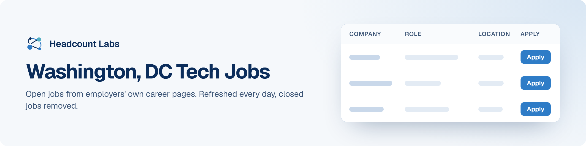

# Washington, DC Tech Jobs

Software, data, AI, product and design jobs in the Washington, DC area, sorted by field.

**77 open jobs** · 34 new since the last update · 107 removed because they closed or left the employer's board · updated November 23, 2026 at 5:28 AM EST

This list is built and refreshed every day by [Headcount Labs](https://headcountlabs.com/?utm_source=github&utm_medium=job-list&utm_campaign=washington-dc-tech-jobs), which reads jobs straight from employers' own career pages and job boards. Every job here was still listed on its source board when we last read that board, within the past 3 days, and was posted in the past 30 days. Copies of the same job are merged into one row, and jobs that close are removed at the next update.

Want this data in your own app or agent? Use the [Headcount Labs jobs API](https://headcountlabs.com/docs/?utm_source=github&utm_medium=job-list&utm_campaign=washington-dc-tech-jobs) (free tier), the [MCP server](https://headcountlabs.com/mcp/?utm_source=github&utm_medium=job-list&utm_campaign=washington-dc-tech-jobs) for Claude, ChatGPT and other AI assistants, or the [public dataset subsets](https://huggingface.co/HeadcountLabs) on Hugging Face (the full dataset is coming soon).

**Full dataset.** A bigger, one-off snapshot dated 2026-10-19 (all matching jobs, not only the open jobs below) is on Hugging Face: [Tech and software jobs](https://huggingface.co/datasets/HeadcountLabs/tech-jobs). It loads with `datasets.load_dataset` and is under the Open Database License (ODbL) 1.0.

**Jump to:** [Software engineering (41)](#software-engineering) · [Data, AI and machine learning (13)](#data-ai-and-machine-learning) · [Product and design (10)](#product-and-design) · [Hardware and engineering (13)](#hardware-and-engineering)

**Columns.** *Apply* opens the original posting on the employer's site. *Details* opens the job on Headcount Labs, with every posting we found for it. *Remote* shows what the employer states; a dash means the posting doesn't say. *Pay* is the range the employer published.

## Software engineering

| Company | Role | Location | Remote | Pay | Posted | Apply | Details |
| --- | --- | --- | --- | --- | --- | :---: | :---: |
| **MetaPhase Consulting** | Senior Application Developer (Power Platform) for TBM | Washington, DC | — | $100k–$120k/yr | Nov 19 |  | <a href="https://headcountlabs.com/catalog/jobs/8a81dc21-1d4e-4307-900b-0b6113518ea9?utm_source=github&utm_medium=job-list&utm_campaign=washington-dc-tech-jobs">via Headcount Labs</a> |
| **MetaPhase Consulting** | Junior Application Developer (Power Platform) for TBM | Washington, DC | — | $80k–$100k/yr | Nov 19 |  | <a href="https://headcountlabs.com/catalog/jobs/18f87512-aebc-4b76-b83b-5b407c2558f3?utm_source=github&utm_medium=job-list&utm_campaign=washington-dc-tech-jobs">via Headcount Labs</a> |
| **GRVTY** | Web Developer | McLean, VA | — | $150k–$250k/yr | Nov 19 |  | <a href="https://headcountlabs.com/catalog/jobs/839a1074-dd61-4e93-a9de-900b8f00ebb7?utm_source=github&utm_medium=job-list&utm_campaign=washington-dc-tech-jobs">via Headcount Labs</a> |
| **Akima, LLC** | Junior SharePoint and Power Platform Developer | Herndon, VA | — | $65k–$80k/yr | Nov 18 |  | <a href="https://headcountlabs.com/catalog/jobs/bb3948bf-894c-47bb-9096-0ca4d536ff9d?utm_source=github&utm_medium=job-list&utm_campaign=washington-dc-tech-jobs">via Headcount Labs</a> |
| **Accenture Federal Services** | Enterprise Solutions Developer | Washington, DC | — | $94k–$179k/yr | Nov 18 |  | <a href="https://headcountlabs.com/catalog/jobs/c2481daf-2aee-4219-a36c-39d4ff7e9424?utm_source=github&utm_medium=job-list&utm_campaign=washington-dc-tech-jobs">via Headcount Labs</a> |
| **Publicis Groupe Holdings B.V** | .NET Developer | Arlington, VA | — | $115k–$165k/yr | Nov 17 |  | <a href="https://headcountlabs.com/catalog/jobs/e02dacd2-1a71-45d1-8871-68655e8fafe6?utm_source=github&utm_medium=job-list&utm_campaign=washington-dc-tech-jobs">via Headcount Labs</a> |
| **COGNIZANT TECH SOLUTIONS A** | Salesforce FSC Developer | 

2 locations
Washington, DC DC-K St N.W., DC
 | On-site | $110k–$125k/yr | Nov 17 |  | <a href="https://headcountlabs.com/catalog/jobs/a50ea9b0-0801-4088-bccf-ebc0f99d528f?utm_source=github&utm_medium=job-list&utm_campaign=washington-dc-tech-jobs">via Headcount Labs</a> |
| **Anduril Industries** | Vulnerability Security Engineer | 

2 locations
Costa Mesa, CA Washington, DC
 | Remote | $147k–$196k/yr | Nov 17 |  | <a href="https://headcountlabs.com/catalog/jobs/a474963d-2f24-4c98-a07b-6c97240d70e0?utm_source=github&utm_medium=job-list&utm_campaign=washington-dc-tech-jobs">via Headcount Labs</a> |
| **Steampunk** | Drupal Developer | McLean, VA | Remote | $100k–$160k/yr | Nov 16 |  | <a href="https://headcountlabs.com/catalog/jobs/1f454fbb-59d2-4260-a743-a4a97a833157?utm_source=github&utm_medium=job-list&utm_campaign=washington-dc-tech-jobs">via Headcount Labs</a> |
| **Oracle** | Senior Network Developer - Optical | 

6 locations
Seattle, WA Nashville, TN Austin, TX Santa Clara, CA Reston, VA United States
 | On-site | $91k–$187k/yr | Nov 16 |  | <a href="https://headcountlabs.com/catalog/jobs/172cbf93-1038-4e70-ae8b-0fa06620ccb7?utm_source=github&utm_medium=job-list&utm_campaign=washington-dc-tech-jobs">via Headcount Labs</a> |
| **SpaceXSI** | Government Cloud Security Engineer | 

4 locations
Austin, TX New York, NY Palo Alto, CA Washington, DC
 | — | $100k–$198k/yr | Nov 13 |  | <a href="https://headcountlabs.com/catalog/jobs/7f1d29cb-62e1-4d65-bcc2-35abffa4fffc?utm_source=github&utm_medium=job-list&utm_campaign=washington-dc-tech-jobs">via Headcount Labs</a> |
| **Anduril Industries** | Senior Software Security Engineer | 

4 locations
Costa Mesa, CA Seattle, WA Washington, DC Boston, MA
 | — | $191k–$254k/yr | Nov 13 |  | <a href="https://headcountlabs.com/catalog/jobs/2716630d-ec7d-43e1-95b8-0dc861807c43?utm_source=github&utm_medium=job-list&utm_campaign=washington-dc-tech-jobs">via Headcount Labs</a> |
| **Accenture Federal Services** | Power Platform Developer | Washington, DC | — | $94k–$179k/yr | Nov 13 |  | <a href="https://headcountlabs.com/catalog/jobs/fcdc0726-365f-44f7-b21e-11c53a40a647?utm_source=github&utm_medium=job-list&utm_campaign=washington-dc-tech-jobs">via Headcount Labs</a> |
| **Virginia Tech** | Software Engineer I or II, Intelligent Systems Division | Arlington, VA | — | $90k/yr | Nov 12 |  | <a href="https://headcountlabs.com/catalog/jobs/b5c8ff3f-7f7e-4bb2-910a-6b1b8aad707e?utm_source=github&utm_medium=job-list&utm_campaign=washington-dc-tech-jobs">via Headcount Labs</a> |
| **Obviant** | Senior Software Engineer | Arlington, VA | Hybrid | $160k–$210k/yr | Nov 12 |  | <a href="https://headcountlabs.com/catalog/jobs/d077b47c-f41f-4ccd-b24b-7e7d279e9f2a?utm_source=github&utm_medium=job-list&utm_campaign=washington-dc-tech-jobs">via Headcount Labs</a> |
| **GRVTY** | Software Engineer | Reston, VA | — | $150k–$250k/yr | Nov 12 |  | <a href="https://headcountlabs.com/catalog/jobs/2aad55a7-eca8-497a-9ad6-1312b0705003?utm_source=github&utm_medium=job-list&utm_campaign=washington-dc-tech-jobs">via Headcount Labs</a> |
| **BAM Technologies, LLC** | Full Stack Software Developer II | Arlington, VA | Remote | — | Nov 12 |  | <a href="https://headcountlabs.com/catalog/jobs/9ba57ed0-d07d-45e2-a546-c911d758b713?utm_source=github&utm_medium=job-list&utm_campaign=washington-dc-tech-jobs">via Headcount Labs</a> |
| **Accenture Federal Services** | Cloud Engineer | Washington, DC | — | $81k–$155k/yr | Nov 12 |  | <a href="https://headcountlabs.com/catalog/jobs/e773eeac-c99a-45e3-aa7c-beae59d5c034?utm_source=github&utm_medium=job-list&utm_campaign=washington-dc-tech-jobs">via Headcount Labs</a> |
| **Bowman Consulting Group, Ltd.** | DevOps Engineer - Remote, US | Reston, VA | Remote | $116k–$147k/yr | Nov 11 |  | <a href="https://headcountlabs.com/catalog/jobs/bff8b061-45e5-4d48-a185-73d4d87983db?utm_source=github&utm_medium=job-list&utm_campaign=washington-dc-tech-jobs">via Headcount Labs</a> |
| **Steampunk** | Salesforce Technical Lead / Sr. Developer | McLean, VA | Remote | $150k–$200k/yr | Nov 10 |  | <a href="https://headcountlabs.com/catalog/jobs/8f559dd5-8e4f-467e-834c-3cbb047e974f?utm_source=github&utm_medium=job-list&utm_campaign=washington-dc-tech-jobs">via Headcount Labs</a> |
| **GRVTY** | ETL Developer | McLean, VA | — | $150k–$250k/yr | Nov 10 |  | <a href="https://headcountlabs.com/catalog/jobs/8810cc07-4a15-4080-87aa-7b75a57ca52c?utm_source=github&utm_medium=job-list&utm_campaign=washington-dc-tech-jobs">via Headcount Labs</a> |
| **Accenture Federal Services** | Java Developer (Open FGA) | Arlington, VA | Hybrid | $66k–$120k/yr | Nov 10 |  | <a href="https://headcountlabs.com/catalog/jobs/0627fd75-8d24-40c9-98ca-460bfe6ec6a5?utm_source=github&utm_medium=job-list&utm_campaign=washington-dc-tech-jobs">via Headcount Labs</a> |
| **SAIC** | Cyber Engineer Principal | 

2 locations
Reston, VA Washington, DC
 | Hybrid | — | Nov 9 |  | <a href="https://headcountlabs.com/catalog/jobs/e54bacca-9ab9-460d-ae7f-06ce7fd0db7a?utm_source=github&utm_medium=job-list&utm_campaign=washington-dc-tech-jobs">via Headcount Labs</a> |
| **Oracle** | Oracle Senior Site Reliability Engineer - Sovereign Cloud | 

2 locations
Reston, VA Austin, TX
 | On-site | — | Nov 9 |  | <a href="https://headcountlabs.com/catalog/jobs/f7593c2f-964b-4249-b6de-0b3fbad958dd?utm_source=github&utm_medium=job-list&utm_campaign=washington-dc-tech-jobs">via Headcount Labs</a> |
| **Accenture Federal Services** | Senior Azure API Developer/Technical Lead | Washington, DC | — | $110k–$224k/yr | Nov 9 |  | <a href="https://headcountlabs.com/catalog/jobs/b7cd4a7c-9fb3-41f9-b15c-b7950d95a24a?utm_source=github&utm_medium=job-list&utm_campaign=washington-dc-tech-jobs">via Headcount Labs</a> |
| **Anduril Industries** | Site Reliability Engineer, Strategic Defense | Washington, DC | — | $147k–$196k/yr | Nov 6 |  | <a href="https://headcountlabs.com/catalog/jobs/f44818e5-90f4-4ee0-9bdf-75893b9e2421?utm_source=github&utm_medium=job-list&utm_campaign=washington-dc-tech-jobs">via Headcount Labs</a> |
| **Accenture Federal Services** | SAP ABAP/BTP Developer | Washington, DC | — | $73k–$196k/yr | Nov 6 |  | <a href="https://headcountlabs.com/catalog/jobs/11f72805-2cdf-4873-8efc-c6ba22a01598?utm_source=github&utm_medium=job-list&utm_campaign=washington-dc-tech-jobs">via Headcount Labs</a> |
| **Publicis Groupe Holdings B.V** | Hands-On Data Platform Engineering Manager | Arlington, VA | — | $120k–$170k/yr | Nov 5 |  | <a href="https://headcountlabs.com/catalog/jobs/5490d534-64cd-4975-b51a-acc9ac301690?utm_source=github&utm_medium=job-list&utm_campaign=washington-dc-tech-jobs">via Headcount Labs</a> |
| **L3HHCM20** | Specialist, Application Developer - Full Stack Developer | 

8 locations
Tallahassee, FL Rochester, NY Herndon, VA Plano, TX Salt Lake City, UT Melbourne, FL Greenville, TX Arlington, VA
 | — | $92k–$172k/yr | Nov 5 |  | <a href="https://headcountlabs.com/catalog/jobs/7d78e2dc-55e1-4e25-b00e-a72ec283d879?utm_source=github&utm_medium=job-list&utm_campaign=washington-dc-tech-jobs">via Headcount Labs</a> |
| **Accenture Federal Services** | Pega Software Developer - Senior | Washington, DC | — | $92k–$179k/yr | Nov 5 |  | <a href="https://headcountlabs.com/catalog/jobs/1eb8cbb1-ef77-46c3-b37b-b881fc88f384?utm_source=github&utm_medium=job-list&utm_campaign=washington-dc-tech-jobs">via Headcount Labs</a> |
| **IntraFi** | Senior Manager, Software Development | Arlington, VA | Hybrid | $180k–$230k/yr | Nov 3 |  | <a href="https://headcountlabs.com/catalog/jobs/5a717ee8-4822-4229-82df-65dde8da9686?utm_source=github&utm_medium=job-list&utm_campaign=washington-dc-tech-jobs">via Headcount Labs</a> |
| **NWF** | Salesforce Developer | 

2 locations
RESTON, VA United States
 | Hybrid | $100k–$135k/yr | Nov 2 |  | <a href="https://headcountlabs.com/catalog/jobs/52007bc9-845f-4a8e-8059-307add1c582b?utm_source=github&utm_medium=job-list&utm_campaign=washington-dc-tech-jobs">via Headcount Labs</a> |
| **GRVTY** | MicroStrategy Developer/Architect - Senior | Washington, DC | — | $107k–$153k/yr | Nov 2 |  | <a href="https://headcountlabs.com/catalog/jobs/284587fc-dc72-48a3-9b50-49b204c7fdcd?utm_source=github&utm_medium=job-list&utm_campaign=washington-dc-tech-jobs">via Headcount Labs</a> |
| **Steampunk** | Medallia Administrator &amp; Developer | McLean, VA | — | $120k–$160k/yr | Nov 1 |  | <a href="https://headcountlabs.com/catalog/jobs/94210e7f-45d7-49c9-96df-73e449458044?utm_source=github&utm_medium=job-list&utm_campaign=washington-dc-tech-jobs">via Headcount Labs</a> |
| **Koniag Government Services** | Senior Appian Developer | Washington, DC | — | $160k–$187k/yr | Oct 29 |  | <a href="https://headcountlabs.com/catalog/jobs/93808712-dbb7-432b-98e9-ff9795c5113a?utm_source=github&utm_medium=job-list&utm_campaign=washington-dc-tech-jobs">via Headcount Labs</a> |
| **Koniag Government Services** | Generative AI Software Engineer | Washington, DC | — | $149k–$175k/yr | Oct 29 |  | <a href="https://headcountlabs.com/catalog/jobs/0ef8f6e1-5d08-4e2a-87d1-8864ca77eda7?utm_source=github&utm_medium=job-list&utm_campaign=washington-dc-tech-jobs">via Headcount Labs</a> |
| **Core-CSI LLC.** | Cyber Security Engineer (Expert) | Reston, VA | — | $150k–$180k/yr | Oct 28 |  | <a href="https://headcountlabs.com/catalog/jobs/80e622cf-6b0f-453f-8e53-f2f8bb934796?utm_source=github&utm_medium=job-list&utm_campaign=washington-dc-tech-jobs">via Headcount Labs</a> |
| **VMD Corp** | Senior Software Engineer(.NET) - Secret Clearance | Arlington, VA | — | — | Oct 27 |  | <a href="https://headcountlabs.com/catalog/jobs/e0d7db8b-2944-480c-b7b6-7c6de9be51c5?utm_source=github&utm_medium=job-list&utm_campaign=washington-dc-tech-jobs">via Headcount Labs</a> |
| **Quindar** | Sr. Software Engineer, Command &amp; Control | 

3 locations
Denver, CO Seattle, WA Washington, DC
 | Hybrid | $155k–$190k/yr | Oct 27 |  | <a href="https://headcountlabs.com/catalog/jobs/b53140c4-bcca-4e69-89c5-5286f5103fc7?utm_source=github&utm_medium=job-list&utm_campaign=washington-dc-tech-jobs">via Headcount Labs</a> |
| **Anduril Industries** | Chief Software Engineer, Space Ground Systems | 

3 locations
Colorado Springs, CO Costa Mesa, CA Washington, DC
 | — | $220k–$292k/yr | Oct 27 |  | <a href="https://headcountlabs.com/catalog/jobs/14ae57a5-85fb-426c-adbe-a44c2ccfb46f?utm_source=github&utm_medium=job-list&utm_campaign=washington-dc-tech-jobs">via Headcount Labs</a> |
| **ILS** | Senior/Principal Software Engineer (DevOps) | Herndon, VA | Hybrid | — | Oct 25 |  | <a href="https://headcountlabs.com/catalog/jobs/c527f86f-4d18-4999-a9b2-1e4580bc9cc5?utm_source=github&utm_medium=job-list&utm_campaign=washington-dc-tech-jobs">via Headcount Labs</a> |

## Data, AI and machine learning

| Company | Role | Location | Remote | Pay | Posted | Apply | Details |
| --- | --- | --- | --- | --- | --- | :---: | :---: |
| **MetaPhase Consulting** | Alteryx Data Analyst | Washington, DC | — | $100k–$135k/yr | Nov 19 |  | <a href="https://headcountlabs.com/catalog/jobs/f788cc09-d71b-4416-9a80-62ebc2bdcb9b?utm_source=github&utm_medium=job-list&utm_campaign=washington-dc-tech-jobs">via Headcount Labs</a> |
| **Steampunk** | Data Scientist | McLean, VA | Remote | $140k–$160k/yr | Nov 18 |  | <a href="https://headcountlabs.com/catalog/jobs/3fe6198c-f6dc-47b7-97ce-0c89dc218bb5?utm_source=github&utm_medium=job-list&utm_campaign=washington-dc-tech-jobs">via Headcount Labs</a> |
| **Chenega Corporation** | Senior Data Engineer | Arlington, VA | — | $159k/yr | Nov 18 |  | <a href="https://headcountlabs.com/catalog/jobs/2ca041b1-f518-479f-96b1-3207342b6e2f?utm_source=github&utm_medium=job-list&utm_campaign=washington-dc-tech-jobs">via Headcount Labs</a> |
| **CARFAX** | Principal Data Analyst | Reston, VA | — | $100k–$140k/yr | Nov 18 |  | <a href="https://headcountlabs.com/catalog/jobs/95d3d20c-436b-4112-9045-1426825b9605?utm_source=github&utm_medium=job-list&utm_campaign=washington-dc-tech-jobs">via Headcount Labs</a> |
| **AVER** | Senior .Net Data Integration Engineer | Washington, DC | — | — | Nov 16 |  | <a href="https://headcountlabs.com/catalog/jobs/1f234453-6331-4dd5-ac8a-3f2e8f63d90e?utm_source=github&utm_medium=job-list&utm_campaign=washington-dc-tech-jobs">via Headcount Labs</a> |
| **Publicis Groupe Holdings B.V** | Senior Data Engineer - Arlington, VA Hybrid | Arlington, VA | Hybrid | $109k–$130k/yr | Nov 10 |  | <a href="https://headcountlabs.com/catalog/jobs/a2780ffb-c977-4568-901d-f2ce73902d82?utm_source=github&utm_medium=job-list&utm_campaign=washington-dc-tech-jobs">via Headcount Labs</a> |
| **Hartman Executive Advisors** | Senior Director, Data &amp; Analytics - Consumer Technology Association | Arlington, VA | — | — | Nov 9 |  | <a href="https://headcountlabs.com/catalog/jobs/b1020d83-66db-4a89-8746-6b705806bb35?utm_source=github&utm_medium=job-list&utm_campaign=washington-dc-tech-jobs">via Headcount Labs</a> |
| **JPMC** | Senior Analytics Engineer, Senior Associate of Morgan Health | 

2 locations
New York, NY Washington, DC
 | On-site | — | Nov 5 |  | <a href="https://headcountlabs.com/catalog/jobs/fdad3017-ff10-4b5c-bc12-e1a8dded6083?utm_source=github&utm_medium=job-list&utm_campaign=washington-dc-tech-jobs">via Headcount Labs</a> |
| **GRVTY** | Data Scientist - Senior | McLean, VA | — | $120k–$160k/yr | Nov 5 |  | <a href="https://headcountlabs.com/catalog/jobs/3f411405-3000-410b-97c6-ae357ff78975?utm_source=github&utm_medium=job-list&utm_campaign=washington-dc-tech-jobs">via Headcount Labs</a> |
| **Okta** | Senior Product Manager, AI Products (Auth0) | 

5 locations
Chicago, IL New York, NY San Francisco, CA Seattle, WA Washington, DC
 | Hybrid | $189k–$260k/yr | Nov 4 |  | <a href="https://headcountlabs.com/catalog/jobs/f26f938f-a779-4219-8430-3746715a8c7b?utm_source=github&utm_medium=job-list&utm_campaign=washington-dc-tech-jobs">via Headcount Labs</a> |
| **Steampunk** | Senior Data Engineer - Databricks | McLean, VA | Remote | $125k–$165k/yr | Nov 1 |  | <a href="https://headcountlabs.com/catalog/jobs/b73baf72-e397-4aad-9f1e-ee097d8f31ba?utm_source=github&utm_medium=job-list&utm_campaign=washington-dc-tech-jobs">via Headcount Labs</a> |
| **Cloudflare** | Global Vendor Manager, Data Center Infrastructure | 

5 locations
Atlanta, GA Austin, TX Denver, CO Seattle, WA Washington, DC
 | Hybrid | $93k–$128k/yr | Oct 30 |  | <a href="https://headcountlabs.com/catalog/jobs/e717231b-42ca-436b-ae39-bb75f274a09b?utm_source=github&utm_medium=job-list&utm_campaign=washington-dc-tech-jobs">via Headcount Labs</a> |
| **Publicis Groupe Holdings B.V** | L2/L3 Data Platform Support Engineer - Arlington, VA Hybrid | Arlington, VA | Hybrid | $130k–$175k/yr | Oct 26 |  | <a href="https://headcountlabs.com/catalog/jobs/e0948f0a-e035-4fad-a8db-81839bba327a?utm_source=github&utm_medium=job-list&utm_campaign=washington-dc-tech-jobs">via Headcount Labs</a> |

## Product and design

| Company | Role | Location | Remote | Pay | Posted | Apply | Details |
| --- | --- | --- | --- | --- | --- | :---: | :---: |
| **Steampunk** | Senior Disruption Designer | McLean, VA | — | $120k–$180k/yr | Nov 18 |  | <a href="https://headcountlabs.com/catalog/jobs/37513af9-cf61-4c59-9c31-0c3e75230c68?utm_source=github&utm_medium=job-list&utm_campaign=washington-dc-tech-jobs">via Headcount Labs</a> |
| **Steampunk** | Disruption Designer | McLean, VA | — | $85k–$150k/yr | Nov 17 |  | <a href="https://headcountlabs.com/catalog/jobs/0bcbdcb6-1594-4b9b-a267-bbd8997d97a5?utm_source=github&utm_medium=job-list&utm_campaign=washington-dc-tech-jobs">via Headcount Labs</a> |
| **MasTec Utility Services** | Power Distribution Designer/Engineer | 

5 locations
RICHMOND, VA ARLINGTON, VA ALEXANDRIA, VA DURHAM, NC RALEIGH, NC
 | — | — | Nov 16 |  | <a href="https://headcountlabs.com/catalog/jobs/8ed074e8-6380-498c-a2c6-0c5ed85a9bdf?utm_source=github&utm_medium=job-list&utm_campaign=washington-dc-tech-jobs">via Headcount Labs</a> |
| **MasTec Utility Services** | Power Distribution Senior Designer | 

5 locations
RICHMOND, VA ARLINGTON, VA ALEXANDRIA, VA DURHAM, NC RALEIGH, NC
 | — | — | Nov 13 |  | <a href="https://headcountlabs.com/catalog/jobs/4fa54edb-efe0-4333-8d80-7c598b08c2da?utm_source=github&utm_medium=job-list&utm_campaign=washington-dc-tech-jobs">via Headcount Labs</a> |
| **Obviant** | Senior Product Designer | Arlington, VA | Hybrid | $160k–$200k/yr | Nov 12 |  | <a href="https://headcountlabs.com/catalog/jobs/6e03b3fa-c4d1-4435-8d4c-47d4b7e9c7dc?utm_source=github&utm_medium=job-list&utm_campaign=washington-dc-tech-jobs">via Headcount Labs</a> |
| **GRVTY** | UI/UX Designer | McLean, VA | — | $150k–$250k/yr | Nov 10 |  | <a href="https://headcountlabs.com/catalog/jobs/4df07d26-a02c-4321-b0fd-929c74b4648e?utm_source=github&utm_medium=job-list&utm_campaign=washington-dc-tech-jobs">via Headcount Labs</a> |
| **MetaPhase Consulting** | Product Manager | Reston, VA | On-site | $150k–$175k/yr | Nov 9 |  | <a href="https://headcountlabs.com/catalog/jobs/ed165d80-8521-451a-9567-6255ff0eafc1?utm_source=github&utm_medium=job-list&utm_campaign=washington-dc-tech-jobs">via Headcount Labs</a> |
| **Anduril Industries** | Senior Product Manager, Identity | 

4 locations
Washington, DC Boston, MA Seattle, WA Costa Mesa, CA
 | — | $167k–$222k/yr | Nov 3 |  | <a href="https://headcountlabs.com/catalog/jobs/964a5bfb-4787-4124-b917-5b2acb91454d?utm_source=github&utm_medium=job-list&utm_campaign=washington-dc-tech-jobs">via Headcount Labs</a> |
| **Steampunk** | UX/UI Designer | McLean, VA | — | $75k–$140k/yr | Nov 1 |  | <a href="https://headcountlabs.com/catalog/jobs/45773218-d0d4-41a8-9f79-5d4a8163895d?utm_source=github&utm_medium=job-list&utm_campaign=washington-dc-tech-jobs">via Headcount Labs</a> |
| **Quindar** | Product Manager, Mission Planning | 

5 locations
Denver, CO Seattle, WA Washington, DC San Francisco, CA Los Angeles, CA
 | Hybrid | $120k–$180k/yr | Oct 28 |  | <a href="https://headcountlabs.com/catalog/jobs/4aa5a8d1-9734-4db2-8c6d-06a264482284?utm_source=github&utm_medium=job-list&utm_campaign=washington-dc-tech-jobs">via Headcount Labs</a> |

## Hardware and engineering

| Company | Role | Location | Remote | Pay | Posted | Apply | Details |
| --- | --- | --- | --- | --- | --- | :---: | :---: |
| **Oracle** | Cloud Adoption Engineer- Cloud Activation and Migrations | 

2 locations
Reston, VA Washington, DC
 | Hybrid | $119k–$194k/yr | Nov 19 |  | <a href="https://headcountlabs.com/catalog/jobs/78621489-3438-4538-8682-074bacf2aa09?utm_source=github&utm_medium=job-list&utm_campaign=washington-dc-tech-jobs">via Headcount Labs</a> |
| **Oracle** | Forward Deployed Cloud Solution Engineer-Federal Civilian | 

2 locations
Reston, VA Washington, DC
 | Hybrid | $119k–$194k/yr | Nov 19 |  | <a href="https://headcountlabs.com/catalog/jobs/2d924462-1520-4e88-973e-3d3be8808cf5?utm_source=github&utm_medium=job-list&utm_campaign=washington-dc-tech-jobs">via Headcount Labs</a> |
| **Oracle** | Cloud Solution Engineer- Federal Civilian | 

2 locations
Reston, VA Washington, DC
 | Hybrid | $119k–$194k/yr | Nov 19 |  | <a href="https://headcountlabs.com/catalog/jobs/d49492c4-e375-4f6e-8b47-983faa46459e?utm_source=github&utm_medium=job-list&utm_campaign=washington-dc-tech-jobs">via Headcount Labs</a> |
| **Oracle** | Lead Principal Network Engineer | 

6 locations
Seattle, WA Santa Clara, CA Redwood City, CA Reston, VA Austin, TX Nashville, TN
 | Hybrid | $146k–$306k/yr | Nov 19 |  | <a href="https://headcountlabs.com/catalog/jobs/82758839-e7d2-4f9d-b427-f1720840bfdb?utm_source=github&utm_medium=job-list&utm_campaign=washington-dc-tech-jobs">via Headcount Labs</a> |
| **Cloudflare** | Senior Systems Engineer, Workers Authoring &amp; Testing; Frameworks | 

4 locations
Austin, TX Lisboa London Washington, DC
 | — | $185k–$254k/yr | Nov 18 |  | <a href="https://headcountlabs.com/catalog/jobs/6e5c65aa-070c-46e1-80b5-ba76d879d7af?utm_source=github&utm_medium=job-list&utm_campaign=washington-dc-tech-jobs">via Headcount Labs</a> |
| **GRVTY** | Systems Engineer | Herndon, VA | — | $150k–$250k/yr | Nov 16 |  | <a href="https://headcountlabs.com/catalog/jobs/991191c2-a9f4-47f1-bc17-9ba388e50ef4?utm_source=github&utm_medium=job-list&utm_campaign=washington-dc-tech-jobs">via Headcount Labs</a> |
| **Accenture Federal Services** | Cloud and Database Engineer | Arlington, VA | Remote | $120k–$235k/yr | Nov 16 |  | <a href="https://headcountlabs.com/catalog/jobs/f834cb68-5ff1-4cff-9d2a-922996898ff2?utm_source=github&utm_medium=job-list&utm_campaign=washington-dc-tech-jobs">via Headcount Labs</a> |
| **Altamira Technologies Corp.** | Senior Network Engineer | 

2 locations
McLean, VA Chantilly, VA
 | — | $180k–$235k/yr | Nov 12 |  | <a href="https://headcountlabs.com/catalog/jobs/777d42a9-549e-4e99-9046-e84c95c0883a?utm_source=github&utm_medium=job-list&utm_campaign=washington-dc-tech-jobs">via Headcount Labs</a> |
| **L3HHCM20** | Program Chief Engineer (Lead, Systems Engineer) | 

2 locations
Millersville, MD Herndon, VA
 | — | — | Nov 6 |  | <a href="https://headcountlabs.com/catalog/jobs/cc2ab3a5-ec7a-4d23-a978-438e1fac1dbf?utm_source=github&utm_medium=job-list&utm_campaign=washington-dc-tech-jobs">via Headcount Labs</a> |
| **Govcio LLC** | Cloud Automation Engineer | Arlington, VA | On-site | $160k–$190k/yr | Nov 5 |  | <a href="https://headcountlabs.com/catalog/jobs/d55ccd5f-6d93-4d2b-ab59-134525edbb9b?utm_source=github&utm_medium=job-list&utm_campaign=washington-dc-tech-jobs">via Headcount Labs</a> |
| **Anduril Industries** | Staff Systems Engineer, Strategic Defense | 

3 locations
Colorado Springs, CO Huntsville, AL Washington, DC
 | — | $191k–$254k/yr | Nov 4 |  | <a href="https://headcountlabs.com/catalog/jobs/ea58a88e-b746-4cf7-910f-f4fa2ec7e26b?utm_source=github&utm_medium=job-list&utm_campaign=washington-dc-tech-jobs">via Headcount Labs</a> |
| **Metron** | Systems Engineer | Reston, VA | — | $100k–$200k/yr | Nov 2 |  | <a href="https://headcountlabs.com/catalog/jobs/8d292303-f38e-47fd-9442-2ef15a1a7c06?utm_source=github&utm_medium=job-list&utm_campaign=washington-dc-tech-jobs">via Headcount Labs</a> |
| **Anduril Industries** | Senior Systems Engineer, Army &amp; NGC2 (Active Clearance) | 

2 locations
Seattle, WA Washington, DC
 | Remote | $166k–$220k/yr | Oct 27 |  | <a href="https://headcountlabs.com/catalog/jobs/bc00991f-c903-4e8d-b3a7-8dc10c33c78e?utm_source=github&utm_medium=job-list&utm_campaign=washington-dc-tech-jobs">via Headcount Labs</a> |

## Related data on Headcount Labs

- [Job postings data for Washington, DC](https://headcountlabs.com/data/job-postings-district-of-columbia-us/)
- [Software engineer salary data from posted pay](https://headcountlabs.com/salary-data/software-engineer/)
- [US job market report: open jobs by state, top employers, pay and remote share](https://headcountlabs.com/reports/us-job-market/)

## More lists from Headcount Labs

[Software Engineering Internships](https://github.com/HeadcountLabs/software-engineering-internships) · [Data Science, AI and Machine Learning Internships](https://github.com/HeadcountLabs/data-science-ai-internships) · [Engineering Internships](https://github.com/HeadcountLabs/engineering-internships) · [Business, Finance and Marketing Internships](https://github.com/HeadcountLabs/business-finance-internships) · [Internships in the US](https://github.com/HeadcountLabs/internships) · [New Grad Software Engineer Jobs](https://github.com/HeadcountLabs/new-grad-software-engineer-jobs) · [Entry-Level and New Grad Jobs](https://github.com/HeadcountLabs/entry-level-jobs) · [Entry-Level Data Analyst Jobs](https://github.com/HeadcountLabs/entry-level-data-analyst-jobs) · [Remote Software Engineer Jobs](https://github.com/HeadcountLabs/remote-software-engineer-jobs) · [Remote Data, AI and Machine Learning Jobs](https://github.com/HeadcountLabs/remote-data-jobs) · [Remote Product Manager Jobs](https://github.com/HeadcountLabs/remote-product-manager-jobs) · [Remote Marketing Jobs](https://github.com/HeadcountLabs/remote-marketing-jobs) · [Remote Sales Jobs](https://github.com/HeadcountLabs/remote-sales-jobs) · [Remote Customer Support and Success Jobs](https://github.com/HeadcountLabs/remote-customer-support-jobs) · [Remote Healthcare Jobs](https://github.com/HeadcountLabs/remote-healthcare-jobs) · [Remote Finance and Accounting Jobs](https://github.com/HeadcountLabs/remote-finance-accounting-jobs) · [Remote Jobs in the US](https://github.com/HeadcountLabs/remote-jobs) · [AI and Machine Learning Engineer Jobs](https://github.com/HeadcountLabs/ai-ml-engineer-jobs) · [Data Engineer Jobs](https://github.com/HeadcountLabs/data-engineer-jobs) · [Cybersecurity Jobs](https://github.com/HeadcountLabs/cybersecurity-jobs) · [Product Manager Jobs](https://github.com/HeadcountLabs/product-manager-jobs) · [Registered Nurse Jobs](https://github.com/HeadcountLabs/registered-nurse-jobs) · [Software Jobs Paying $200k+](https://github.com/HeadcountLabs/high-paying-software-jobs) · [Tech and Software Jobs in the US](https://github.com/HeadcountLabs/tech-jobs) · [Jobs with Salary Listed in the US](https://github.com/HeadcountLabs/pay-transparency-jobs) · [San Francisco Bay Area Tech Jobs](https://github.com/HeadcountLabs/bay-area-tech-jobs) · [New York City Tech Jobs](https://github.com/HeadcountLabs/new-york-tech-jobs) · [Seattle Tech Jobs](https://github.com/HeadcountLabs/seattle-tech-jobs) · [Austin Tech Jobs](https://github.com/HeadcountLabs/austin-tech-jobs) · [Boston Tech Jobs](https://github.com/HeadcountLabs/boston-tech-jobs) · [Los Angeles Tech Jobs](https://github.com/HeadcountLabs/los-angeles-tech-jobs)

## Contributing

This README is generated, so edits to it are overwritten at the next update. If a job is closed, a link is broken or a detail is wrong, [open an issue](../../issues/new) with the link and we'll fix it in the data, which fixes it everywhere. Requests for new lists are welcome too.

## License

The list data is under the [Open Database License (ODbL) 1.0](LICENSE). Our own values in it are under the [Database Contents License (DbCL) 1.0](https://opendatacommons.org/licenses/dbcl/1-0/). Credit "Headcount Labs (https://headcountlabs.com)" when you reuse it. Job description text is the employer's own text and is not licensed by us. Takedown requests: [https://headcountlabs.com/remove/](https://headcountlabs.com/remove/). Location data includes data from OpenStreetMap contributors (ODbL) and Overture Maps. The same rows are in [`data/jobs.csv`](data/jobs.csv).

Generated by Headcount Labs from the jobs API on November 23, 2026 at 5:28 AM EST. At most 8 jobs per employer are shown in each list.
